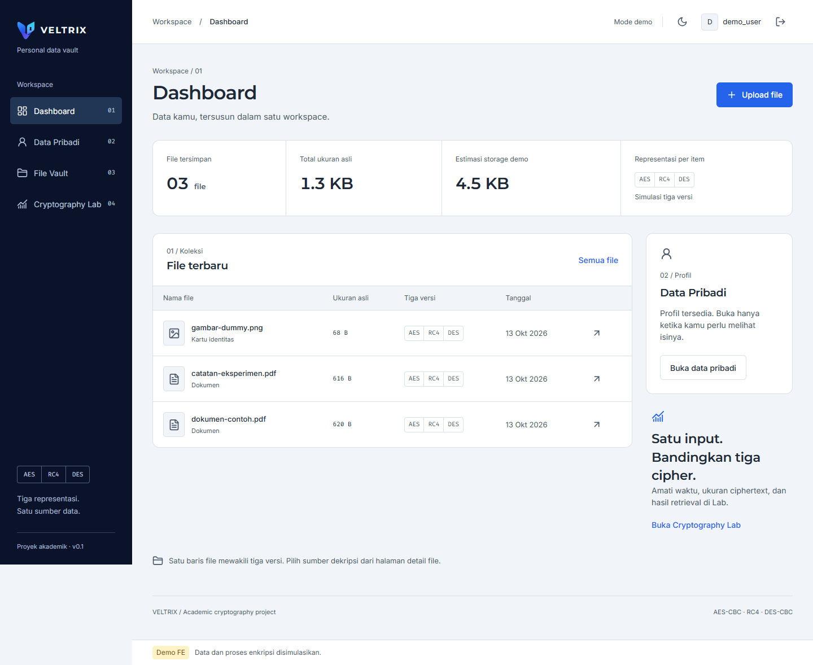

# VELTRIX

Academic information-security assignment: a personal-data vault and comparison lab for AES, RC4, and DES.

The current implementation is an interactive Next.js frontend with a browser mock API. FastAPI, MySQL, real encryption, persistent ciphertext storage, and actual cryptographic benchmarks are planned. Use dummy data; mock results are not valid measurements for the academic report.

## Run the frontend

Requires Node.js compatible with Next.js 16 (the project was verified with Node.js 22) and npm.

```bash
cd frontend
npm install
npm run dev
```

Open http://127.0.0.1:3000 and choose **Gunakan akun demo**. Alternatively, use `demo_user` / `veltrix123`. On Windows, use `npm.cmd` when PowerShell blocks `npm.ps1`.

The mock stores files and profile changes in browser memory and resets them on a full page reload. It simulates encryption and crypto timings; it does not provide real private storage or secure authentication.

## Repository contents

- [Product requirements](VELTRIX_PRD_v0.1.md)
- [Frontend blueprint and API contract](VELTRIX_FE_BLUEPRINT_v0.1.md)
- [Graphic Standard Manual](VELTRIX_GSM_v0.1.md)
- [Frontend setup and integration guide](frontend/README.md)
- [Design decisions](frontend/DESIGN.md)
- [Frontend verification and antislop report](frontend/ANTISLOP_QA.md)
- `ki1.jpeg`, `ki2.jpeg`: supplied assignment instructions.
- `frontend/public/brand/`: reconstructed SVG logo variants and app icons derived from the supplied brand board.

Brand assets can be previewed at http://127.0.0.1:3000/brand/preview.html while the app runs. The SVGs are web reconstructions, not original design master files.

## Verification

```bash
cd frontend
npm run build
npm run typecheck
npm run test:e2e
```

Browser tests use installed Microsoft Edge and an isolated production server on port 3100. See the frontend README for details.


