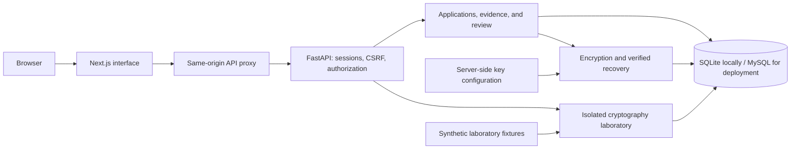
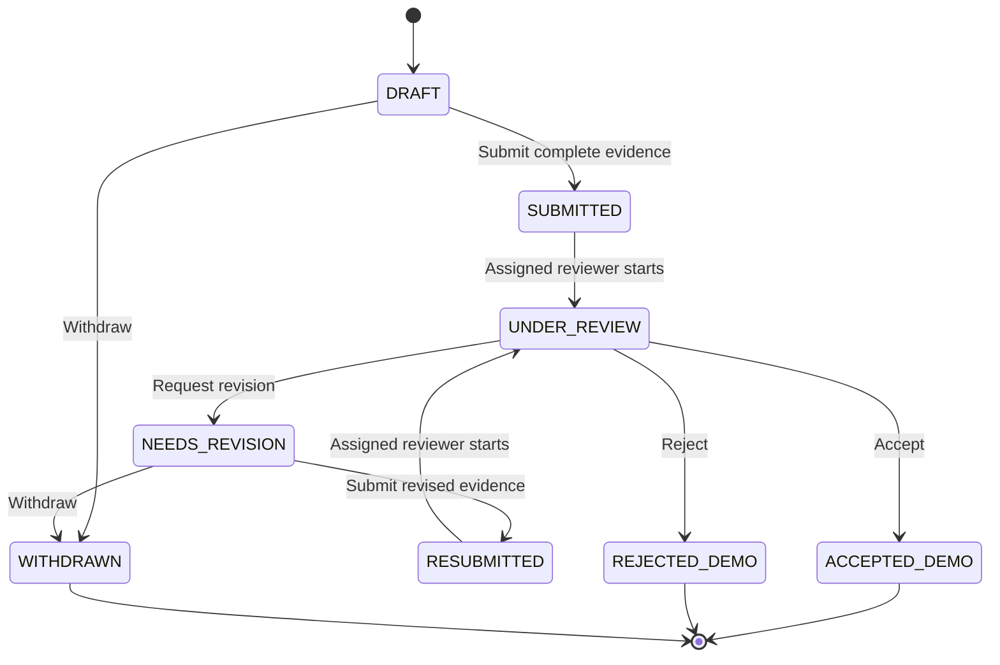
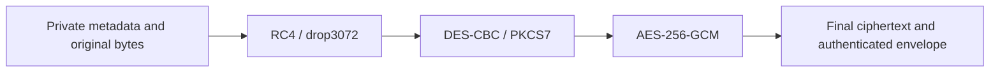

# VELTRIX BankKYC

**A KYC onboarding application with encrypted evidence storage and a cryptography laboratory.**

VELTRIX models the document preparation and review stages of opening a bank account. Applicants assemble a personal profile, identity scan, supporting office document, and verification video into one application. Reviewers check assigned applications for completeness, administrators manage assignments, and evaluators compare cryptographic algorithms using separate synthetic fixtures.

This is an **Information Security group assignment using synthetic data only**. Decisions represent an academic onboarding workflow; they do not open a bank account or establish an identity's authenticity. DES and RC4 are included for academic comparison and are not recommended for protecting real-world banking data.

## Implementation status

The Next.js frontend connects to the **FastAPI BankKYC v2 backend in live mode** by default. Accounts, sessions, applications, evidence versions, assignments, and laboratory results are persisted in a database.

| Area | Implementation |
| --- | --- |
| Frontend | Next.js App Router, TypeScript, React, Tailwind CSS, responsive layouts, light/dark themes |
| Backend | FastAPI, Pydantic, SQLAlchemy, Alembic migrations |
| Local database | Persistent SQLite at `backend/data/bankkyc.db` |
| Deployment database | MySQL through SQLAlchemy/PyMySQL; configured separately from SQLite |
| Access control | Session authentication, roles, ownership, reviewer assignment, and application-state checks |
| Stored evidence | Versioned encrypted envelopes with authenticated recovery and per-object keys |
| Laboratory | Actual measurements, raw samples, result history, and CSV exports |
| Public deployment | Being prepared; no verified public endpoint is documented yet |

Browser mocks remain available for isolated interface tests. Their temporary data and illustrative measurements are separate from the live backend. The older vault implementation remains in `backend/app/main.py` for reference and regression tests; the active entry point is `app.server:app`.

## Architecture

VELTRIX runs as a Next.js web application and a single FastAPI service. The browser calls `/api/v1/*` on the web application's origin. Next.js forwards these requests to FastAPI, keeping browser requests, session cookies, and CSRF handling on the same origin.



The backend enforces permissions and state transitions independently of the interface. Private filenames, profiles, file contents, and review notes are encrypted before database storage. Operational fields such as case references, roles, categories, sizes, versions, and status support authorization and indexing.

Writes use transactions and expected-version checks. Conflicting updates return `409 VERSION_CONFLICT` rather than silently overwriting another change. Replacing evidence creates a new version and preserves previous versions for the owner.

## Users and permissions

Access combines **RBAC with ownership, assignment, and state-based checks**. A role alone does not grant access to another applicant's evidence.

| Role | Responsibilities | Access boundary |
| --- | --- | --- |
| Applicant | Create applications, complete evidence, submit revisions, track decisions, retrieve versions | Own applications and evidence only |
| Reviewer | Check completeness, start reviews, request revisions, accept or reject | Assigned operational metadata; no applicant profile, private filename, preview, or download |
| Administrator | Assign or reassign a reviewer before review begins | Assignment metadata; no applicant plaintext or application decisions |
| Evaluator | Run benchmarks and recovery checks; view and export results | Isolated synthetic fixtures and the evaluator's own laboratory results |

Public registration always creates an **applicant**. Other roles are provisioned through the backend CLI, not through a role selector in the registration or login form.

## Application workflow

1. **Register or sign in.** The authenticated account determines the workspace and permissions.
2. **Create a draft.** Complete a five-step wizard: profile, identity scan, supporting document, verification video, and final review.
3. **Save each step.** Profile changes require saving; selecting a file does not upload it. All four evidence categories and the synthetic-data acknowledgement are required before submission.
4. **Submit.** Evidence becomes read-only while the application is being processed.
5. **Assign a reviewer.** An administrator assigns the application. The reviewer examines category, size, version, and completeness metadata.
6. **Review and revise.** The reviewer requests a revision or records a decision. Revisions reopen applicant editing; replacement evidence adds a version before resubmission.
7. **Retrieve evidence.** The owner can preview or download available versions after authorization and integrity checks succeed.



`ACCEPTED_DEMO` and `REJECTED_DEMO` are internal academic workflow states. The interface displays their corresponding Indonesian labels for Accepted and Rejected. Neither decision activates a real bank account. Withdrawal is available only for drafts and applications awaiting revision; it does not delete evidence.

## Evidence and validation

| Category | Accepted input | Limit |
| --- | --- | --- |
| Personal profile | Eight required fields, stored as canonical UTF-8 JSON | Up to 500 characters per field |
| Identity scan | PNG, JPEG, PDF | 5 MiB |
| Supporting office document | PDF, DOCX | 10 MiB |
| Verification video | MP4 | 30 MiB; 10-30 seconds |

The server validates content as well as extensions and size: image decoding/dimensions, PDF parsing, DOCX container structure, and MP4 inspection with `ffprobe`. A 34 MiB request cap is enforced while receiving requests. The multipart spool threshold is above that cap to keep accepted upload plaintext in memory.

Synthetic profiles require `DUMMY-...` identity numbers, example-domain emails, dummy phone numbers, and valid past dates. Format validation is not malware scanning, identity verification, OCR, face matching, or biometric liveness detection.

## Encryption and data recovery

The operational envelope is `vtx-kyc-layered-v1`:



- Each object version receives independent random RC4, DES, and AES keys, plus fresh IV/nonce material.
- The outer AES-GCM layer authenticates ciphertext and binds it to the object, application, owner, category, and version through additional authenticated data.
- The per-object key bundle is wrapped with AES-GCM using a server-side key-encryption key (KEK), kept outside the database.
- Recovery verifies the wrapped keys, authentication tags, context, stored length, and SHA-256 before returning plaintext.
- Files must return byte-for-byte identical to the upload. Profile downloads return the stored canonical JSON representation.

Passwords use **Argon2id hashing**, and session tokens are stored as hashes. They are not recoverable encrypted evidence. Minimal operational metadata is also separate from the encrypted private payload.

This implements the current academic baseline. Layering DES and RC4 does not establish greater security than authenticated AES alone. The assignment's interpretation of layered versus independently stored cipher representations remains a decision to confirm with the lecturer.

## Cryptography laboratory

The laboratory compares **AES-256-GCM, DES-CBC, RC4, and the layered pipeline** on synthetic profile, image, document, and video fixtures. It does not reuse applicant evidence.

Each run uses **two excluded warm-up trials and 30-100 measured trials**, with randomized candidate order. `perf_counter_ns` measurements retain raw samples, median encryption/decryption times, encryption IQR, standard deviations, binary overhead, encryption throughput, and byte-recovery correctness. Results include fixture hashes and execution-environment metadata and can be exported as CSV.

Timing covers cipher construction, padding, transformation, and GCM authentication work. Random key generation, operational envelope packing, key wrapping, JSON, HTTP, and database work are excluded from cipher-core timing. Peak native memory is not measured.

Committed 100-trial exports are available for [JSON](backend/CSV_trial/JSON.csv), [PNG](backend/CSV_trial/PNG.csv), [PDF](backend/CSV_trial/PDF.csv), and [MP4](backend/CSV_trial/MP4.csv). Each file contains raw measurements for all four candidates, not a universal speed ranking.

Interpret results in the KYC context: latency matters for small profiles; throughput and overhead matter for larger files. Lower runtime does not imply stronger security. The bundled 8,664-byte video is a smoke fixture, so its timings do not represent large verification videos.

## Run locally

### Requirements

- Python **3.11+**
- Node.js **22+** with npm
- FFmpeg, with **`ffprobe`** on `PATH` or configured through `FFPROBE_PATH`
- Internet access for the first dependency installation

### Windows

```powershell
git clone https://github.com/shzirley/information-security-assignment1.git
cd information-security-assignment1
.\start.bat
```

You can also double-click `start.bat`. Extract ZIP downloads before starting the application.

### Linux / macOS

```bash
git clone https://github.com/shzirley/information-security-assignment1.git
cd information-security-assignment1
bash start.sh
```

The launcher creates the Python environment, installs dependencies, generates missing local keys, applies migrations, prepares local test accounts, and starts both services. Existing keys and account passwords are retained. Keep it running; `Ctrl+C` stops its services without deleting saved data.

| Service | Local address |
| --- | --- |
| Web application | http://127.0.0.1:3000 |
| API health | http://127.0.0.1:8000/api/v1/health |
| Interactive API documentation | http://127.0.0.1:8000/docs |

Applicants can register through the interface. The launcher also creates role-specific accounts with random passwords, displayed in its terminal and saved in `backend/data/demo-accounts.txt`. There is no shared fixed password; the credential file is excluded from Git.

For manual setup and troubleshooting, see the [running guide](PANDUAN_MENJALANKAN.md) and [backend guide](backend/README.md).

## Configuration, persistence, and backup

Backend configuration belongs in `backend/.env`; frontend configuration belongs in `frontend/.env.local`. Example placeholders must be replaced with valid generated keys.

| Setting | Purpose |
| --- | --- |
| `NEXT_PUBLIC_API_MODE` | `live` for FastAPI; `mock` for isolated interface work |
| `API_ORIGIN` | Backend origin used by the Next.js proxy |
| `KYC_DATABASE_URL` | Optional MySQL URL; otherwise the persistent local SQLite database |
| `VELTRIX_KEK_V1_BASE64` | Base64-encoded 32-byte key-encryption key |
| `VELTRIX_AUTH_SECRET_BASE64` | Separate Base64-encoded 32-byte authentication/CSRF secret |
| `ALLOWED_ORIGINS` | Explicit frontend origins allowed for mutations |
| `COOKIE_SECURE` | `false` for local HTTP; `true` for HTTPS deployment |
| `APP_ENV` | `demo` enables explicit local test-account provisioning and cleanup |
| `FFPROBE_PATH` | Optional video-inspection executable path |

Saved data survives reloads and application restarts. **Retain the database and its original keys.** Back them up separately: a database backup cannot recover evidence if the KEK is lost.

Create a consistent SQLite backup from `backend/`:

```powershell
.venv\Scripts\python.exe manage.py backup D:\Backup\bankkyc-backup.db
```

For MySQL setup, migrations, backup, and restore, follow the [backend guide](backend/README.md). Switching the connection URL does not transfer existing SQLite data into MySQL. Use a fresh database or an explicit migration.

## Testing and verification

Run backend tests from `backend/` using its virtual environment:

```powershell
.venv\Scripts\python.exe -m pytest tests/test_bankkyc.py tests/test_api.py tests/test_crypto.py -q
```

On Linux/macOS, use `.venv/bin/python`. Tests use temporary SQLite databases by default. Optional MySQL tests require a **disposable test database**, because the suite resets its schema.

With both services running, check live HTTP integration from `backend/`:

```powershell
.venv\Scripts\python.exe scripts/smoke_kyc_live.py --origin http://127.0.0.1:3000
```

This creates a synthetic account/application and checks authentication, CSRF rotation, profile storage, evidence upload/download byte equality, submission, persisted reads, and logout.

Run frontend checks from `frontend/`:

```powershell
npm.cmd run typecheck
npm.cmd run build
```

Use `npm` on Linux/macOS. The Playwright suite in `frontend/tests/flows.spec.ts` targets **browser mocks**, a mock-mode production build, and Microsoft Edge on port 3100. Run it in an isolated checkout/configuration; its results do not verify live cryptography.

Recorded checks include **65 passing backend tests with SQLite**, live HTTP integration, and applicant login/dashboard/logout in a real browser. An earlier MySQL 8.0.46 run recorded **36 passed and one SQLite-specific test skipped**. These results have stated environments and coverage; they do not verify every deployment. See [verification results and limitations](VERIFIKASI.md).

## Deployment status

Local live operation is verified. A public deployment is being prepared. The proposed free-hosting arrangement separates the Next.js frontend, FastAPI service, and persistent MySQL database; it has not yet been verified online.

Deployment requires stable server-side keys, a persistent database, HTTPS, secure cookies, explicit allowed origins, and `ffprobe`. Upload limits, memory usage, cold starts, and benchmark execution must be checked on the selected host. An ephemeral server filesystem is not a persistent database.

## Repository map

```text
frontend/
  src/app/                 Public pages and role-specific routes
  src/features/kyc/        Applications, evidence wizard, review, assignment, lab
  src/lib/                 Domain types, validation, API transport and contracts
  src/mocks/               Isolated browser-test fixtures
  tests/                   Playwright interface tests
backend/
  app/server.py            Active FastAPI entry point
  kyc/                     BankKYC API, authorization, storage, crypto and lab
  migrations/              Alembic schema migrations
  fixtures/                Synthetic laboratory assets
  scripts/                 Live integration checks and support scripts
  tests/                   BankKYC and legacy regression tests
  manage.py                Migration, provisioning, backup and cleanup CLI
launcher.py                Local setup and service startup
start.bat / start.sh       Platform-specific launcher entry points
```

## Project documentation

| Document | Contents |
| --- | --- |
| [Product PRD](VELTRIX_BankKYC_PRD.md) | Scenario, requirements, privacy boundaries, and open academic decisions |
| [Frontend PRD](VELTRIX_BankKYC_FE_PRD.md) | Screens, flows, API contracts, interactions, and acceptance criteria |
| [Backend PRD](VELTRIX_BankKYC_BE_PRD.md) | Architecture, authorization, encryption, persistence, and handoff |
| [Brand guidelines](VELTRIX_GSM_v0.1.md) | Logo, color palette, and typography |
| [Running guide](PANDUAN_MENJALANKAN.md) | Detailed setup and troubleshooting in Indonesian |
| [Backend guide](backend/README.md) | Configuration, migrations, operators, MySQL, and backup |
| [Frontend guide](frontend/README.md) | Setup, live transport, and mock-test scope |
| [Verification report](VERIFIKASI.md) | Actual test results, environments, and remaining coverage |

The coursework submission also requires meaningful Git history, a report of at most two A4 pages explaining the scenario and design decisions, interpreted experimental results, and the actual AI conversation link and screenshot when AI assistance is used.
