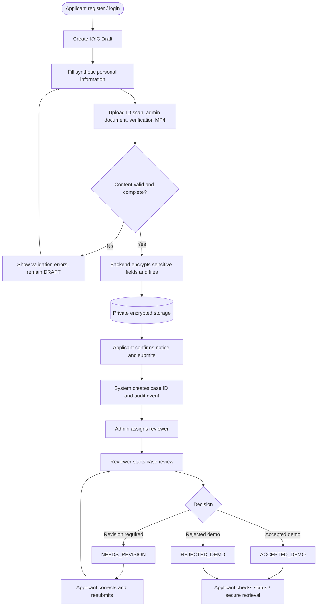
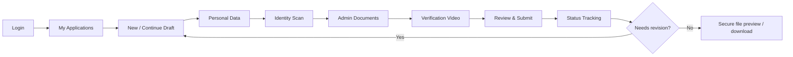
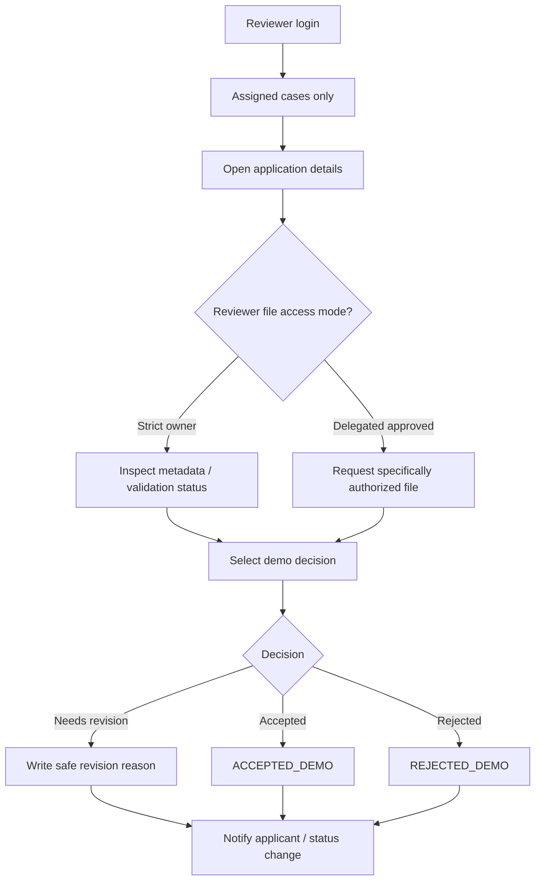
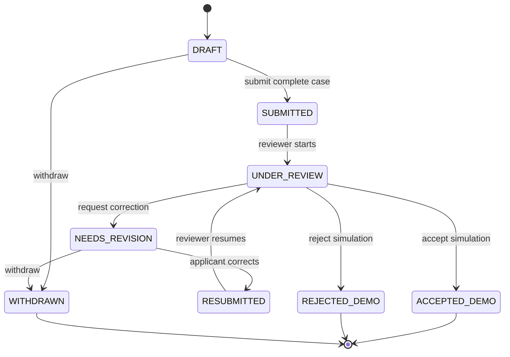
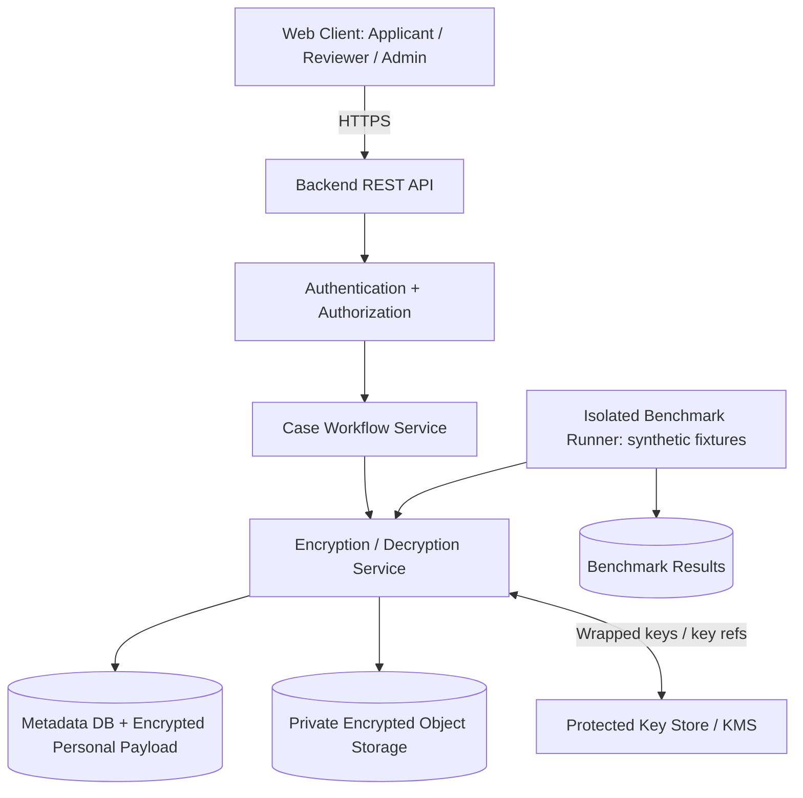
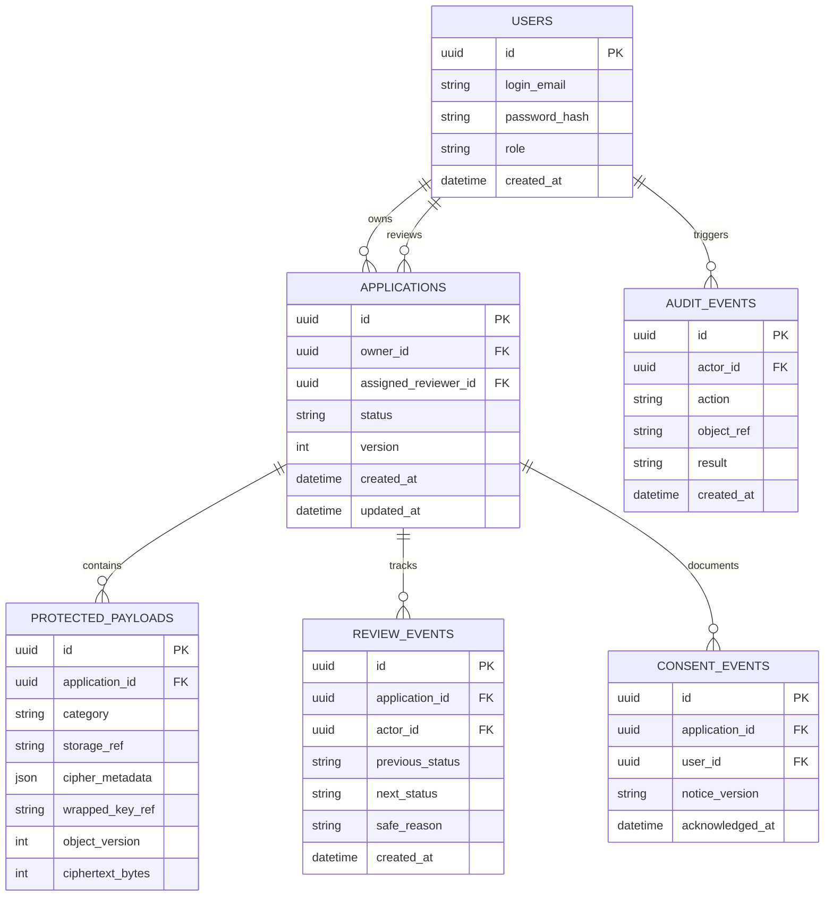
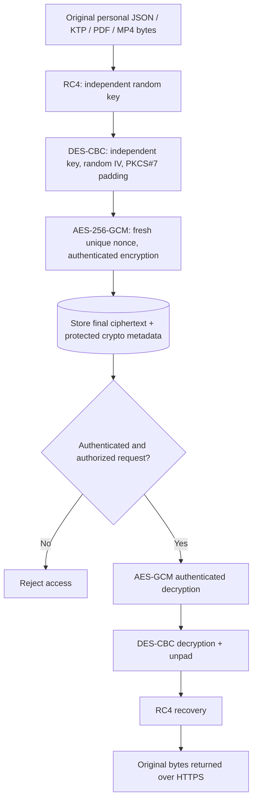

# VELTRIX BankKYC
## Product Requirements Document (PRD) — Version 2.1

> **Product:** VELTRIX BankKYC  
> **Positioning:** Secure Digital Banking Onboarding & Encrypted KYC Evidence Management  
> **Project:** Tugas akademik kriptografi — aplikasi web, tim 4 orang  
> **Document status:** Draft untuk penyelarasan tim; beberapa keputusan akademik masih perlu konfirmasi dosen  
> **Last updated:** 27 Oktober 2026  
> **Data policy:** **Synthetic/demo data only** — tidak untuk data nasabah nyata  
> **Document owner:** VELTRIX Project Team

---

## Daftar Isi

1. [Executive Summary](#1-executive-summary)
2. [Perubahan Arah Produk](#2-perubahan-arah-produk)
3. [Konteks dan Validasi Skenario Nyata](#3-konteks-dan-validasi-skenario-nyata)
4. [Problem Statement, Goals, dan Non-Goals](#4-problem-statement-goals-dan-non-goals)
5. [Pengguna, Peran, dan Hak Akses](#5-pengguna-peran-dan-hak-akses)
6. [Skenario Nyata dan Proses Bisnis End-to-End](#6-skenario-nyata-dan-proses-bisnis-end-to-end)
7. [User Flow per Aktor](#7-user-flow-per-aktor)
8. [Status Pengajuan dan Business Rules](#8-status-pengajuan-dan-business-rules)
9. [Data yang Ditangani dan Klasifikasinya](#9-data-yang-ditangani-dan-klasifikasinya)
10. [Cakupan MVP dan Prioritas Fitur](#10-cakupan-mvp-dan-prioritas-fitur)
11. [Halaman Aplikasi dan Rancangan UX](#11-halaman-aplikasi-dan-rancangan-ux)
12. [Functional Requirements dan Acceptance Criteria](#12-functional-requirements-dan-acceptance-criteria)
13. [Arsitektur Sistem dan Model Data](#13-arsitektur-sistem-dan-model-data)
14. [Strategi Enkripsi, Dekripsi, dan Key Management](#14-strategi-enkripsi-dekripsi-dan-key-management)
15. [Kontrak API Awal](#15-kontrak-api-awal)
16. [Benchmarking dan Metodologi Eksperimen](#16-benchmarking-dan-metodologi-eksperimen)
17. [Security, Privacy, dan Non-Functional Requirements](#17-security-privacy-dan-non-functional-requirements)
18. [Test Plan dan Demo Penilaian](#18-test-plan-dan-demo-penilaian)
19. [Rencana Implementasi Empat Developer](#19-rencana-implementasi-empat-developer)
20. [Pemetaan terhadap Assignment](#20-pemetaan-terhadap-assignment)
21. [Risiko, Asumsi, dan Open Decisions](#21-risiko-asumsi-dan-open-decisions)
22. [Definition of Done](#22-definition-of-done)
23. [Referensi](#23-referensi)
24. [Lampiran: Dataset Demo dan Glosarium](#24-lampiran-dataset-demo-dan-glosarium)

---

## 1. Executive Summary

**VELTRIX BankKYC** adalah prototipe web yang mensimulasikan tahap **pengumpulan, penyimpanan, peninjauan, dan pengambilan kembali berkas Know Your Customer (KYC)** pada proses pembukaan rekening bank digital.

Calon nasabah (*applicant*) mengisi data pribadi dan mengunggah tiga kategori berkas: **scan identitas**, **dokumen administrasi pembukaan rekening**, dan **video simulasi verifikasi identitas**. Sistem melindungi data yang disimpan (*data at rest*) dengan implementasi kriptografi sesuai requirement mata kuliah, lalu mengizinkan pengambilan kembali data setelah autentikasi dan pemeriksaan hak akses. Petugas (*reviewer*) mengelola alur review terhadap kasus yang ditugaskan. Modul **Cryptographic Benchmark Lab** menguji AES, DES, dan RC4 dengan dataset serta pengukuran yang dapat direproduksi.

**Core value proposition:** data KYC yang sensitif **tidak sekadar diunggah ke server**, tetapi diproteksi melalui enkripsi, akses dibatasi berdasarkan pemilik/otorisasi, dan file dapat dipulihkan **byte-identical**.

**Batasan utama:** VELTRIX **bukan** sistem pembukaan rekening bank sungguhan, **bukan** layanan kepatuhan KYC resmi, dan **tidak** menggunakan identitas atau rekaman nasabah riil. Algoritma DES dan RC4 hanya digunakan untuk analisis akademik karena tidak layak sebagai perlindungan data sensitif produksi.

### 1.1 Hasil akhir MVP yang harus dapat dibuktikan

1. Applicant membuat satu pengajuan KYC dengan **empat kategori data wajib**.
2. Backend mengenkripsi field data sensitif **dan** file sebelum disimpan.
3. User tidak dapat membaca file private hanya dengan mengetahui URL atau ID objek.
4. Applicant yang sah dapat mengunduh kembali file yang **identik secara biner** dengan file asal.
5. Akun lain dan reviewer yang tidak ditugaskan tidak dapat membaca data tersebut.
6. Reviewer dapat memperbarui status kasus sesuai peran dan penugasan.
7. Tim dapat menunjukkan ciphertext, pengujian dekripsi, uji integritas, serta hasil perbandingan **AES vs DES vs RC4** yang benar-benar diukur.

---

## 2. Perubahan Arah Produk

| Aspek | VELTRIX sebelumnya | VELTRIX BankKYC (baru) |
|---|---|---|
| Identitas produk | Generic encrypted personal file storage | Secure digital banking onboarding & KYC evidence vault |
| Masalah yang diselesaikan | Pengguna perlu menyimpan file rahasia | Proses onboarding mengumpulkan identitas, dokumen, dan bukti verifikasi sensitif yang harus terlindungi |
| Pengguna | Pengguna penyimpanan file umum | Applicant, assigned KYC reviewer, administrator, evaluator |
| Unit bisnis | File/folder | **KYC application/case** dengan tahapan proses bisnis |
| Jenis data | Beragam file umum | Data calon nasabah, identitas, formulir, video verifikasi |
| Fitur inti | Upload dan download terenkripsi | Pengajuan → enkripsi → review → revisi/keputusan → retrieval |
| Komponen penelitian | Benchmark cipher | Benchmark cipher berdasarkan workload KYC yang konkret |

### 2.1 Pernyataan positioning

> **VELTRIX BankKYC is a secure digital onboarding and encrypted KYC evidence-management prototype that allows applicants to submit personal information, scanned identity documents, administrative forms, and simulated verification videos, while demonstrating authenticated retrieval, access control, and comparative cryptographic performance.**

### 2.2 Kenapa bukan DRM, YouTube Kids, atau penyimpanan file generik?

Parental content restriction memilih konten yang boleh ditonton; DRM melindungi penggunaan media berlisensi; sementara **BankKYC memproteksi berkas sensitif pada proses administrasi konkret**. Video di BankKYC adalah **bukti verifikasi identitas**, bukan video hiburan. Enkripsi berkaitan langsung dengan seluruh kumpulan dokumen yang diperlukan dalam pengajuan.

---

## 3. Konteks dan Validasi Skenario Nyata

### 3.1 Masalah industri

Pembukaan rekening digital memerlukan pengumpulan informasi pemohon, dokumen identitas, formulir administratif, serta langkah verifikasi. Jika informasi ini disimpan sebagai plaintext, diberikan melalui URL publik, atau tersedia untuk akun yang tidak berwenang, risiko kebocoran dan penyalahgunaan meningkat.

### 3.2 Produk pembanding yang benar-benar ada

| Produk / layanan | Fitur publik yang relevan | Implikasi bagi VELTRIX | Batas klaim |
|---|---|---|---|
| [myBCA — BCA](https://www.bca.co.id/id/informasi/edukatips/2024/06/05/02/18/cara-buka-rekening-bank-bca-secara-online-di-mybca) | Pembukaan rekening online dengan pengisian data, dokumen, dan proses verifikasi | Alur pengajuan nasabah digital nyata | Tidak membuktikan bahwa setiap video call direkam menjadi MP4 |
| [Jumio Video Verification](https://www.jumio.com/products/video-verification/) | Verifikasi identitas berbasis video untuk kebutuhan lembaga keuangan | Alasan mengapa video verifikasi dapat menjadi bagian dari evidence KYC | Tidak membuktikan bahwa VELTRIX menerapkan teknologi yang identik |
| [OJK — POJK No. 8/2023](https://ojk.go.id/apu-ppt/id/peraturan/pojk/Pages/POJK-8-2023-.aspx) | Kerangka identifikasi dan verifikasi nasabah dalam APU/PPT | Dasar konteks proses KYC | MVP ini tidak otomatis memenuhi kewajiban regulatory CDD |
| [OJK — Layanan Digital Bank Umum](https://ojk.go.id/id/regulasi/Pages/Layanan-Digital-oleh-Bank-Umum.aspx) | Konteks pengelolaan risiko dan perlindungan dalam layanan digital bank | Alasan kebutuhan kontrol keamanan dan data | Bukan sertifikasi compliance aplikasi |

> **Boundary of evidence:** aplikasi dan kebijakan nyata membuktikan bahwa kebutuhan bisnis ada. **Video MP4 yang diunggah, status `ACCEPTED_DEMO`, arsitektur enkripsi berlapis, dan fitur benchmark adalah rancangan VELTRIX**, bukan klaim tentang implementasi internal produk-produk di atas.

---

## 4. Problem Statement, Goals, dan Non-Goals

### 4.1 Problem statement

Proses onboarding digital menghimpun data dan berkas calon nasabah yang bersifat sensitif. Sebuah prototipe yang hanya menyediakan form upload belum membuktikan bahwa data tersimpan aman, dapat dibatasi per pemilik, dan dapat dipulihkan tanpa perubahan. Selain itu, tim perlu mengevaluasi dampak **pilihan cipher** terhadap kecepatan, ukuran output, dan integritas data pada berkas KYC nyata secara bentuk (tetapi menggunakan isi sintetis).

### 4.2 Product goals

| ID | Goal | Outcome terukur |
|---|---|---|
| G-01 | KYC application workflow | Applicant dapat membuat, menyimpan draft, submit, dan melacak satu kasus |
| G-02 | Four-category data support | JSON personal, identity scan, office document, MP4 diterima dan terlindungi |
| G-03 | Confidential storage | Tidak ada plaintext sensitif yang tersimpan pada DB/file storage normal aplikasi |
| G-04 | Authenticated retrieval | Hanya pemilik atau aktor yang eksplisit diizinkan dapat meminta data |
| G-05 | Accurate decryption | SHA-256 input dan hasil dekripsi sama dalam semua fixture valid |
| G-06 | Review workflow | Reviewer dapat mengelola kasus yang ditugaskan dan transisi status valid |
| G-07 | Cryptographic evaluation | Hasil AES, DES, RC4 mencakup waktu, throughput, overhead, dan interpretasi |
| G-08 | Reproducible submission | Source code, test evidence, README, dan commit GitHub terdokumentasi |

### 4.3 Non-goals / Out of Scope

- Membuka rekening bank sungguhan atau membuat nomor rekening riil.
- Integrasi API bank, Dukcapil, OJK, SLIK, AML/PEP/sanctions screening.
- OCR KTP resmi atau validasi keaslian NIK.
- Pengenalan wajah, skor liveness, maupun verifikasi biometrik resmi.
- Video call real-time; cukup **unggah MP4 simulasi**.
- Mobile native application, transfer uang, saldo, transaksi, pembayaran, atau credit scoring.
- Penggunaan data nasabah nyata atau klaim siap produksi / compliant.

---

## 5. Pengguna, Peran, dan Hak Akses

### 5.1 Aktor

| Aktor | Tugas utama | Batasan |
|---|---|---|
| **Applicant** | Register/login, isi pengajuan, unggah data, submit, revisi, cek status, download berkas sendiri | Tidak boleh membuka kasus milik pemohon lain |
| **Assigned KYC Reviewer** | Melihat antrean kasus yang ditugaskan, meminta revisi, memutuskan hasil **simulasi** | Tidak otomatis boleh membuka plaintext; lihat aturan delegated access |
| **Administrator** | Mengelola user dan menugaskan reviewer ke kasus | Tidak otomatis memiliki akses file sensitif atau key |
| **Evaluator / Test Operator** | Menjalankan benchmark pada fixture dummy, mencatat pengujian dan bukti | Tidak memakai data user asli atau plaintext aplikasi produksi |

### 5.2 Matriks akses minimum

| Operasi | Applicant (owner) | Applicant lain | Assigned Reviewer | Admin | Evaluator |
|---|---:|---:|---:|---:|---:|
| Buat kasus pribadi | Ya | Ya, kasusnya sendiri | Tidak | Tidak | Tidak |
| Baca daftar kasus pemilik | Ya | Tidak | Daftar kasus yang ditugaskan | Metadata penugasan | Tidak |
| Edit data kasus `DRAFT` | Ya | Tidak | Tidak | Tidak | Tidak |
| Submit / resubmit | Ya | Tidak | Tidak | Tidak | Tidak |
| Download berkas private pemilik | Ya | Tidak | **Tergantung mode delegasi** | Tidak | Tidak |
| Ubah status review | Tidak | Tidak | Ya, kasus yang ditugaskan | Tidak | Tidak |
| Assign reviewer | Tidak | Tidak | Tidak | Ya | Tidak |
| Jalankan benchmark fixture | Tidak | Tidak | Tidak | Tidak | Ya |

### 5.3 Keputusan akses reviewer yang harus dikunci

Assignment menyebut: **“Only an authenticated user may get their own data back.”** Agar tidak salah menafsirkan:

- **Mode A — Strict Owner Only (default sampai ada klarifikasi):** applicant hanya bisa membaca berkas miliknya. Reviewer melihat metadata operasional (case ID, status, kelengkapan, hasil validasi) dan mengubah status, tetapi **tidak menerima plaintext** berkas applicant. Kekurangan: review konten dokumen hanya disimulasikan.
- **Mode B — Explicit Case Delegation (jika disetujui dosen):** reviewer yang **ditugaskan** dan diberi otorisasi per kasus dapat membaca berkas untuk keperluan verifikasi. Semua akses dicek server-side dan diaudit. Tidak ada akses global untuk semua reviewer.

**Rekomendasi:** tetapkan pilihan bersama dosen sebelum membuat halaman reviewer dan endpoint `GET /files/:id`.

---

## 6. Skenario Nyata dan Proses Bisnis End-to-End

### 6.1 Cerita penggunaan (contoh sintetis)

Seorang pemohon fiktif, **Nadia Pratama**, ingin mengajukan pembukaan rekening bank digital melalui portal demonstrasi. Nadia membuat akun, mengisi nama dan pekerjaan fiktif, mengunggah gambar KTP ber-watermark `SAMPLE`, formulir pembukaan rekening PDF, serta video MP4 20 detik berisi pernyataan identitas simulasi. Setelah berkas lengkap, Nadia menekan **Submit**.

VELTRIX mengenkripsi semua field sensitif dan berkas **sebelum persistence**, memberi ID aplikasi `KYC-DEMO-0001`, lalu menampilkan status pengajuan. Admin menugaskan reviewer. Reviewer meminta revisi salah satu dokumen jika metadata/validasi belum sesuai, atau memberi keputusan `ACCEPTED_DEMO`. Nadia dapat kembali login dan mengambil berkas aslinya—dengan output yang identik dengan unggahan semula.

### 6.2 Diagram proses bisnis utama



### 6.3 Business process per tahap

| Tahap | Aktor | Input | Proses | Output / state |
|---|---|---|---|---|
| 1. Register/Login | Applicant | Dummy email, password | Hash password; buat sesi | User terautentikasi |
| 2. Create Application | Applicant | Permintaan pengajuan | Buat ID dan ownership | `DRAFT` |
| 3. Personal Profile | Applicant | Data personal sintetik | Validasi; serialisasi; enkripsi | Encrypted personal payload |
| 4. Evidence Upload | Applicant | KTP dummy, PDF/DOCX, MP4 | Periksa format/ukuran; enkripsi | Encrypted binary objects |
| 5. Submission | Applicant | Dossier lengkap; acknowledgement | Cek 4 kategori; lock versi | `SUBMITTED` |
| 6. Assignment | Admin/System | Unassigned case | Tetapkan reviewer | Reviewer assignment |
| 7. Review | Reviewer | Case + permitted metadata | Periksa dan tentukan tindakan | `UNDER_REVIEW`, `NEEDS_REVISION`, dll. |
| 8. Correction | Applicant | File/field perbaikan | Buat versi payload baru terenkripsi | `RESUBMITTED` |
| 9. Result | Reviewer | Hasil pemeriksaan demo | Catat transisi dan audit | `ACCEPTED_DEMO` / `REJECTED_DEMO` |
| 10. Retrieval | Applicant / permitted actor | Request file ID | Session + ownership + decrypt | Byte-identical original via HTTPS |

### 6.4 Exception/alternative flows

- **File tidak valid:** upload ditolak sebelum menjadi objek permanen; kasus tetap `DRAFT`.
- **Video melampaui batas:** tampilkan alasan dan batas ukuran tanpa mencoba mengunggah ke folder publik.
- **Upload putus / proses enkripsi gagal:** transaksi tidak ditandai berhasil; hapus temporary object; izinkan retry aman.
- **Field wajib belum lengkap:** tombol submit tidak boleh menghasilkan `SUBMITTED`.
- **Review perlu revisi:** tampilkan catatan yang aman, applicant mengunggah **versi baru**, simpan riwayat status.
- **Session berakhir:** request data ditolak dan perlu login ulang.
- **User lain menebak URL/ID file:** server menolak `403 Forbidden` (atau response yang tidak membocorkan keberadaan file).
- **Ciphertext/AEAD tag berubah:** dekripsi gagal, tidak mengirim plaintext parsial ke user.

---

## 7. User Flow per Aktor

### 7.1 Applicant flow



**Sisi UI:** wizard lima langkah, status indikator, daftar file dengan ukuran dan tipe, validasi, acknowledgement, dan riwayat status. File hasil dekripsi hanya diminta ketika user memilih **View/Download**, bukan dibuka dari direktori publik.

### 7.2 Reviewer flow



### 7.3 Admin flow

`Login → Review users / cases metadata → Assign one reviewer → Save assignment → Audit event`.

Admin tidak boleh mendapat akses otomatis ke file dan tidak berwenang menggunakan key untuk mendekripsi berkas applicant.

### 7.4 Evaluator flow

`Open isolated Benchmark Lab → Choose synthetic fixture + algorithm → Run repeated tests → Compare results → Export CSV/summary → Inspect actual test evidence`.

---

## 8. Status Pengajuan dan Business Rules

### 8.1 State machine



### 8.2 Business rules

| Rule ID | Aturan |
|---|---|
| BR-01 | `owner_id` selalu ditentukan dari session backend, bukan field yang bebas diisi client. |
| BR-02 | Hanya owner dapat mengedit draft atau melakukan revisi terhadap pengajuannya. |
| BR-03 | Submit wajib memeriksa empat kategori data dan acknowledgement. |
| BR-04 | Perubahan status hanya boleh mengikuti state transition yang didefinisikan. |
| BR-05 | Hanya reviewer yang ditugaskan boleh memberi status review. |
| BR-06 | Hasil `ACCEPTED_DEMO` bukan persetujuan bank atau validasi identitas legal. |
| BR-07 | Re-upload dokumen menghasilkan object version baru, bukan menimpa tanpa audit. |
| BR-08 | Case terminal bersifat read-only, kecuali mekanisme hapus/retensi yang diatur. |
| BR-09 | Akses preview/download selalu mengecek session, relasi ownership atau delegasi, dan state bila relevan. |
| BR-10 | Kegagalan enkripsi tidak boleh menghasilkan record “upload successful”. |

---

## 9. Data yang Ditangani dan Klasifikasinya

### 9.1 Pemetaan mandatory assignment

| Kategori assignment | Contoh VELTRIX | Bentuk data | Perlindungan |
|---|---|---|---|
| **Personal data** | Nama, tanggal lahir, alamat, pekerjaan, tujuan membuka rekening | Form → serialized JSON | Encrypted structured payload |
| **Scanned identity documents** | Mock e-KTP/paspor ber-watermark `SAMPLE / NOT VALID` | PNG/JPG/PDF | Encrypted binary object |
| **Office documents** | Mock account-opening form / declaration / consent | PDF/DOCX | Encrypted binary object |
| **Video** | Simulated identity-verification recording | MP4 | Encrypted binary object |

### 9.2 Klasifikasi dan minimisasi

- **Restricted:** field identitas pribadi, scanned ID, administrasi yang mengidentifikasi orang, dan video verifikasi.
- **Operational/internal:** opaque case ID, owner user ID, status, timestamp, kategori file, ukuran file, assignment reviewer. Jika metadata dapat mengidentifikasi seseorang, ikut dibatasi atau dienkripsi.
- **Secrets:** password hash dan cryptographic keys. Password tidak disimpan sebagai plaintext ataupun reversible ciphertext; gunakan password hashing yang disarankan seperti **Argon2id**. Keys dikelola terpisah dari database dan source code.
- **Audit data:** actor ID, aksi, case/object ID, hasil, timestamp; **tanpa** NIK, isi file, password, raw token, dan keys.

**Konteks regulasi:** [UU No. 27 Tahun 2022 tentang PDP](https://peraturan.bpk.go.id/Home/Download/224884/UU%20Nomor%2027%20Tahun%202022.pdf) menggolongkan data biometrik dan keuangan pribadi sebagai data pribadi spesifik. Regulasi tersebut menjadi dasar perhatian privasi, **bukan** bukti bahwa MVP ini memenuhi standar keamanan perbankan produksi.

### 9.3 Aturan dataset demo (wajib)

- KTP, identitas, nama, alamat, nomor ponsel, dan nomor referensi **dibuat fiktif**.
- Scan identitas harus jelas bertuliskan `SAMPLE — NOT VALID`.
- Jangan menggunakan KTP riil yang sekadar diblur atau diberi stiker.
- MP4 sebaiknya animasi/simulasi atau pemeran yang setuju, tanpa klaim liveness/biometric verification.
- Jangan mengunggah data teman/keluarga yang nyata demi mendemonstrasikan security.

---

## 10. Cakupan MVP dan Prioritas Fitur

**Prioritas:** `P0` = wajib untuk assignment/MVP; `P1` = penting jika P0 selesai; `P2` = peningkatan opsional.

### P0 — Must Have

- Authentication (register/login/logout) dan secure session.
- Create/read own KYC case; case ID dan owner validation.
- Encrypted personal-data form.
- Upload encrypted scan identitas.
- Upload encrypted office documents.
- Upload encrypted video MP4.
- Review and submit lengkap, dengan validasi empat kategori.
- Case status & assigned reviewer.
- Secure retrieval/decryption untuk applicant owner.
- SHA-256 round-trip validation fixture.
- AES, DES, RC4 implementation untuk requirement akademik.
- Cryptographic Benchmark Lab dengan pengukuran nyata.
- Negative testing (unauthorized access, wrong key, corrupted ciphertext).

### P1 — Should Have

- Revision request dan resubmission versi dokumen.
- Audit log aman.
- UI *Encryption Verification Dashboard*.
- Export hasil benchmark CSV/JSON.
- Admin reviewer assignment sederhana.

### P2 — Could Have

- Autosave draft, resume wizard, drag-and-drop upload.
- Progressive upload indicator.
- Grafik performa lebih interaktif.
- Notification internal sederhana (tanpa email/sms production).

---

## 11. Halaman Aplikasi dan Rancangan UX

| Page / Route contoh | Pengguna | Isi utama |
|---|---|---|
| `/login`, `/register` | Semua | Credential form, validation, session |
| `/applicant/dashboard` | Applicant | My applications, status, create/continue draft |
| `/applicant/applications/new` | Applicant | Wizard input dan upload |
| `/applicant/applications/:id` | Applicant | Status timeline, encrypted file list, secure download |
| `/reviewer/queue` | Reviewer | Hanya assigned cases, status filter |
| `/reviewer/applications/:id` | Reviewer | Metadata, permitted evidence access, revision/decision |
| `/admin/assignments` | Admin | Reviewer assignment berdasarkan case ID |
| `/lab/verification` | Evaluator | Bukti ciphertext, round-trip, authorization, tamper tests |
| `/lab/benchmark` | Evaluator | Pilih dataset/cipher, run trials, hasil dan ekspor |

### 11.1 Wizard pengajuan (5 langkah)

1. **Personal Information:** data fiktif identitas, kontak, pekerjaan, tujuan pembukaan rekening.
2. **Identity Document:** unggah dummy ID scan dan pratinjau filename/ukuran.
3. **Administrative Documents:** unggah PDF/DOCX formulir pembukaan rekening dummy.
4. **Verification Video:** unggah video MP4 simulasi; tidak ada real video call.
5. **Review & Submit:** cek kelengkapan, notice penggunaan data sintetis, submit.

### 11.2 Form validation awal (nilai awal dapat dikonfigurasi)

| Field/file | Validasi awal |
|---|---|
| Data pribadi | Required fields + sane format checks; tidak menggunakan nomor identitas riil |
| Scan identitas | PNG/JPG/PDF; maks. 5 MiB; file signature diverifikasi |
| Office document | PDF/DOCX; maks. 10 MiB; validasi signature/content type |
| Video | MP4 (disarankan H.264 untuk playback); maks. 30 MiB; 10–30 detik untuk dataset demo |
| Submit | Keempat kategori tersedia + notice acknowledged |

**Note:** batas ukuran di atas adalah **target desain awal MVP**, bukan angka baku industri. Jangan percaya MIME extension saja; validasi di server dan proses berkas di storage non-public.

---

## 12. Functional Requirements dan Acceptance Criteria

| ID | Priority | Requirement | Acceptance / evidence |
|---|---|---|---|
| FR-01 | P0 | Secure authentication | Request anonim ke endpoint privat ditolak `401` |
| FR-02 | P0 | Create KYC application | Case owner ditetapkan server-side; hanya owner melihat draft |
| FR-03 | P0 | Encrypt personal form fields | Database inspection tidak menemukan plaintext PII |
| FR-04 | P0 | Upload encrypted identity scan | Blob bukan PNG/JPG/PDF plaintext; tidak ada public URL |
| FR-05 | P0 | Upload encrypted PDF/DOCX | Setelah dekripsi file dapat dibuka dan hash sesuai |
| FR-06 | P0 | Upload encrypted MP4 | Hasil dekripsi dapat diputar dan hash sesuai |
| FR-07 | P0 | Implement cipher requirement | Artefak storage mengikuti interpretasi final 3 cipher |
| FR-08 | P0 | Submit complete application | Tidak bisa submit jika satu kategori wajib tidak ada |
| FR-09 | P0 | Reviewer case assignment & status | Reviewer yang tidak ditugaskan ditolak |
| FR-10 | P0 | Owner-only secure retrieval | Akun B tidak dapat mendownload berkas akun A |
| FR-11 | P0 | Correct round-trip decryption | SHA-256 original = SHA-256 recovered |
| FR-12 | P0 | Run AES/DES/RC4 benchmarks | Actual trials menghasilkan tabel ukuran/waktu/throughput |
| FR-13 | P1 | Request revision and resubmit | State berubah sesuai aturan; object versions tercatat |
| FR-14 | P1 | Audit events | Event tercatat tanpa kunci atau plaintext sensitif |
| FR-15 | P1 | Encryption verification UI | Menampilkan hasil tes nyata, bukan hardcoded `PASS` |
| FR-16 | P2 | Autosave / exports | Data draft tersimpan secara aman; hasil tes dapat diekspor |

### 12.1 User stories

**US-01 — Applicant membuat aplikasi**  
Sebagai applicant, saya ingin membuat draft KYC agar dapat mengunggah berkas secara bertahap.

**US-02 — Applicant melindungi identitas**  
Sebagai applicant, saya ingin KTP, form, video, dan informasi pribadi disimpan secara terenkripsi agar tidak tersedia sebagai plaintext pada storage.

**US-03 — Applicant mengambil dokumen asli**  
Sebagai applicant, saya ingin mengunduh dokumen yang pernah saya kirim dan mendapatkan file asli yang tidak berubah.

**US-04 — Reviewer memproses kasus terbatas**  
Sebagai reviewer, saya ingin melihat hanya pengajuan yang ditugaskan kepada saya agar review tidak membuka akses global ke seluruh calon nasabah.

**US-05 — Evaluator membandingkan cipher**  
Sebagai evaluator, saya ingin membandingkan AES, DES, dan RC4 pada dataset yang setara agar dapat menarik kesimpulan berbasis pengukuran, bukan klaim performa tanpa bukti.

---

## 13. Arsitektur Sistem dan Model Data

### 13.1 Arsitektur logis



**Alternatif stack yang cukup realistis untuk empat orang:** React/Next.js, Python FastAPI, PostgreSQL (atau SQLite untuk uji lokal), private disk storage/MinIO, dan library kriptografi tepercaya. Stack adalah rekomendasi teknis, **bukan bagian wajib assignment**.

### 13.2 Prinsip persistence

- Objek file private disimpan sebagai **binary ciphertext** dengan ID acak/opaque, **bukan** nama KTP atau MP4 asli sebagai public path.
- Data form pribadi diserialisasi ke payload (misalnya JSON) dan dienkripsi juga.
- Database menyimpan metadata minimum untuk workflow. Nama file asli yang sensitif dapat diletakkan di metadata terenkripsi.
- Key bukan disimpan sebagai plaintext di tabel user/case. Simpan key terbungkus (*wrapped key*) dan gunakan secret terproteksi di luar repo.
- Backup, temporary objects, dan log mengikuti aturan larangan plaintext sensitif.

### 13.3 ERD konsep



**Additional table:** `benchmark_runs(id, dataset_id, cipher, trial, input_bytes, encrypted_bytes, encrypt_ns, decrypt_ns, integrity_pass, environment_json)`.

### 13.4 Contoh metadata object (ilustratif, bukan hasil eksekusi)

```json
{
  "object_id": "obj_demo_42",
  "application_id": "KYC-DEMO-0001",
  "category": "video",
  "object_version": 1,
  "storage_ref": "private/opaque-object-id",
  "encryption_profile": "academic-layered-v1",
  "cipher_metadata_ref": "protected-metadata-reference",
  "encrypted_key_ref": "wrapped-key-reference"
}
```

Catatan: ID dan lokasi pada contoh ini fiktif. **Jangan** menyimpan raw master key atau data identitas pada JSON metadata yang tampil ke publik.

---

## 14. Strategi Enkripsi, Dekripsi, dan Key Management

### 14.1 Pertanyaan desain yang belum final

Kalimat assignment:

> **“Everything you store must be protected with each of the following ciphers: AES, DES, RC4.”**

Memiliki dua kemungkinan interpretasi:

1. **Layered interpretation:** setiap payload yang disimpan harus melewati **ketiga** cipher.
2. **Separate implementations:** semua jenis payload harus dapat dienkripsi/dekripsi menggunakan **masing-masing** cipher saat diuji.

**Baseline PRD saat ini mengikuti interpretasi pertama**, tetapi **wajib dikonfirmasi kepada dosen**. Jangan membuat klaim keputusan final pada laporan jika belum ada persetujuan.

### 14.2 Baseline pipeline akademik (synthetic data only)



**Aturan utama pipeline:**

- Ketiga tahap menggunakan **kunci independen**, dihasilkan dengan CSPRNG.
- DES digunakan dengan mode **CBC**, IV acak, dan padding PKCS#7; **bukan ECB**.
- AES menggunakan **GCM** dengan nonce yang tidak boleh berulang untuk key yang sama, serta authentication tag dan **AAD** untuk mengikat metadata penting (misalnya object ID dan versi).
- RC4 adalah stream cipher; tidak memiliki ECB/CBC dan tidak menyediakan autentikasi.
- Simpan **hanya ciphertext terakhir** sebagai versi resmi object. Jangan menyimpan salinan file yang hanya dilindungi RC4/DES di storage operasional.
- Perubahan ciphertext/nonce/AAD/tag harus menyebabkan proses AES-GCM gagal sebelum plaintext dilepas ke user.
- Untuk MVP, batasi ukuran video agar pengolahan terverifikasi sesuai memori. Chunked verified streaming adalah improvement yang lebih rumit, **bukan** syarat MVP.

### 14.3 Penting: AES, DES, dan RC4 bukan setara keamanannya

| Cipher | Status pada project | Alasan |
|---|---|---|
| **AES-256-GCM** | Modern authenticated encryption; dipakai sebagai outer layer | Mendukung confidentiality + integrity/authenticity saat dipakai dengan benar |
| **DES-CBC** | Legacy educational stage | Effective key 56-bit, obsolete; CBC sendiri tidak menjamin integritas |
| **RC4** | Legacy educational stage | Memiliki kelemahan kriptografis; tidak boleh menjadi proteksi produksi |

**Tidak boleh disimpulkan:** “AES + DES + RC4 lebih aman daripada AES-GCM saja.” Layering di sini untuk demonstrasi assignment, **bukan** pola arsitektur perbankan yang direkomendasikan. Aplikasi nyata sebaiknya menggunakan desain yang telah diaudit dengan enkripsi modern dan mekanisme keamanan tambahan.

### 14.4 Key management

1. Generate data-encryption keys dengan **cryptographically secure RNG**.
2. Sediakan **key-encryption key (KEK)** melalui secret manager/KMS atau konfigurasi terlindungi yang berada di luar repository.
3. Kunci per objek dienkripsi/dibungkus (*wrapped*) sebelum metadata kunci disimpan.
4. Jangan taruh key di URL, HTML, respons normal API, GitHub, screenshot, audit log, atau `.env` yang di-commit.
5. Jangan mengklaim “encrypted” bila raw key disimpan berdampingan sebagai plaintext tanpa proteksi yang memadai.
6. Lakukan pemisahan akses antara operator aplikasi, evaluator, dan key store.

### 14.5 Encryption & retrieval contract

**Upload:**

`Authenticated upload → validate → obtain bytes → encrypt → persist only ciphertext + safe metadata → mark stored`

**Retrieve:**

`Authenticated request → ownership/delegation check → load ciphertext → unwrap key → AES-GCM verify → decrypt remaining stages → return exact original bytes over HTTPS`

Jika signature autentikasi GCM tidak valid atau permission gagal, endpoint **tidak boleh** mengeluarkan plaintext parsial.

### 14.6 Bagaimana membuktikan enkripsi benar-benar terjadi?

Tampilkan bukti berupa:

- File awal yang dapat dibuka, misalnya `sample_id.png`, `account_form.pdf`, `verification.mp4`.
- Object di private storage berupa ciphertext; tidak terbaca sebagai format PNG/PDF/MP4 ketika dibuka langsung.
- Database field profil sensitif tidak tampil sebagai teks aslinya.
- Applicant owner mendownload dan membuka kembali file original.
- SHA-256 input = SHA-256 output setelah dekripsi untuk file uji.
- Wrong-user access dan tampered AES-GCM ciphertext selalu ditolak.

**Tidak cukup:** hanya menampilkan ikon gembok, teks “encrypted”, atau contoh hex palsu yang tidak terhubung ke proses backend.

---

## 15. Kontrak API Awal

> Pembaruan handoff 27 Oktober 2026: route pada bagian ini adalah contoh awal. Untuk implementasi yang cocok dengan FE yang sudah dibuat, gunakan [Backend PRD bagian 8–9](VELTRIX_BankKYC_BE_PRD.md#8-kontrak-api-yang-harus-cocok-dengan-fe) dan [Frontend PRD](VELTRIX_BankKYC_FE_PRD.md). Prefix final integrasi adalah `/api/v1`, dengan pengajuan `/applications`, mutation `/actions`, dan lab `/lab/runs`. Keputusan D-01/D-02 tetap terbuka; dokumen BE tidak menganggapnya sudah disetujui dosen.

| Method | Endpoint contoh | Actor | Deskripsi |
|---|---|---|---|
| `POST` | `/api/auth/register` | Public | Registrasi dummy applicant |
| `POST` | `/api/auth/login` | Public | Authentikasi dan session |
| `POST` | `/api/auth/logout` | Authenticated | Tutup session |
| `GET` | `/api/applications` | Applicant | List own cases |
| `POST` | `/api/applications` | Applicant | Create draft |
| `GET` | `/api/applications/:id` | Owner / assigned reviewer | Metadata sesuai izin |
| `PUT` | `/api/applications/:id/profile` | Owner | Simpan encrypted personal payload |
| `POST` | `/api/applications/:id/files` | Owner | Validate/encrypt/store ID/doc/video |
| `POST` | `/api/applications/:id/submit` | Owner | Submit complete dossier |
| `POST` | `/api/applications/:id/resubmit` | Owner | Resubmit revision |
| `GET` | `/api/applications/:id/files/:fileId` | Owner / explicit delegate | Authorized decrypt + return |
| `GET` | `/api/reviewer/queue` | Reviewer | Assigned case list |
| `POST` | `/api/reviewer/applications/:id/decision` | Assigned reviewer | Status transition |
| `POST` | `/api/admin/applications/:id/assign` | Admin | Assign reviewer |
| `POST` | `/api/lab/benchmark` | Evaluator | Run synthetic benchmark only |
| `GET` | `/api/lab/benchmark/:runId` | Evaluator | Result details |

**API design rules:**

- Semua keputusan ownership dan assignment dilakukan **server-side**.
- Tidak menerima `owner_id`, `role`, atau `key` dari frontend sebagai sumber kebenaran authorization.
- File asli tidak disimpan dalam URL publik; token atau signed URL, jika ada, tidak menggantikan authorization yang benar.
- API error tidak mengungkap apakah akun lain memiliki KTP tertentu atau key yang digunakan.
- Rate-limit login, upload, download, dan benchmark yang berat.

---

## 16. Benchmarking dan Metodologi Eksperimen

### 16.1 Pertanyaan penelitian

> Bagaimana perbandingan AES, DES, dan RC4 dalam waktu enkripsi, waktu dekripsi, throughput, penambahan ukuran data, dan pemulihan integritas untuk empat jenis payload KYC pada lingkungan uji yang sama?

### 16.2 Dataset yang diuji

| Test fixture | Format | Rencana ukuran | Pertanyaan uji |
|---|---|---|---|
| `synthetic_profile.json` | JSON | 1–100 KiB | Apakah personal fields dipulihkan tepat? |
| `sample_identity.png` | PNG/JPEG | 1–5 MiB | Apakah byte scan identitas sama? |
| `mock_account_form.pdf` | PDF/DOCX | 2–10 MiB | Apakah dokumen setelah decrypt tetap valid? |
| `verification_demo.mp4` | MP4 | 10–30 MiB | Apakah video setelah decrypt dapat diputar dan hash sama? |

Ukuran tersebut adalah **rentang target eksperimen**, bukan ukuran asli seluruh dokumen perbankan.

### 16.3 Metrik

| Metrik | Metode pengukuran | Interpretasi |
|---|---|---|
| Encryption time | High-resolution monotonic timer pada operasi cipher | Biaya pemrosesan upload |
| Decryption time | Timer hanya pada operasi decrypt | Biaya retrieval |
| Throughput | `input_bytes / duration_seconds` dalam MiB/s | Efisiensi pemrosesan berbagai ukuran |
| Ciphertext expansion | `encrypted_bytes - input_bytes` termasuk IV/tag/padding & metadata yang wajib | Overhead storage |
| Memory | Peak memory atau catatan peak RSS bila bisa diukur konsisten | Kesesuaian untuk video |
| Integrity | SHA-256 dari fixture asli vs recovered fixture | Pemulihan byte-identical |
| Error/tamper handling | Wrong key, modified ciphertext, invalid metadata | Keandalan mekanisme penolakan |

**Metode awal:** setiap kombinasi cipher × file diuji menggunakan input yang identik; lakukan warm-up, lalu **30 trial** pada hardware dan lingkungan uji yang sama. Catat **median**, ukuran variasi (IQR atau standar deviasi), satuan dan versi library. Pisahkan waktu HTTP/upload dari waktu cipher murni.

**Catatan penting:**

- **Benchmark individual:** ukur AES-GCM, DES-CBC, dan RC4 secara terpisah di lingkungan fixture dummy untuk mengetahui kontribusi tiap cipher.
- **End-to-end storage benchmark:** ukur pipeline tiga lapis (jika diputuskan) sebagai operasi aplikasi nyata.
- Jangan menyimpan ciphertext legacy-only hasil benchmark sebagai berkas nasabah operasional.
- SHA-256 round-trip adalah bukti kesamaan file yang dipulihkan, **bukan** pengganti autentikasi ciphertext untuk DES/RC4.
- Jangan menyimpulkan cipher tercepat otomatis paling aman; bahas trade-off performa dan keamanan secara terpisah.
- Angka benchmark baru boleh dicantumkan sebagai hasil ketika **benar-benar dieksekusi**.

### 16.4 Contoh struktur hasil (tanpa angka fiktif)

| Dataset | Cipher | Median encrypt (ms) | Median decrypt (ms) | Throughput (MiB/s) | Expansion (bytes) | SHA-256 match |
|---|---|---:|---:|---:|---:|---|
| Identity scan | AES-GCM | *to measure* | *to measure* | *to measure* | *to measure* | *to test* |
| Identity scan | DES-CBC | *to measure* | *to measure* | *to measure* | *to measure* | *to test* |
| Identity scan | RC4 | *to measure* | *to measure* | *to measure* | *to measure* | *to test* |
| MP4 video | AES-GCM | *to measure* | *to measure* | *to measure* | *to measure* | *to test* |

---

## 17. Security, Privacy, dan Non-Functional Requirements

### 17.1 Threat model ringkas

| Ancaman | Contoh | Kontrol minimum |
|---|---|---|
| Database/blob leak | Storage dicopy pihak luar | Ciphertext at rest, separate key handling |
| IDOR / broken access control | User B mengganti file ID milik A | Ownership/assignment check per request |
| Session hijack | Cookie/session dicuri | HTTPS, secure cookie, expiry, session controls |
| Malicious file | Upload file disguised sebagai PDF | Allowlist, file signature, size cap, isolated storage |
| Ciphertext tampering | Modifikasi byte ciphertext | AES-GCM authenticated decryption menolak |
| Sensitive logs | Nama/KTP/key masuk log | Redaction, logging allowlist, no secrets |
| Accidental plaintext copy | Temp upload atau backup tertinggal | Temp cleanup, encryption-before-persistence, encrypted backup |
| Insider overreach | Admin mengakses seluruh berkas | Least privilege, key separation, audit |

### 17.2 NFR release gates

| ID | Requirement |
|---|---|
| NFR-01 | Tidak ada plaintext file/PII tersimpan permanen dalam operasi normal. |
| NFR-02 | Deployment demo menggunakan HTTPS; jika lokal HTTP, jelas diberi label lingkungan pengembangan terbatas. |
| NFR-03 | Semua endpoint privat memakai session dan authorization server-side. |
| NFR-04 | Seluruh fixture empat kategori dapat dipulihkan byte-identical. |
| NFR-05 | AES-GCM corruption/tamper harus menyebabkan kegagalan tanpa plaintext keluar. |
| NFR-06 | Hasil benchmark memuat ukuran, unit, lingkungan uji, jumlah trial, dan interpretasi. |
| NFR-07 | Tidak ada key atau identitas sungguhan di repo GitHub dan screenshot. |
| NFR-08 | Form punya label/error yang dapat dimengerti, termasuk validasi upload. |
| NFR-09 | Pengguna hanya melihat daftar kasus sesuai ownership/assignment. |
| NFR-10 | Penghapusan data demo dan temporary files memiliki prosedur yang teruji. |

### 17.3 Retention & deletion untuk prototype

- Definisikan retention demo singkat yang terdokumentasi (misalnya data bisa dihapus manual setelah penilaian).
- Withdrawal **tidak berarti langsung menghapus seluruh audit**; tentukan aturan yang membedakan event log tanpa PII, payload, dan backup.
- Untuk data sintetis sekalipun, bersihkan file temporary, export hasil dekripsi, dan backup yang tidak dibutuhkan.

---

## 18. Test Plan dan Demo Penilaian

### 18.1 Test matrix

| ID | Jenis tes | Langkah | Expected result |
|---|---|---|---|
| T-01 | Authentication | Akses dashboard tanpa login | `401`/redirect login |
| T-02 | File upload | A upload empat kategori | Semua data terlindungi di storage |
| T-03 | Data at rest | Periksa tabel DB dan file private | Tidak ada plaintext sensitif |
| T-04 | Authorized retrieval | A mengunduh file sendiri | Bisa dibuka, hash cocok |
| T-05 | IDOR | B request file ID milik A | Ditolak server-side |
| T-06 | Reviewer scope | Reviewer tidak ditugaskan akses case | Ditolak |
| T-07 | Business flow | Submit tanpa video | Validasi gagal, tetap draft |
| T-08 | Versioning | Revisi dokumen setelah `NEEDS_REVISION` | Versi baru, audit tercatat |
| T-09 | Cipher integrity | Flip 1 byte AES-GCM ciphertext/tag | Decryption rejected |
| T-10 | Wrong key | Gunakan salah satu key yang salah pada fixture | Tidak menghasilkan original valid |
| T-11 | Crypto correctness | Round-trip AES/DES/RC4 pada fixture | SHA-256 sama untuk test valid |
| T-12 | Benchmark reproducibility | Ulangi test setara dengan metadata lingkungan | Hasil nyata tercatat dan dapat dibandingkan |
| T-13 | File validation | Upload `.exe` disamarkan menjadi `.pdf` | Ditolak berdasarkan content validation |
| T-14 | Source secrets | Periksa Git history/repo | Tidak ada key/PII nyata |

### 18.2 Demo script 7–10 menit (urutan, bukan janji durasi presentasi)

1. **Applicant A:** register, login, buat `KYC-DEMO-0001`.
2. Input **personal JSON**, unggah **KTP dummy**, **PDF formulir**, dan **MP4 video simulasi**.
3. **Storage inspection:** tampilkan bahwa DB/blob menyimpan ciphertext, bukan file asli; sembunyikan kunci.
4. Submit dan lihat status `SUBMITTED`; reviewer ditugaskan dan melakukan transition demo.
5. **Applicant B:** login, ubah ID URL ke object A; tunjukkan penolakan authorization.
6. **Applicant A:** ambil dokumen dan video; buka berkas, cocokkan SHA-256 dengan sumber.
7. **Evaluator:** jalankan uji AES, DES, RC4 dan satu skenario tampering; tampilkan angka nyata, metode, dan kesimpulan terbatas.

### 18.3 Bukti yang disimpan untuk laporan

- Screenshot wizard yang lengkap empat kategori.
- Screenshot storage inspection yang telah **meredaksi semua secrets**.
- Screenshot `403`/denied access.
- SHA-256 original-vs-decrypted test output.
- Output benchmark asli (CSV/JSON) beserta environment dan library versions.
- Screenshot/hasil modified-ciphertext rejection.
- Git commit history bermakna dan dokumentasi penggunaan AI sesuai tugas.

---

## 19. Rencana Implementasi Empat Developer

| Sprint | Deliverable | Bukti selesai |
|---|---|---|
| **Sprint 1 — Foundation** | UX flow, ERD, auth, roles, draft case | User login dan buat `DRAFT` |
| **Sprint 2 — Encrypted Storage** | PII encryption, 4-category uploader, private storage, key handling | Keempat kategori encrypt/decrypt byte-identical |
| **Sprint 3 — Workflow & Authorization** | Submit, reviewer assignment, status, secure retrieval, revision | End-to-end flow dan IDOR tests lulus |
| **Sprint 4 — Evaluation & Delivery** | Benchmark, tamper tests, UI verification, report, GitHub evidence | Data pengukuran dan demo dapat direproduksi |

### Pembagian ownership tim

| Developer | Fokus utama | Keterlibatan integrasi |
|---|---|---|
| 1. Frontend / UX | Applicant wizard, dashboards, reviewer pages | Integrasi API, file preview/download |
| 2. Backend / Workflow | Auth, authorization, status, API, DB | Ownership/assignment tests |
| 3. Cryptography / Storage | Cipher pipeline, keys, ciphertext persistence | Encryption/decryption and tamper tests |
| 4. QA / Research | Benchmark runner, fixtures, QA, dokumentasi | Test automation, results interpretation, report |

Semua anggota tetap harus memahami arsitektur, meninjau keamanan secara silang, dan membuat commit GitHub yang bermakna secara berkala.

### Struktur repository yang disarankan

```text
veltrix-bankkyc/
├── frontend/
├── backend/
│   ├── auth/
│   ├── applications/
│   ├── crypto/
│   ├── storage/
│   └── review/
├── benchmarking/
│   ├── fixtures/        # synthetic data only
│   ├── runner/
│   └── results/        # sanitized reproducible results
├── tests/
│   ├── access_control/
│   ├── encryption/
│   └── workflow/
├── docs/
│   ├── PRD.md
│   ├── architecture.md
│   ├── test-plan.md
│   └── ai-usage.md
├── .gitignore
├── .env.example       # no real secrets
└── README.md
```

---

## 20. Pemetaan terhadap Assignment

| Requirement dosen | Implementasi VELTRIX | Cara verifikasi |
|---|---|---|
| Specific real-world scenario | Digital banking onboarding / KYC dossier | Problem, aktor, proses bisnis, produk pembanding |
| Personal data | Encrypted applicant personal profile | Cek ciphertext DB dan round-trip |
| Scanned identity documents | Synthetic identity scan | Upload, private storage, decrypt/open |
| Office documents | Mock account-opening PDF/DOCX | Upload, decrypt/open, hash |
| Video | Simulated verification MP4 | Upload, decrypt/play, hash |
| AES | AES-GCM | Cipher implementation tests |
| DES | DES-CBC (non-ECB) | Cipher implementation tests |
| RC4 | Academic isolated stage/test | Cipher implementation tests |
| Non-ECB for block ciphers | GCM and CBC | Code inspection and test records |
| Authenticated own data retrieval | Owner access policy | Applicant A/B negative tests |
| Data comes back intact | Binary equality / SHA-256 | Original-vs-recovered result |
| Performance comparison | Repeated fixture benchmark | Median, variability, throughput, expansion |
| Reasoned technical decisions | Architecture and threat model | Design decision explanations |
| GitHub history | Meaningful commits over development | Repository history |
| AI disclosure | Link + screenshot chat per assignment | Submission evidence |
| Max 2 A4 pages report | Separate concise **assignment report** | Do not submit entire PRD as final 2-page report |

> **Penting:** PRD ini adalah dokumen perencanaan **internal tim** dan sengaja lengkap. Laporan final yang diminta tugas hanya **maksimal 2 halaman A4** dan harus diringkas menjadi scenario, chosen analysis, serta justifikasi keputusan signifikan.

---

## 21. Risiko, Asumsi, dan Open Decisions

### 21.1 Decision log

| ID | Pertanyaan / risiko | Status | Arah kerja sementara |
|---|---|---|---|
| D-01 | Apakah ketiga cipher harus diterapkan berlapis atau tersedia sebagai alternatif independen? | **OPEN — lecturer** | Layered at rest pada data sintetis + independent benchmark |
| D-02 | Apakah reviewer boleh mendapatkan plaintext milik applicant? | **OPEN — lecturer** | Strict owner only; optional explicit delegation jika diizinkan |
| D-03 | Berapa batas MP4 agar demo stabil? | Proposed | Maks. 30 MiB untuk MVP |
| D-04 | Apakah video harus berupa real-time call? | Decided | Tidak; upload rekaman MP4 simulasi |
| D-05 | Apakah OCR/face matching diperlukan? | Decided | Tidak, out of scope |
| D-06 | Library DES/RC4 apa yang tersedia dan terdokumentasi? | Technical validation pending | Pilih implementation akademik yang terpercaya/terisolasi, hindari cipher buatan sendiri |
| D-07 | Apakah encrypted blob akan disimpan di MinIO atau private disk? | Team decision | Pilih berdasarkan reliability dan kemudahan pengujian |
| D-08 | Data yang digunakan saat demo? | Decided | Synthetic data only |
| D-09 | Berapa retention period untuk fixture/aplikasi demo? | Team decision | Tentukan dan uji cleanup |
| D-10 | Kapan SLA/performance target ditetapkan? | Pending benchmark baseline | Jangan menetapkan angka latensi tanpa pengukuran |

### 21.2 Risiko utama

1. **Misinterpretasi requirement cipher:** berpengaruh pada seluruh desain kripto. **Mitigasi:** konfirmasi D-01 sebelum implementasi final.
2. **Kebocoran plaintext lewat temp/log/backup:** mitigasi dengan inspeksi storage dan automated tests.
3. **Reviewer memperoleh akses lebih luas daripada yang diperbolehkan:** mitigasi dengan default-deny dan case-level authorization.
4. **File video terlalu besar:** mitigasi dengan fixture singkat, limit ukuran, dan pengujian memory.
5. **Benchmark tidak fair:** mitigasi dengan dataset sama, lingkungan tercatat, trial berulang.
6. **Overclaim regulasi/perbankan:** mitigasi dengan menyebut semua hasil sebagai **simulation/academic prototype**.

---

## 22. Definition of Done

VELTRIX BankKYC MVP dinyatakan **selesai** jika seluruh kondisi berikut terpenuhi:

- [ ] Applicant dapat register, login, membuat draft, dan submit kasus.
- [ ] Personal data, identity scan, office document, dan video tersimpan terlindungi.
- [ ] Final encryption architecture sesuai klarifikasi requirement tiga cipher.
- [ ] Tidak ada sensitive plaintext di DB maupun direktori storage normal.
- [ ] Applicant dapat mengunduh empat kategori data miliknya setelah autentikasi.
- [ ] File hasil dekripsi byte-identical pada seluruh fixture test.
- [ ] Akun lain tidak dapat mengakses file melalui modifikasi URL atau object ID.
- [ ] Reviewer/status mengikuti aturan penugasan dan transition yang valid.
- [ ] Wrong-key, corrupted ciphertext, dan unauthorized retrieval ditolak dengan benar.
- [ ] Benchmark AES, DES, RC4 menggunakan pengukuran sungguhan, pengulangan, dan interpretasi.
- [ ] Semua kode, dokumentasi teknis, serta test evidence tersedia di GitHub tanpa secrets/data riil.
- [ ] Laporan akademik <= 2 halaman A4 ditulis terpisah dari PRD ini.
- [ ] Tautan serta screenshot percakapan AI disertakan sesuai instruksi pengumpulan.

---

## 23. Referensi

> Dokumen ini menggunakan sumber berikut untuk **validasi konteks dan praktik keamanan**, bukan untuk mengklaim bahwa aplikasi nyata mengimplementasikan mekanisme VELTRIX yang sama. Tinjau ulang tautan dan ketentuan sebelum dimasukkan ke laporan akhir.

1. Bank Central Asia. *Cara Buka Rekening Bank BCA Secara Online di myBCA*. https://www.bca.co.id/id/informasi/edukatips/2024/06/05/02/18/cara-buka-rekening-bank-bca-secara-online-di-mybca
2. Jumio. *Video Verification*. https://www.jumio.com/products/video-verification/
3. Otoritas Jasa Keuangan. *POJK No. 8 Tahun 2023*. https://ojk.go.id/apu-ppt/id/peraturan/pojk/Pages/POJK-8-2023-.aspx
4. Otoritas Jasa Keuangan. *Layanan Digital oleh Bank Umum / POJK No. 21 Tahun 2023*. https://ojk.go.id/id/regulasi/Pages/Layanan-Digital-oleh-Bank-Umum.aspx
5. Republik Indonesia. *Undang-Undang Nomor 27 Tahun 2022 tentang Pelindungan Data Pribadi*. https://peraturan.bpk.go.id/Home/Download/224884/UU%20Nomor%2027%20Tahun%202022.pdf
6. NIST. *SP 800-38D: Galois/Counter Mode (GCM) and GMAC*. https://csrc.nist.gov/pubs/sp/800/38/d/final
7. NIST. *Withdrawal of FIPS 46-3 (Data Encryption Standard)*. https://csrc.nist.gov/News/2005/Withdrawal-of-FIPS-46-3-FIPS-74-and-FIPS-81
8. IETF. *RFC 7465: Prohibiting RC4 Cipher Suites*. https://www.rfc-editor.org/rfc/rfc7465.html
9. OWASP. *Cryptographic Storage Cheat Sheet*. https://cheatsheetseries.owasp.org/cheatsheets/Cryptographic_Storage_Cheat_Sheet.html
10. OWASP. *Password Storage Cheat Sheet*. https://cheatsheetseries.owasp.org/cheatsheets/Password_Storage_Cheat_Sheet.html

---

## 24. Lampiran: Dataset Demo dan Glosarium

### 24.1 Contoh folder fixtures

```text
fixtures/
├── personal/
│   └── synthetic_profile.json
├── identity/
│   └── sample_ktp_NOT_VALID.png
├── documents/
│   └── mock_account_opening_form.pdf
└── video/
    └── verification_demo.mp4
```

**Contoh JSON data personal (fiktif):**

```json
{
  "full_name": "Nadia Pratama (Fiktif)",
  "birth_date": "2000-01-01",
  "contact_email": "nadia.demo@example.test",
  "occupation": "Student",
  "account_purpose": "Personal savings account — simulation",
  "is_synthetic": true
}
```

### 24.2 Glosarium

| Istilah | Makna dalam VELTRIX |
|---|---|
| KYC | Know Your Customer; konteks pengumpulan/verifikasi identitas calon nasabah |
| Applicant | Pemohon pembukaan rekening **simulasi** |
| Reviewer | Petugas peninjau pengajuan dalam workflow demo |
| Data at rest | Data yang sedang tersimpan di database atau object storage |
| Plaintext | Isi asli data/file sebelum enkripsi |
| Ciphertext | Hasil enkripsi yang tidak dapat dibaca tanpa proses dekripsi yang benar |
| AES-GCM | Mode enkripsi terautentikasi modern untuk AES |
| DES-CBC | Algoritma legacy DES memakai mode CBC; hanya untuk tugas akademik |
| RC4 | Legacy stream cipher; hanya untuk tugas akademik |
| Non-ECB | Syarat assignment untuk cipher blok; GCM/CBC digunakan di baseline |
| AEAD | Authenticated Encryption with Associated Data |
| IV / nonce | Parameter enkripsi yang harus dipakai sesuai ketentuan skema |
| DEK / KEK | Data Encryption Key / Key Encryption Key |
| IDOR | Akses tidak sah dengan memanipulasi referensi object ID |
| SHA-256 | Hash untuk membandingkan byte fixture sebelum dan sesudah dekripsi |
| Benchmark fixture | Data uji sintetis yang sama untuk eksperimen berulang |
| `ACCEPTED_DEMO` | Status simulasi internal, **bukan** keputusan KYC bank resmi |

---

**Document note:** Dokumen ini disiapkan untuk diskusi produk dan implementasi tim. Keputusan yang masih berstatus **OPEN** wajib diselesaikan sebelum mengunci desain final, khususnya interpretasi AES/DES/RC4 serta hak baca reviewer. File Markdown ini dapat disimpan sebagai `docs/PRD.md` dan dibuka langsung melalui GitHub atau editor Markdown.
