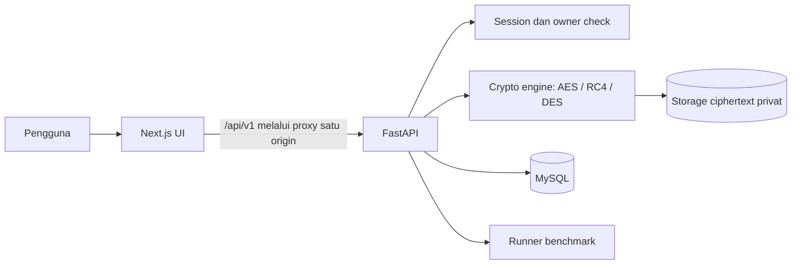
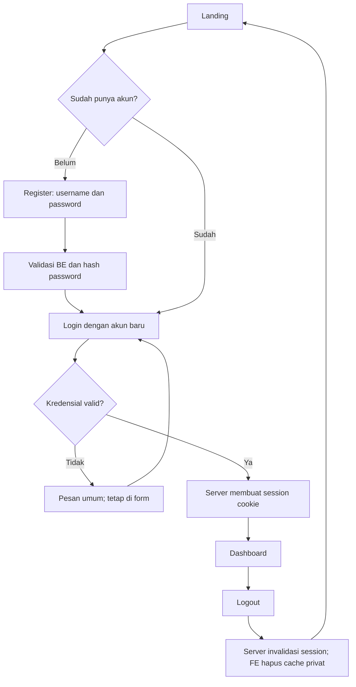

# VELTRIX — Blueprint UI, User Flow, dan Kontrak FE–BE

Versi: 0.1 • 13 Oktober 2026 • Tahap: rancangan sebelum implementasi

Dasar: `ki2.jpeg` (Assignment 1), `ki1.jpeg` (Cont’d), dan `VELTRIX_PRD_v0.1.md`.
Dokumen ini menetapkan usulan implementasi untuk dibahas tim. FE dengan mock API kini tersedia di `frontend/`; panduan dan batas simulasinya ada di `frontend/README.md`. Backend dan hasil benchmark kriptografi nyata belum dibuat.

## 1. Memahami tugas dan menentukan scope

Produk yang dibangun adalah **personal data vault dengan laboratorium perbandingan kriptografi**. Pengguna menyimpan data, mengambil kembali hasil dekripsi, lalu membandingkan AES, RC4, dan DES menggunakan input identik.

| Instruksi soal | Implementasi VELTRIX | Bukti saat demo/laporan |
| --- | --- | --- |
| Menyimpan private data dalam database | Form data pribadi; ciphertext di MySQL | Tampilkan record terenkripsi dan hasil reveal setelah login |
| Menyimpan gambar kartu identitas | Kategori Kartu Identitas; gunakan gambar dummy | Upload dan download JPEG/PNG yang sama |
| Menyimpan PDF/DOC/XLS | Kategori Dokumen; juga dukung DOCX/XLSX sesuai PRD | Uji tiap format yang didukung, bukan hanya PDF |
| Menyimpan video | Kategori Video; MP4 | Upload/download video dummy tanpa transcoding |
| Semua data dienkripsi dengan AES, RC4, DES | Tiga representasi independen per item | Satu item mempunyai tiga ciphertext; semuanya bisa didekripsi |
| Username dan password untuk akses | Register, login, logout, session, pemeriksaan owner di API | Akun B tidak bisa membaca ID file/data akun A |
| Mode block cipher selain ECB | AES-CBC dan DES-CBC; RC4 adalah stream cipher | Konfigurasi, IV, padding, dan pengujian engine |
| Analisis running time dan ciphertext | Cryptography Lab, ukuran, sampel hex, tabel/chart | Eksperimen berulang, CSV, analisis variasi hasil |
| Download berulang dan ukur waktunya | Tab Uji Download yang terpisah dari benchmark crypto | Catatan setiap request dan ringkasan tiap algoritma |
| Laporan singkat dan justifikasi keputusan | CSV + catatan metode + laporan tim | Jelaskan stack, mode, storage, parameter, dan keterbatasan |

**Interpretasi soal:** frasa “all stored data must be encrypted with all of these algorithms” menjadi dasar menggunakan tiga versi per item. D-01 pada PRD dapat diputuskan sebagai tiga versi, sambil memastikan interpretasi ini ke dosen bila ada instruksi tambahan.

Data pribadi berupa nama, kontak, alamat, tanggal lahir, dan nomor identitas dummy. Laporan perlu menjelaskan hubungan data dengan individu yang dapat diidentifikasi menurut [GDPR Pasal 4](https://eur-lex.europa.eu/legal-content/EN/TXT/?uri=CELEX:32016R0679) dan merujuk [UU No. 27 Tahun 2022 tentang Pelindungan Data Pribadi](https://jdih.komdigi.go.id/produk_hukum/view/id/832/t/crc32/). Rujukan ini menjadi dasar pembahasan akademik; tidak menetapkan aplikasi sudah memenuhi seluruh kewajiban hukum.

**Konsekuensi desain:** RC4 dan DES tetap tersedia untuk memenuhi tugas. UI memberi label “Legacy / pembelajaran”. Menyimpan salinan plaintext yang sama dengan algoritma lemah juga berarti keseluruhan vault tidak mempunyai perlindungan setara penyimpanan AES saja. Gunakan data sintetis seperti yang telah ditetapkan PRD. Dokumentasi [ARC4](https://www.pycryptodome.org/src/cipher/arc4) dan [DES](https://www.pycryptodome.org/src/cipher/des) menempatkannya untuk penggunaan legacy.

## 2. Keputusan kerja untuk MVP

| Area | Usulan yang dipakai dalam blueprint | Alasan |
| --- | --- | --- |
| Prioritas antarmuka | Storage-first; Lab menjadi menu tersendiri | Alur menyimpan/mengambil data mudah, analisis tetap terlihat |
| Enkripsi saat save/upload | AES + RC4 + DES otomatis | Tidak ada dropdown algoritma saat upload |
| Dekripsi | AES dipilih awal; RC4/DES bisa dipilih | Mendemonstrasikan ketiga jalur retrieval |
| Data pribadi | Satu profil terenkripsi per pengguna | Scope form dan update sederhana; identitas akun terpisah dari profil |
| Batas upload | Usulan 25 MB = 25.000.000 bytes per file | FE dan BE menggunakan batas byte yang sama; evaluasi setelah pengujian |
| Upload awal | Satu file per operasi | Mempermudah progress, rollback, dan validasi |
| Benchmark | 10 pengulangan tercatat + 2 warm-up; batas 10–30 | Mendukung PRD; batasi biaya CPU dan memori |
| Target awal | Demo lokal | Menyelesaikan integrasi dan bukti tugas sebelum membahas hosting |
| Preview | Metadata dan sampel ciphertext; tidak ada preview video/document | Retrieval utama berupa download, sesuai scope PRD |
| Auth | Session opaque di cookie HttpOnly | Logout dan invalidasi di server sederhana |

Batas file, jumlah pengulangan, dan target demo adalah usulan engineering, bukan ketentuan dosen. Batas dan format dikembalikan melalui endpoint capabilities agar FE tidak berbeda dengan BE.

## 3. Stack dan pembagian tanggung jawab

| Bagian | Pilihan | Fungsi |
| --- | --- | --- |
| Frontend | Next.js App Router + TypeScript | Routing, layout, komponen, tipe kontrak API |
| Styling | Tailwind CSS | Token visual dan layout responsif |
| Komponen | shadcn/ui + Lucide | Dialog, input, tabs, table, ikon yang konsisten |
| Form | React Hook Form + Zod | Validasi cepat di browser; BE tetap memvalidasi ulang |
| Server state | TanStack Query | Daftar file, metadata, invalidasi setelah mutation |
| Chart | Recharts | Bar chart encrypt/decrypt; tabel angka tetap tersedia |
| Mock FE | Mock Service Worker (MSW) | Kontrak HTTP sama sebelum API tersedia |
| Backend | Python FastAPI + Pydantic | Auth, owner checks, upload, download, error terstruktur |
| Database | MySQL + SQLAlchemy + PyMySQL + Alembic | Data pengguna, ciphertext profil, metadata dan hasil eksperimen |
| Crypto | PyCryptodome | AES-CBC, DES-CBC, ARC4, random, derivasi key, HMAC |
| Password | argon2-cffi / Argon2id | Hash password; tidak dienkripsi reversibel |
| Binary storage | Folder privat di luar public/static | Ciphertext file dengan UUID, bukan nama asli sebagai path |
| Timer/test BE | perf_counter_ns + Pytest | Pengukuran dan uji round-trip/otorisasi/integritas |
| E2E terpilih | Playwright | Alur login → upload → download, session expired, interaksi dialog |

Next.js sudah mendukung App Router, TypeScript, dan setup Tailwind: [dokumentasi instalasi Next.js](https://nextjs.org/docs/app/getting-started/installation). Stack ini mengikuti PRD dan cocok dengan pembagian tim empat orang. Pilihan komponen/form/chart merupakan usulan, bukan fitur wajib tugas. Kunci versi stabil ketika implementasi dimulai dan commit lockfile.

**Batas tanggung jawab:** FE mengatur tampilan dan interaksi. FastAPI menjadi pemilik logika bisnis, akses data, kunci, enkripsi, dekripsi, dan waktu crypto. MySQL tidak diakses browser. Next.js cukup menjadi FE dan proxy `/api`; tidak perlu menyalin logika crypto ke Server Actions.



Pengembangan: Next.js di localhost:3000, FastAPI di localhost:8000, MySQL lokal/container. Browser mengakses API melalui origin Next.js untuk menyederhanakan cookies. Jika menggunakan origin terpisah, atur CORS ke origin eksplisit dengan credentials; jangan memakai wildcard.

## 4. Sitemap dan navigasi

```text
/                         Landing ringkas
/login                    Masuk
/register                 Buat akun
/dashboard                Ringkasan vault
/personal-data            Profil pribadi terenkripsi
/vault                    Daftar file dan filter kategori
/vault/[fileId]           Detail, versi ciphertext, download, delete
/lab                      Benchmark crypto dan uji download
/lab/[benchmarkId]        Hasil eksperimen tersimpan
```

Halaman setelah login memakai satu `AppShell`: sidebar, topbar, area konten, nama pengguna, dan tombol logout. Menu utama hanya Dashboard, Data Pribadi, File Vault, Cryptography Lab. Upload berupa dialog dari Vault/Dashboard; halaman upload tersendiri tidak diperlukan.

Kategori Vault: **Semua / Kartu Identitas / Dokumen / Video**. Profil terstruktur tetap ada di Data Pribadi. Satu pengguna biasa sudah cukup; admin, public sharing, billing, dan social login tidak dibutuhkan.

## 5. User flow

### 5.1 Akun dan session



Registrasi tidak otomatis login pada rancangan ini. Halaman privat mengecek session; redirect FE membantu UX, sedangkan setiap endpoint tetap memeriksa session dan ownership. Session habis → tutup tampilan data terbuka, hapus cache privat, arahkan login dengan pesan “Sesi berakhir”. Jangan menyimpan password atau token session di localStorage.

### 5.2 Menyimpan file

1. Pengguna membuka Vault → **Upload file**.
2. Pilih kategori, lalu file lewat drag-and-drop **atau** tombol pilih file.
3. FE menampilkan nama, ukuran, jenis, dan batas format sebelum submit.
4. Tombol **Enkripsi & simpan** mengirim satu request; tiga algoritma diproses otomatis.
5. FE menampilkan progress transfer bila memakai XHR, lalu status indeterminate “Memproses enkripsi dan penyimpanan”.
6. BE memvalidasi file, menghasilkan tiga ciphertext + integrity tag, lalu menyimpan metadata dan objek privat.
7. Hanya setelah tiga versi dan metadata berhasil disimpan, API mengembalikan `201` dengan `status: ready`.
8. Dialog menampilkan sukses, daftar diperbarui; CTA **Lihat detail** tersedia.

FE tidak menampilkan persentase AES/RC4/DES atau langkah server yang belum dilaporkan API. Upload progress 100% hanya berarti transfer selesai. Jika satu versi gagal, operasi tidak boleh ditandai sukses; BE membersihkan artefak parsial. Setelah timeout, FE tidak otomatis mengulang POST: refresh daftar dahulu karena server mungkin sudah selesai.

### 5.3 Mengambil file

Vault → pilih file → detail → pilih sumber **AES / RC4 / DES** → **Dekripsi & download** → API memeriksa owner dan HMAC → dekripsi → respons binary dengan nama asli → browser memicu save.

Gunakan `fetch` + Blob untuk menampilkan error API sebelum download. Revoke object URL setelah digunakan. Jika ciphertext rusak, tampilkan error; jangan menyerahkan plaintext parsial. Tombol per-file disabled selama request berlangsung.

### 5.4 Data pribadi

Data Pribadi → **Tambah data dummy** → isi form → **Enkripsi & simpan** → status tiga versi siap. Nilai sensitif tidak otomatis dibuka setiap halaman dimuat.

Untuk membaca: pilih algoritma → **Tampilkan data** → POST decrypt → BE cek owner/integritas → FE menampilkan nilai. **Sembunyikan** menghapus nilai dari state. Navigasi/logout juga membersihkan state; hindari cache persisten atau query cache untuk plaintext. JavaScript tidak menjamin penghapusan memori secara forensik.

Untuk update: buka data → **Edit** → validasi → PUT → BE mengganti ketiga versi secara konsisten → UI kembali tersembunyi. Untuk delete: dialog konfirmasi → DELETE → profil menjadi empty state. Cancel edit menghapus draft dari state.

### 5.5 Cryptography Lab

Lab punya dua tab: **Benchmark Crypto** dan **Uji Download**.

**Benchmark Crypto:** pilih file tersimpan atau profil dummy → 10–30 pengulangan → **Jalankan benchmark** → loading → tabel/chart → detail tiap algoritma → **Ekspor CSV**.

Runner memulihkan satu input yang diotorisasi, lalu menguji tiga algoritma dengan bytes identik. Persiapan input dan pembacaan storage tidak masuk timer crypto. Dua warm-up tidak masuk ringkasan. Urutan algoritma divariasikan per pengulangan dan dicatat agar bias urutan dapat dibahas.

**Uji Download:** pilih file → semua algoritma → 10–30 pengulangan → **Mulai uji**. FE mengambil respons binary secara berurutan dan mengukur dari sebelum request sampai `await response.blob()` selesai. Tidak memunculkan 30 dialog save; aksi download manual tetap tersedia untuk demo retrieval.

Durasi ini adalah **waktu request hingga seluruh payload diterima browser**, meliputi server, jaringan, dan buffering. Tidak mengukur waktu pengguna memilih lokasi atau penulisan final ke disk. Gunakan `Cache-Control: no-store` pada request/response dan jangan memasukkan request gagal sebagai durasi sukses. Jika dosen meminta pengukuran save ke disk, tambahkan prosedur terpisah dalam laporan.

## 6. Spesifikasi setiap layar

| Layar | Konten utama | Aksi utama | Empty/error state |
| --- | --- | --- | --- |
| Landing | Nama VELTRIX, penjelasan vault dan Lab, tiga algoritma, konteks akademik | Buat akun / Masuk | Tidak ada klaim zero-knowledge atau “100% secure” |
| Register/Login | Username, password, password confirmation khusus register, show/hide, label jelas | Daftar / Masuk | Username duplikat; login gagal memakai pesan umum |
| Dashboard | Jumlah file, total ukuran asli, total storage ciphertext, profil tersedia, recent files | Upload file / Tambah data pribadi | Akun baru diberi CTA tanpa statistik/benchmark palsu |
| Data Pribadi | Status profil, tiga versi, pemilih dekripsi, form/reveal | Simpan / Tampilkan / Edit / Hapus | Profil belum ada; error validasi per field; session habis |
| Vault | Search nama, tabs kategori, tabel/card, upload dialog | Upload / Buka detail | Belum ada file; filter tidak cocok; retry daftar |
| Detail file | Nama/jenis/ukuran, tanggal, tabel tiga ciphertext, status integritas bila terverifikasi | Dekripsi & download / Uji di Lab / Hapus | File tidak ditemukan; versi rusak; retrieval gagal |
| Lab | Input, pengulangan, dua tab, hasil dan histori | Jalankan / Ekspor CSV | Belum ada input; belum ada hasil; eksperimen gagal |

**Kolom Vault desktop:** nama, kategori, ukuran asli, total ukuran terenkripsi, tanggal upload, status, aksi. AES/RC4/DES muncul sebagai satu grup badge; pengguna tidak melihat tiga baris file yang berbeda. Mobile mengubah tabel menjadi card dengan aksi yang sama.

**Form profil:** nama lengkap (wajib), email dummy, telepon dummy, alamat dummy, tanggal lahir, nomor identitas dummy. Data demo dapat diisi melalui tombol “Isi contoh dummy”. Username akun tidak otomatis dianggap nama lengkap profil.

**Detail ciphertext:** algoritma, mode, ciphertext bytes, ukuran objek tersimpan, sampel hex maksimal 32 bytes. Ciphertext-only sample harus authenticated dan owner-scoped. Tidak ada key/master secret pada UI. IV tidak sama dengan key, tetapi tidak perlu dimunculkan pada UI utama.

**Status integritas:** saat penyimpanan selesai tampilkan “Tag integritas disimpan”. “Integritas terverifikasi” hanya setelah pemeriksaan server, bukan badge statis yang diasumsikan benar.

## 7. Wireframe dan arah visual

Arah terbaru mengikuti `Veltrix Secure Brand Identity Board.png` dan `VELTRIX_GSM_v0.1.md`: dashboard minimal, sidebar Midnight Blue, background Cloud, heading Montserrat, body Inter, dan logo V berlapis/keyhole. Brand board menggantikan identitas prototype awal. Lab memakai komparasi data dengan tabel dan grouped bar chart; heatmap tidak diperlukan untuk tiga algoritma.

```text
┌─────────────────┬────────────────────────────────────────────────┐
│ VELTRIX         │ Dashboard                        demo_user  Keluar│
│                 ├────────────────────────────────────────────────┤
│ Dashboard       │ Vault kamu                   [ Upload file ]   │
│ Data Pribadi    │ Ringkasan file dan data tersimpan              │
│ File Vault      │                                                │
│ Cryptography Lab│ [Jumlah file] [Ukuran asli] [Storage ciphertext]│
│                 │                                                │
│                 │ Data Pribadi           Aktivitas terbaru       │
│                 │ [Tambah / buka]        nama, waktu, status     │
│                 │                                                │
│ Demo akademik   │ File terbaru                     [Semua file]  │
│ Data dummy      │ Nama | Jenis | Ukuran | 3 versi | Aksi         │
└─────────────────┴────────────────────────────────────────────────┘
```

| Token | Nilai awal |
| --- | --- |
| Sidebar/navy | Midnight Blue `#0B132B` dengan teks `#F1F5F9` |
| Background | Cloud `#F1F5F9`; dark mode Midnight Blue `#0B132B` |
| Surface | `#FFFFFF` |
| Primary/button | `#2563EB` dengan teks putih |
| Text utama / sekunder | Charcoal `#1F2937` / `#475569` |
| Aksen logo | Indigo `#6366F1` dan Cyan `#22D3EE` mengikuti board |
| Border dekoratif | `#E2E8F0`; kontrol aktif/focus perlu batas yang lebih jelas |
| Success | `#166534` pada `#DCFCE7` |
| Legacy/warning | `#92400E` pada `#FEF3C7` |
| Error | `#B91C1C` pada `#FEE2E2` |
| Font | Montserrat untuk heading/logo, Inter untuk UI/body, Fira Code untuk hex/angka teknis; self-hosted |
| Spacing / radius | Skala 4/8/12/16/24/32 px; radius 12 px |

Pakai semantic tokens, satu keluarga ikon Lucide, hierarki heading jelas, dan animasi ringan 150–250 ms. Target viewport verifikasi: 375, 768, 1440 px; sidebar menjadi menu drawer di mobile. Chart dan tabel tetap mudah dibaca tanpa memaksakan seluruh halaman horizontal scroll.

**Kriteria aksesibilitas:** label input terlihat, focus ring, navigasi keyboard, password manager/paste diperbolehkan, dialog mengelola focus dan mengembalikannya ke trigger, `aria-live` untuk status/error. Tombol upload menjadi alternatif drag-and-drop. Target interaksi minimal 44 px sebagai keputusan desain. Status memakai teks + ikon; warna bukan satu-satunya informasi. Ukur kontras teks minimal 4.5:1 dan dukung reduced motion saat implementasi.

## 8. Kontrak HTTP FE–BE

Base path browser: `/api/v1`. UUID untuk resource ID; timestamp ISO 8601 UTC; UI mengubahnya ke waktu lokal. Algoritma selalu enum `AES | RC4 | DES`, category `identity | document | video`. Request/response JSON kecuali upload/download/export.

### 8.1 Endpoint

| Method | Path relatif | Request | Respons sukses / catatan |
| --- | --- | --- | --- |
| GET | `/capabilities` | — | `200`: format, max_file_bytes, repetition bounds; boleh publik |
| GET | `/auth/csrf` | — | `200`: CSRF token; terikat session/pre-auth session |
| POST | `/auth/register` | username, password | `201`: user id + username; belum login |
| POST | `/auth/login` | username, password | `200`: user; Set-Cookie session |
| GET | `/auth/me` | — | `200`: id + username; `401` bila belum login |
| POST | `/auth/logout` | — | `204`: invalidasi session dan expire cookie |
| GET | `/vault/summary` | — | `200`: counts, original_bytes, stored_bytes, personal_data_exists |
| GET | `/vault/personal-data` | — | `200`: profil metadata atau null; tidak otomatis plaintext |
| POST | `/vault/personal-data` | fields profil | `201`: id, status, versions |
| POST | `/vault/personal-data/{id}/decrypt` | algorithm | `200`: fields plaintext setelah owner + HMAC check |
| PUT | `/vault/personal-data/{id}` | fields profil | `200`: metadata tiga versi terbaru |
| DELETE | `/vault/personal-data/{id}` | — | `204`: hapus profil dan tiga ciphertext |
| GET | `/vault/files` | category, search, page, page_size | `200`: items + pagination |
| POST | `/vault/files` | multipart: `file`, `category` | `201`: file ready beserta tiga versi |
| GET | `/vault/files/{id}` | — | `200`: metadata + ukuran/sampel ciphertext |
| GET | `/vault/files/{id}/download` | query `algorithm=AES` | `200`: binary; owner + integrity check setiap request |
| DELETE | `/vault/files/{id}` | — | `204`: metadata dan tiga objek dihapus |
| POST | `/benchmarks` | source, repetitions, warmups | `201`: benchmark tersimpan dan hasil; bounded synchronous MVP |
| GET | `/benchmarks` | page, page_size | `200`: histori milik pengguna |
| GET | `/benchmarks/{id}` | — | `200`: settings, environment, raw samples, summary |
| GET | `/benchmarks/{id}/export` | — | `200`: CSV crypto dengan header download |
| POST | `/download-tests` | file_id, repetitions | `201`: test id untuk pencatatan eksperimen browser |
| POST | `/download-tests/{id}/results` | attempts + metadata browser | `200`: ringkasan; verifikasi owner, enum dan batas sample |
| GET | `/download-tests/{id}/export` | — | `200`: CSV durasi download, diberi label client-measured |

Semua endpoint privat memerlukan session dan owner scope. Semua mutasi POST/PUT/DELETE termasuk login/register memakai kebijakan CSRF yang disepakati; ambil token sebelum submit. Untuk file/data orang lain, kembalikan `404` agar keberadaan resource tidak diungkap. `401` untuk session tidak valid; `403` untuk CSRF/aksi terlarang yang relevan.

Session cookie: HttpOnly, SameSite=Lax, Path=/, Secure pada HTTPS. Local HTTP memiliki konfigurasi development terpisah. Token CSRF dikirim di `X-CSRF-Token`; HttpOnly/SameSite saja tidak menggantikan perlindungan CSRF. Panduan: [OWASP Session Management](https://cheatsheetseries.owasp.org/cheatsheets/Session_Management_Cheat_Sheet.html), [OWASP CSRF Prevention](https://cheatsheetseries.owasp.org/cheatsheets/Cross-Site_Request_Forgery_Prevention_Cheat_Sheet.html).

Download, reveal, metadata privat, dan CSV memakai `Cache-Control: no-store`. Download memakai MIME asli yang sudah divalidasi, `Content-Disposition: attachment` dengan filename yang di-escape benar, dan `X-Content-Type-Options: nosniff`. Jangan memakai path/nama pengguna sebagai path storage.

### 8.2 Bentuk file resource

```ts
type Algorithm = 'AES' | 'RC4' | 'DES';
type FileCategory = 'identity' | 'document' | 'video';

interface CipherVersion {
  algorithm: Algorithm;
  mode: 'CBC' | null; // RC4: null, bukan CBC
  ciphertext_bytes: number;
  stored_bytes: number; // ciphertext + envelope/metadata yang ikut objek
  ciphertext_sample_hex?: string; // maksimal 32 bytes = 64 karakter hex
}

interface VaultFile {
  id: string;
  display_name: string; // nama untuk pengguna yang diotorisasi, bukan storage path
  category: FileCategory;
  mime_type: string;
  original_bytes: number;
  total_stored_bytes: number;
  status: 'ready'; // upload MVP tidak mengembalikan success parsial
  created_at: string;
  versions: CipherVersion[]; // tepat satu AES, RC4, dan DES
}

interface FileList {
  items: VaultFile[];
  page: number;
  page_size: number;
  total: number;
}
```

Status UI `selected | uploading | processing | failed` adalah state lokal operasi upload; tidak dicampur dengan file persisten `ready`. Maksimum page_size ditetapkan BE, misalnya 50.

### 8.3 Benchmark request dan response

```json
{
  "source": { "type": "file", "id": "<uuid-file-milik-user>" },
  "repetitions": 10,
  "warmups": 2
}
```

Source type lain: `personal_data`. Algoritma selalu ketiganya; FE tidak perlu mengirim pilihan yang bisa menghilangkan kewajiban soal. POST MVP menunggu hasil, menampilkan spinner tanpa progress server palsu. Tetapkan timeout/limit sesudah pilot test. Jika durasi tidak memadai, ubah kontrak secara eksplisit menjadi job `202` + polling; jangan membangun Redis/Celery sebelum ada kebutuhan.

Hasil minimal:

```ts
interface CryptoSample {
  algorithm: Algorithm;
  repetition: number;
  encrypt_ns: number; // core timer: setup cipher, padding bila perlu, encrypt
  decrypt_ns: number; // core timer: setup cipher, decrypt, unpadding bila perlu
  integrity_ns: number; // MAC generation + verification, dilaporkan terpisah
  correctness_ns: number; // round-trip equality check, di luar core timer
  ciphertext_bytes: number;
  stored_bytes: number;
  round_trip_ok: boolean;
}

interface BenchmarkResult {
  id: string;
  source: { type: 'file' | 'personal_data'; id: string };
  input_bytes: number;
  repetitions: number;
  warmups: number;
  created_at: string;
  environment: Record<string, string>; // CPU, OS, Python, library, mode/key size
  methodology_version: string;
  samples: CryptoSample[]; // repetitions × 3; warm-up dikeluarkan
  summary: Array<{
    algorithm: Algorithm;
    mean_encrypt_ns: number;
    median_encrypt_ns: number;
    stddev_encrypt_ns: number;
    mean_decrypt_ns: number;
    median_decrypt_ns: number;
    stddev_decrypt_ns: number;
    round_trip_successes: number;
    measured_runs: number;
  }>;
}
```

Scope timer harus dicatat di hasil: key derivation/random parameter preparation dan storage I/O di luar core; setup cipher dan padding/unpadding di dalam. Jika ARC4 drop digunakan, nilainya tetap dan dicatat karena setup cost ikut timer. MAC dan correctness tidak diam-diam dicampur dengan core time. Semua algoritma memakai source bytes yang sama; file envelope tidak ikut input benchmark crypto.

### 8.4 Format error

```json
{
  "error": {
    "code": "FILE_TOO_LARGE",
    "message": "Ukuran file melebihi batas 25 MB.",
    "field_errors": { "file": ["Pilih file maksimal 25 MB."] },
    "request_id": "<request-id>"
  }
}
```

| HTTP | Contoh code | Perlakuan FE |
| --- | --- | --- |
| 401 | `SESSION_EXPIRED`, `INVALID_CREDENTIALS` | Login gagal tetap di form; session habis bersihkan cache lalu login |
| 403 | `CSRF_INVALID` | Tampilkan pesan; refresh token, jangan ulang mutasi otomatis |
| 404 | `RESOURCE_NOT_FOUND` | State tidak ditemukan dan link kembali |
| 409 | `USERNAME_TAKEN`, `PROFILE_EXISTS` | Pesan pada field atau arahkan update profil |
| 413 | `FILE_TOO_LARGE` | Error di input file |
| 415 | `UNSUPPORTED_FILE_TYPE` | Jelaskan daftar format |
| 422 | `VALIDATION_ERROR` | Map field_errors ke form; error lain di summary |
| 429 | `RATE_LIMITED` | Jelaskan coba lagi; hormati Retry-After |
| 500 | `INTEGRITY_CHECK_FAILED`, `STORAGE_ERROR`, `ENCRYPTION_FAILED` | Pesan terkontrol; tidak membuat download palsu |

Normalisasi error validation bawaan FastAPI ke bentuk ini; FE tidak perlu menangani dua schema. Server log menggunakan request_id tanpa password, plaintext, key, atau dump body. Error jaringan FE mempunyai state tersendiri, tidak dianggap JSON dari server.

## 9. Database dan desain crypto yang perlu disepakati

Bagian 8 PRD saat ini hanya memuat `users`, lalu langsung baris endpoint tanpa header bagian 9. Skema berikut melengkapi rancangan sebelum backend dibuat.

| Tabel | Kolom/purpose utama |
| --- | --- |
| users | id, username unik, password_hash, created_at |
| sessions | id, user_id, token_hash, expires_at; token raw hanya di cookie |
| personal_records | id, user_id unik, created_at, updated_at; tidak ada kolom nama/alamat plaintext |
| personal_versions | record_id, algorithm, ciphertext BLOB, IV/salt, MAC, key_version; unique(record_id, algorithm) |
| files | id, user_id, category, original_bytes, status, created_at; tidak menyimpan binary plaintext |
| file_versions | file_id, algorithm, storage_id, ciphertext_bytes, stored_bytes, IV/salt, MAC, key_version; unique(file_id, algorithm) |
| benchmarks | id, user_id, source_type/id, settings, environment, methodology_version, input_bytes, created_at |
| benchmark_samples | benchmark_id, algorithm, repetition, timings, lengths, round_trip_ok |
| download_tests | id, user_id, file_id, repetitions, browser/environment, created_at |
| download_samples | test_id, algorithm, repetition, elapsed_ms, received_bytes, success, error_code |

Nama file bisa memuat identitas. Simpan nama asli/MIME sensitif di metadata terenkripsi per representasi atau envelope, lalu kembalikan display_name hanya melalui API yang diotorisasi. Ukuran, waktu, kategori, owner reference, dan routing IDs tetap menjadi metadata operasional; jelaskan batas privasi metadata ini dalam laporan.

Untuk benchmark yang sumbernya dihapus, histori hasil boleh tetap ada sesuai kebijakan retensi MVP, tetapi tidak dapat di-run ulang dari sumber yang hilang. UI menyatakan “Sumber sudah dihapus”. Delete profile/file tetap membersihkan seluruh ciphertext terkait.

**Konfigurasi crypto usulan:** AES-256-CBC (IV 16 bytes), DES-CBC (IV 8 bytes; efektif key 56 bit), PKCS#7 padding sesuai block size. ARC4 memakai derived key independen per item/version; salt derivasi bukan IV cipher RC4. Catat panjang key dan parameter drop dalam metode. CBC menyediakan kerahasiaan, bukan integritas: tambahkan Encrypt-then-MAC dengan key terpisah dan verifikasi sebelum dekripsi. Rujukan: [classic modes PyCryptodome](https://www.pycryptodome.org/src/cipher/classic).

HMAC mengikat ciphertext dan metadata yang relevan (algorithm, format/version, item ID, IV/salt) memakai encoding deterministik. Domain derivasi berbeda untuk algoritma, item/version, metadata dan MAC. Update profil memakai input derivasi baru. Master secret tetap konfigurasi BE; key_version memungkinkan data lama tetap dibaca setelah perubahan key yang direncanakan.

Upload tiga versi bukan transaksi database saja: filesystem dan DB membutuhkan staging ciphertext, cleanup saat gagal, dan rekonsiliasi objek orphan setelah crash. Sukses hanya setelah artefak lengkap. Delete juga harus menangani kegagalan filesystem tanpa mengklaim semua objek sudah terhapus.

**Catatan upload FastAPI:** `UploadFile` memakai `SpooledTemporaryFile` yang dapat memindahkan plaintext upload ke file sementara. Rancang limit sebelum pemrosesan berat, cleanup temporary upload, dan kebijakan temp storage; jangan mengklaim “plaintext tidak pernah menyentuh disk” dengan konfigurasi default. PRD saat ini melarang salinan plaintext di repository persisten. Jika tim ingin larangan disk yang lebih ketat, gunakan jalur upload memory-only terbatas dan uji parser/framework-nya. [FastAPI Request Files](https://fastapi.tiangolo.com/tutorial/request-files/).

## 10. Hasil eksperimen yang ditampilkan

| Metrik | Sumber pengukuran | Tampilan |
| --- | --- | --- |
| Encrypt/decrypt mean, median, SD | perf_counter_ns di BE | Tabel, grouped bar chart mean dalam ms |
| Ciphertext bytes | Panjang output engine | Tabel per algoritma |
| Stored bytes | Ciphertext + metadata/envelope terkait | Bedakan dari ciphertext bytes |
| Storage expansion | stored_bytes / original_bytes | Per versi dan total tiga versi |
| Round-trip | Kesamaan bytes setelah dekripsi | N/N lulus, bukan klaim keamanan |
| End-to-end receipt time | performance.now di browser hingga Blob selesai | Tabel terpisah; mean/median/SD/success count |
| Sampel ciphertext | 32 bytes awal output | Hex terbatas, tanpa plaintext/key |

CBC dengan PKCS#7 menambah padding; RC4 core menghasilkan panjang sama dengan input, sedangkan format tersimpan menambah metadata/tag. Gunakan catatan ini untuk menjelaskan hasil, bukan menyimpulkan keamanan dari panjang atau tampilan hex. Ciphertext dapat berubah antar-run karena parameter baru.

Dataset minimum mengikuti PRD: teks profil sekitar 1 KB, gambar identitas dummy 500 KB, PDF 2 MB, DOC/XLS sekitar 5 MB, MP4 20 MB. Laporkan ukuran aktual dalam bytes. Uji fungsi format DOCX/XLSX/JPEG/PNG juga walau tidak semuanya menjadi dataset eksperimen.

CSV crypto berisi raw sample per repetition dan method/environment. CSV download berisi algorithm, repetition, elapsed_ms, received_bytes, success, error_code dan label `client-measured`. Pengukuran browser adalah data eksperimen dari client, bukan bukti performa yang dipercaya server untuk keputusan keamanan.

## 11. Struktur FE dan cara bekerja sebelum BE tersedia

```text
frontend/
  src/app/
    (public)/page.tsx
    (auth)/login/page.tsx
    (auth)/register/page.tsx
    (workspace)/layout.tsx
    (workspace)/dashboard/page.tsx
    (workspace)/personal-data/page.tsx
    (workspace)/vault/page.tsx
    (workspace)/vault/[fileId]/page.tsx
    (workspace)/lab/page.tsx
    (workspace)/lab/[benchmarkId]/page.tsx
  src/components/ui/            button, input, dialog, tabs, table
  src/components/layout/        app-shell, sidebar, topbar
  src/features/auth/            forms, session handling
  src/features/personal-data/   form, reveal state, encrypted summary
  src/features/vault/           file-table, upload-dialog, download, delete
  src/features/lab/             settings, comparison-table, charts, download tests
  src/lib/api/                  client, contracts, normalized errors
  src/mocks/                    MSW handlers dan fixtures dummy
  src/styles/                   semantic tokens
backend/                        dibuat terpisah sesuai kontrak
```

Urutan implementasi FE:

1. Buat design tokens, AppShell, dan route semua halaman.
2. Buat contracts dan HTTP client dengan credentials, CSRF, dan error mapping.
3. Buat MSW handler yang mengikuti endpoint dan bentuk resource di atas.
4. Kerjakan login/register, Dashboard, Data Pribadi, upload/list/detail/download/delete.
5. Kerjakan Lab beserta crypto table, download test, CSV, empty/loading/error.
6. Ganti handler mock dengan FastAPI tanpa mengganti alur atau schema komponen.
7. Uji dengan dua akun, file nyata dummy, dan hasil eksperimen backend.

Mock harus menyertakan skenario akun baru, profil tersimpan, file tiap kategori, validasi gagal, ciphertext rusak, network failure, dan session expired. Banner “Mode demo: data dan waktu simulasi” tampil selama mock aktif. Mock download tidak membuktikan dekripsi dan mock timings tidak masuk laporan akademik.

## 12. Pembagian tim dan acceptance checklist

| Anggota | Deliverable |
| --- | --- |
| 1 — FE/UI | Tokens, layout, semua halaman, form, mock HTTP, integrasi |
| 2 — BE/DB | Auth/session/CSRF, schema, owner checks, storage, kontrak HTTP |
| 3 — Crypto | Interface tiga cipher, derivasi key, IV/padding, MAC, round-trip/tamper tests |
| 4 — Benchmark/QA | Dataset dummy, runner, CSV, uji download, laporan/metode, QA lintas fitur |

Semua anggota ikut integrasi dan memahami justifikasi. Gunakan library dan sumber dengan atribusi; setiap anggota harus bisa menjelaskan implementasinya saat demo.

**Blueprint siap diimplementasikan bila:**

- [ ] Tim menerima stack, sitemap, tiga representasi/item, dan format kontrak.
- [ ] API personal-data delete/decrypt, register/login, dan schema database yang hilang di PRD disepakati.
- [ ] Batas upload/benchmark dan aturan temp plaintext ditetapkan.
- [ ] Scope timer crypto vs end-to-end download disetujui.
- [ ] Dataset dummy dan machine environment tersedia.

**FE selesai saat:** semua CTA bekerja, deep link/refresh masuk akal, keyboard/mobile dapat digunakan, kondisi empty/loading/error ada, plaintext reveal tidak bertahan setelah hide/logout, mode mock jelas, dan tidak ada angka benchmark simulasi yang dilabeli hasil nyata.

**MVP akademik selesai saat:** API nyata membatasi owner, tiga cipher round-trip pada seluruh kategori, tampering ditolak sebelum plaintext keluar, tidak ada plaintext di repository persisten, upload/delete failure ditangani, benchmark berulang serta uji download menghasilkan CSV, dan laporan menjelaskan hasil serta keputusan.

## 13. Hal yang masih perlu informasi tim/dosen

- Deadline, format laporan, dan apakah ada larangan/library atau ketentuan implementasi tambahan.
- Apakah database diwajibkan menyimpan seluruh binary, atau personal data terenkripsi + metadata DB dan binary ciphertext filesystem diterima. Slide eksplisit menyebut private data dalam database; rancangan ini menyimpannya di DB dan memisahkan file binary sesuai PRD.
- Kecukupan batas 25 MB untuk video demo.
- Prosedur uji download ke browser saja atau sampai save ke disk bila dosen menetapkan definisi khusus.

Rancangan FE bisa dimulai dengan keputusan kerja dokumen ini; konfirmasi tersebut mempengaruhi integrasi atau laporan tanpa menghalangi pembuatan layout dan flow.
