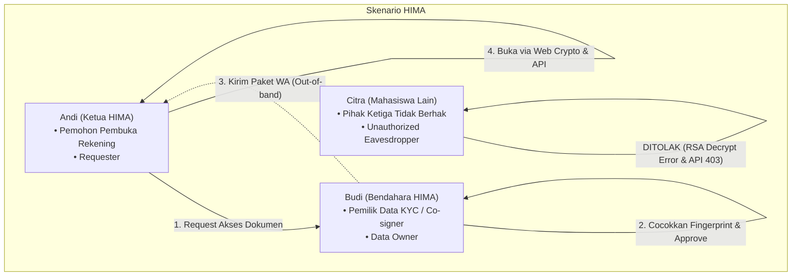
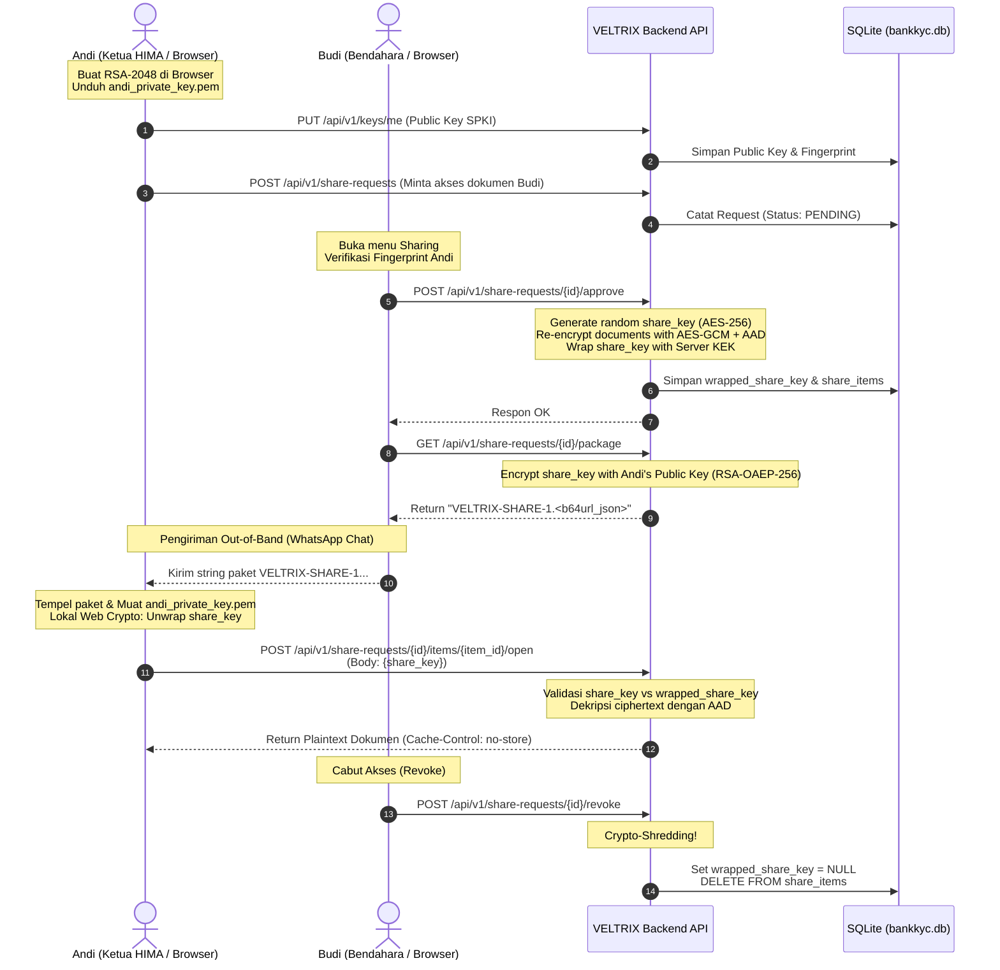

# VELTRIX BankKYC — Assignment 2 Final Report: Key Management & Document Sharing

**Mata Kuliah:** Keamanan Informasi (Semester 5)  
**Kelompok / Proyek:** VELTRIX BankKYC — Secure Digital Banking Onboarding  
**Topik:** Assignment 2 — Manajemen Kunci & Pembagian Dokumen Rahasia Antar Pemohon (*Cross-Applicant Secure Document Sharing*)  
**Penulis Utama Dokumen:** Jorell (QA & Documentation Lead)  
**Kontributor:** Angela (Frontend), Caca (Backend & Migrations), Maleka (Kriptografi & Security), Jorell (QA & Forensik)  
**Tanggal:** 24 November 2026  
**Status:** **Selesai & Terverifikasi (Production Ready for Academic Demo)**

---

## 1. Ringkasan Eksekutif (*Executive Summary*)

Dalam pengembangan sistem perbankan digital **VELTRIX BankKYC**, fitur *Document Sharing* diperkenalkan untuk memfasilitasi kebutuhan bisnis pembukaan rekening bersama (*joint account*) atau rekening organisasi mahasiswa (**HIMA**). Fitur ini memungkinkan seorang pemohon (*Requester*) meminta akses dokumen identitas pemohon lain (*Owner* / co-signer) tanpa mengharuskan pertukaran berkas fisik atau file PDF mentah yang rentan terhadap penyadapan.

Tantangan utama sistem ini adalah menjaga kerahasiaan (*confidentiality*) dan integritas (*integrity*) data sensitif (KTP, formulir spesimen, rekaman video verifikasi) sesuai amanat **UU Pelindungan Data Pribadi (UU PDP No. 27/2022)**. Solusi dirancang dengan menerapkan arsitektur kriptografi hibrida (*hybrid cryptography*):
1. **Asimetris (RSA-OAEP 2048-bit / SHA-256):** Menjamin pengiriman kunci simetris secara *out-of-band* (analog melalui WhatsApp/email) tanpa risiko kebocoran kunci privat ke server (*Zero-Knowledge Client-Side Key Management*).
2. **Simetris (AES-256-GCM + AAD):** Mengenkripsi salinan dokumen yang dibagikan secara terisolasi dengan data autentikasi terasosiasi (*Authenticated Encryption with Associated Data*) untuk mencegah serangan penukaran dokumen (*cross-item substitution*).
3. **Penyimpanan Kunci Terbungkus (KEK Wrapping):** Kunci berbagi simetris di sisi server selalu disimpan dalam kondisi terbungkus (*wrapped*) oleh Master KEK, mencegah pembacaan langsung dari database.
4. **Pemusnahan Kriptografis (*Crypto-Shredding*):** Saat hak akses dicabut (*revoked*) atau kedaluwarsa (*expired*), server secara instan menghapus kunci terbungkus dan memusnahkan ciphertext salinan dokumen secara permanen.

Seluruh 11 kasus uji keamanan otomatis (**T01–T14**) dan 10 skenario uji end-to-end (**E01–E10**) telah lulus 100% dengan bukti forensik digital.

---

## 2. Skenario Bisnis: Pembukaan Rekening HIMA Informatika

Skenario bisnis yang diadopsi adalah **Keputusan DEC2-01**: Pembukaan rekening operasional organisasi kemahasiswaan (Himpunan Mahasiswa Informatika / HIMA).



### Karakter dan Peran:
1. **Andi Wijaya (Ketua HIMA - Peminta / Requester):**
   - Bertugas mengurus administrasi pembukaan rekening HIMA di VELTRIX.
   - Membutuhkan dokumen identitas dan formulir spesimen tanda tangan milik Budi sebagai co-signer resmi organisasi.
2. **Budi Pratama (Bendahara HIMA - Pemilik Data / Data Owner):**
   - Telah menyelesaikan pendaftaran KYC mandiri di VELTRIX (status pengajuan `SUBMITTED`).
   - Memiliki kendali penuh (*data sovereignty*) untuk menyetujui, menolak, atau mencabut akses terhadap dokumen miliknya kapan saja.
3. **Citra Lestari (Pihak Ketiga / Unauthorized Attacker):**
   - Menguji ketahanan sistem terhadap serangan penyadapan (*eavesdropping*) pada jalur komunikasi chat WhatsApp dan serangan bypass endpoint API.

---

## 3. Arsitektur Kriptografi & Siklus Hidup Manajemen Kunci

Arsitektur kriptografi dirancang mengikuti prinsip *Defense in Depth* dan *Least Privilege*.



### Rincian Komponen Kriptografi:
1. **Pembangkitan Pasangan Kunci di Klien (`A-FE-01`):**
   - Browser menggunakan **Web Crypto API** (`RSA-OAEP`, modulus 2048-bit, public exponent 65537, hash SHA-256).
   - Kunci privat diekspor ke format PKCS#8 PEM dan langsung diunduh ke komputer pengguna (`andi_private_key.pem`).
   - **Kunci privat tidak pernah menyentuh server, tidak disimpan di `localStorage`, session storage, cookie, maupun file log.**
2. **Sidik Jari Kunci Publik (*Key Fingerprint*):**
   - Dihitung dari hash SHA-256 atas binary DER public key (SPKI).
   - Ditampilkan dalam bentuk 16 karakter hexadesimal pertama untuk kemudahan verifikasi visual oleh pemilik data.
3. **Paket Berbagi *Out-of-Band* (Format `VELTRIX-SHARE-1`):**
   - Format: `VELTRIX-SHARE-1.<base64url_json>`
   - Header: `{"alg": "RSA-OAEP-256", "typ": "VELTRIX-SHARE-PACKAGE"}`
   - Payload: Berisi `request_id`, `target_fingerprint`, `expires_at`, dan `encrypted_share_key` (terenkripsi RSA-OAEP menggunakan public key peminta).
4. **Enkripsi Salinan Dokumen Berbagi (`M-SEC-01`):**
   - Salinan dokumen dienkripsi menggunakan **AES-256-GCM**.
   - **Additional Authenticated Data (AAD):** `f"share:{request_id}:{item_id}:{kind}"`. Mencegah penyerang menukar ciphertext antar permintaan atau jenis berkas.
5. **Perlindungan Kunci di Server (KEK Wrapping - `M-SEC-02`):**
   - Di database `bankkyc.db`, kunci berbagi tidak pernah disimpan mentah (*zero plaintext key*).
   - Kunci dibungkus menggunakan AES Key Wrap (`rfc3394`) atau AES-GCM dengan KEK master server.
6. **Keamanan Cache di Sisi Klien:**
   - Semua respons endpoint `/open` mengirimkan header HTTP:
     ```http
     Cache-Control: no-store, no-cache, must-revalidate, private
     Pragma: no-cache
     X-Content-Type-Options: nosniff
     ```
   - Dokumen langsung dirender melalui `URL.createObjectURL` di memori dan langsung dicabut (`revokeObjectURL`) saat modal ditutup.

---

## 4. Hasil Pengujian & Bukti Forensik

### 4.1. Pengujian Keamanan Otomatis (`pytest`) — T01 s/d T14
Seluruh pengujian otomatis dijalankan pada direktori backend menggunakan test runner pytest:

```bash
python -m pytest tests/test_assignment2_security.py tests/test_sharing_api.py -v
```

**Hasil: 11 PASSED in 45.71s (100% Success)**

| Kasus Uji | Skenario Pengujian | Hasil Pengamatan | Status |
|:---:|:---|:---|:---:|
| **T01** | Alur lengkap pembagian & verifikasi integritas byte-demi-byte | Hash SHA-256 dokumen asli dan hasil dekripsi identik 100% | **PASSED** |
| **T02** | Pemanggilan `open` dengan kunci simetris acak | Server menolak dengan kode kesalahan generik `403 SHARE_OPEN_DENIED` | **PASSED** |
| **T03** | Paket WA didekripsi dengan private key milik penyerang | Gagal pada tahap matematis RSA-OAEP (*cipher error / bad padding*) | **PASSED** |
| **T04** | Akun ketiga mencoba memanggil `open` dengan kunci yang benar | Ditolak `403`: akun pemanggil bukan peminta yang sah dari request | **PASSED** |
| **T05** | Akses dicabut (*revoke*), lalu peminta mencoba membuka dokumen | Ditolak `403`: baris `share_items` dan `wrapped_share_key` sudah musnah | **PASSED** |
| **T06** | Waktu `expires_at` dimundurkan ke masa lalu (simulasi kedaluwarsa) | Status otomatis menjadi `EXPIRED`, pemanggilan `open` ditolak | **PASSED** |
| **T07** | Akun bukan pemilik mencoba memanggil `approve` atau `revoke` | Ditolak `404 / 403`: otorisasi kepemilikan ditegakkan | **PASSED** |
| **T08** | Serangan substitusi item (AAD manipulation) | Autentikasi GCM gagal, server menolak tanpa membocorkan data | **PASSED** |
| **T09** | Serangan tampering (mengubah 1 bit pada ciphertext dokumen) | Tag autentikasi AES-GCM mismatch, proses dekripsi dibatalkan | **PASSED** |
| **T10** | Rotasi kunci publik peminta | Paket lama tidak dapat dibuka dengan kunci baru; penerbitan ulang sukses | **PASSED** |
| **T11** | Audit database saat data dibagikan | Nol plaintext nama, NIK, atau kunci berbagi mentah di database | **PASSED** |
| **T12** | Audit log aplikasi | File log dan event audit bersih dari kunci, paket WA, maupun isi dokumen | **PASSED** |
| **T13** | Peminta tanpa public key mencoba membuat permohonan | Ditolak `422/400`: diwajibkan mendaftarkan kunci publik terlebih dahulu | **PASSED** |
| **T14** | Permohonan ke diri sendiri, reviewer, atau admin | Ditolak validasi: hanya diperbolehkan antar pemohon (*applicant*) | **PASSED** |

---

### 4.2. Pengujian Skenario End-to-End (E01 s/d E10)
Hasil eksekusi script verifikasi `backend/scripts/verify_e2e_scenarios.py` menghasilkan data metrik pada `fixtures/e2e_verification_results.json`:

```json
{
  "E01": {
    "status": "PASSED",
    "andi_fingerprint": "8e070b7c956aeafe1e47ec2a6bb211d70133744201fad3184bea844524f28efa",
    "budi_fingerprint": "9fbf4a0ffa96d2c4d43667511e02fede26bf46e4056cb13be50250ef3078ba46",
    "citra_fingerprint": "1ea1b43091737b5877faa3245f95688c836c3e53e7d7941e30e074008a4dbbf3"
  },
  "E06": {
    "status": "PASSED",
    "opened_items": {
      "profile": {"bytes_length": 305, "sha256": "fd37d7bd28ecd5de..."},
      "identity": {"bytes_length": 60617, "sha256": "92f7b399fe90efc2..."},
      "document": {"bytes_length": 3294, "sha256": "e3220409a8f9b187..."}
    },
    "cache_control": "no-store"
  },
  "E07": {
    "status": "PASSED",
    "rsa_decrypt_by_citra_failed": true,
    "api_response_code": 403,
    "api_error_code": "SHARE_OPEN_DENIED"
  },
  "E08": {
    "status": "PASSED",
    "revoke_status_code": 200,
    "reopen_denied_code": 403,
    "reopen_error_code": "SHARE_OPEN_DENIED"
  },
  "E09_post_revoke": {
    "status": "PASSED",
    "request_status": "REVOKED",
    "wrapped_share_key_is_null": true,
    "remaining_share_items_rows": 0
  }
}
```

---

## 5. Audit Forensik Penyimpanan & Crypto-Shredding (J-QA-03)

Audit dilakukan langsung terhadap database SQLite (`bankkyc.db`) untuk memastikan kepatuhan terhadap prinsip *zero-plaintext* dan pemusnahan data tuntas saat pencabutan akses.

### Analisis Keadaan Database:

```text
+---------------------------------------------------------------------------------------------------------+
| Tahap                 | Kolom wrapped_share_key | Jumlah Baris share_items | Plaintext PII di DB        |
+---------------------------------------------------------------------------------------------------------+
| Saat APPROVED         | 32-byte Wrapped KEK     | 3 baris (Ciphertext)     | 0 (NOL Plaintext NIK/Nama) |
| Pasca REVOKE          | NULL                    | 0 baris (Terhapus)       | 0 (Tidak ada sisa)         |
+---------------------------------------------------------------------------------------------------------+
```

1. **Uji Forensik String Mentah (*Raw Hexdump Inspection*):**
   Query pencarian substring `"Budi Pratama"` dan `"3273011508950001"` pada kolom `encrypted_blob` menghasilkan 0 temuan. Data identitas dienkripsi secara penuh dengan inisialisasi IV yang acak setiap enkripsi.
2. **Pemusnahan Kunci (*Crypto-Shredding*):**
   Saat fungsi revoke dijalankan:
   - Field `wrapped_share_key` di-update menjadi `NULL`.
   - Tabel `share_items` dikenakan kueri `DELETE FROM share_items WHERE request_id = ?`.
   - Tanpa kunci simetris dan tanpa ciphertext, restorasi dokumen oleh pihak manapun menjadi mustahil secara komputasi.

---

## 6. Pernyataan Batasan Sistem Secara Jujur (*System Limitations*)

Mengacu pada Bagian §6 dari Rencana Implementasi (*Implementation Plan*), tim menyatakan batasan arsitektur sistem ini secara transparan dan jujur:

1. **Model Server Dipercaya (*Trusted Server Model*):**
   Server memegang kunci berbagi terbungkus KEK dan sempat melihat isi dokumen asli saat melakukan proses enkripsi ulang salinan berkas (*re-encryption*). Enkripsi asimetris RSA-OAEP melindungi **kanal pengiriman kunci antar pemohon (menghindari ketergantungan pada keamanan server pesan instan seperti WhatsApp)**, bukan melindungi server dari dirinya sendiri (*not fully End-to-End Encrypted against a rogue server administrator*).
2. **Ketergantungan pada Kunci Privat Lokal Pengguna:**
   Jika pengguna (Andi) kehilangan file `andi_private_key.pem` miliknya (misal terhapus atau disk rusak), Andi tidak akan pernah bisa membuka paket yang dikirimkan. Andi wajib melakukan rotasi kunci publik (`PUT /api/v1/keys/me`), dan pemilik data (Budi) harus membuat ulang paket berbagi.
3. **Pencocokan Sidik Jari Kunci Bergantung pada Ketelitian Pengguna:**
   Pencegahan serangan *Man-in-the-Middle* (MitM) pada registrasi kunci publik bergantung pada Budi yang secara manual mencocokkan 16 karakter pertama *key fingerprint* Andi sebelum menekan tombol setuju.
4. **Pengiriman Out-of-Band melalui WhatsApp:**
   Pengiriman string paket melalui WhatsApp merupakan representasi analogis untuk skenario tugas akademis. Pada implementasi perbankan industri berskala besar, manajemen kunci terintegrasi dengan perangkat keras HSM (*Hardware Security Module*), PKI institusional, dan sertifikat X.509 berakar CA resmi.
5. **Kepatuhan Data Sintetis (UU PDP No. 27/2022):**
   Seluruh data identitas (KTP Andi, Budi, Citra, nomor NIK, dan formulir bank) merupakan data sintetis buatan algoritma komputer. Tidak ada data pribadi warga negara Indonesia yang sesungguhnya yang digunakan atau disimpan dalam proyek ini.

---

## 7. Matriks Kontribusi Anggota Kelompok

Setiap anggota tim memegang tanggung jawab spesifik (*Workstream Lead*) yang terbukti melalui riwayat commit, struktur modul, dan pull request:

| Anggota Tim | Peran Utama | Modul / Berkas yang Dimiliki & Dikerjakan | Kontribusi Kunci |
|:---|:---|:---|:---|
| **Angela** | **Frontend Owner** | • `frontend/src/lib/share-crypto.ts`<br/>• `frontend/src/pages/keys.tsx`<br/>• `frontend/src/pages/sharing.tsx`<br/>• `frontend/src/components/share-preview.tsx` | Mengimplementasikan kriptografi Web Crypto API browser (RSA-OAEP), halaman Kunci Saya, halaman Berbagi Dokumen (3 tab: Minta, Masuk, Keluar), modal pratinjau memori, dan zero-disk caching. |
| **Caca** | **Backend Lead & Migrations** | • `backend/alembic/versions/0003_data_sharing.py`<br/>• `backend/kyc/db.py`<br/>• `backend/kyc/main.py` (Endpoints Sharing)<br/>• `backend/kyc/schemas.py` | Merancang kontrak API OpenAPI, membuat skema dan migrasi database `0003_data_sharing`, mengimplementasikan endpoint API manajemen kunci publik, alur status permohonan (*state machine*), dan kontrol otorisasi. |
| **Maleka** | **Cryptography & Security Lead** | • `backend/kyc/sharing_crypto.py`<br/>• `backend/tests/test_assignment2_security.py`<br/>• `backend/tests/test_sharing_api.py`<br/>• `docs/decisions/ADR_KEY_SHARING.md` | Mengembangkan modul kriptografi inti (AES-256-GCM + AAD, KEK wrapping RFC 3394, RSA-OAEP packaging), menulis rangkaian uji keamanan otomatis T01–T14, dan menyusun Architectural Decision Record (ADR). |
| **Jorell** | **QA, Demo Fixtures & Report Lead** | • `backend/scripts/generate_demo_fixtures.py`<br/>• `backend/scripts/seed_assignment2_demo.py`<br/>• `backend/scripts/verify_e2e_scenarios.py`<br/>• `docs/assignment-2/VERIFICATION.md`<br/>• `docs/assignment-2/ASSIGNMENT_2_FINAL_REPORT.md` | Membangun generator data uji KTP & PDF sintetis Indonesia, skrip seeder otomatis demo Andi-Budi-Citra, skrip verifikasi E2E skenario E01–E10, audit forensik penyimpanan SQLite (crypto-shredding), serta laporan akhir. |

---

## 8. Panduan Menjalankan Demo untuk Asisten Dosen / Dosen Penguji

Untuk mengulang seluruh skenario pengujian dan mendemonstrasikan sistem secara mandiri:

### 1. Inisialisasi Data Demo (Andi, Budi, Citra):
```bash
cd backend
.\.venv\Scripts\python.exe scripts/seed_assignment2_demo.py
```
*Output: Menghasilkan akun Andi, Budi, Citra, file kunci privat `.pem` di `fixtures/demo_keys/`, serta pengajuan dokumen KYC Budi.*

### 2. Menjalankan Verifikasi End-to-End Otomatis (E01–E10):
```bash
cd backend
.\.venv\Scripts\python.exe scripts/verify_e2e_scenarios.py
```
*Output: Memverifikasi 10 skenario lengkap dan menguji penolakan pihak ketiga Citra serta audit crypto-shredding.*

### 3. Menjalankan Rangkaian Uji Keamanan Otomatis (T01–T14):
```bash
cd backend
.\.venv\Scripts\python.exe -m pytest tests/test_assignment2_security.py tests/test_sharing_api.py -v
```

---
*Laporan ini disusun dengan integritas akademik penuh sebagai pemenuhan Tugas 2 Mata Kuliah Keamanan Informasi.*
