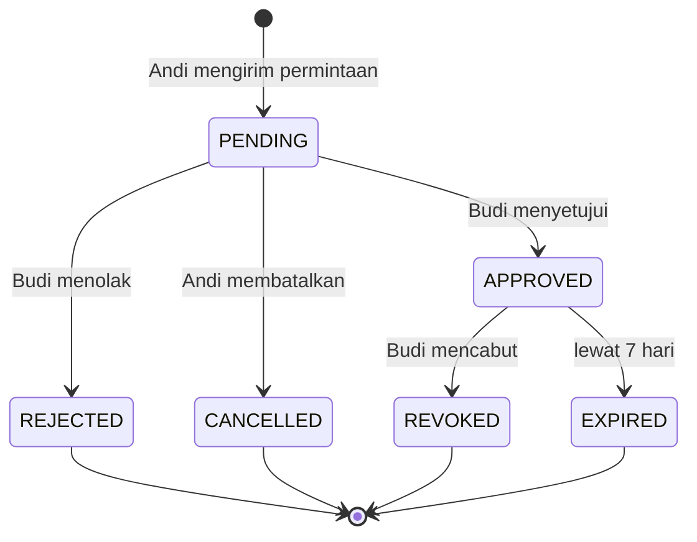
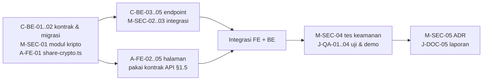

# Assignment 2 — Rencana Pengerjaan: Berbagi Dokumen dengan Kunci Terenkripsi

**Skenario:** rekening organisasi mahasiswa (lihat [ASSIGNMENT_2_SCENARIO_OPTIONS.md](ASSIGNMENT_2_SCENARIO_OPTIONS.md))  
**Basis kode:** VELTRIX BankKYC di `main` (backend `backend/kyc/`, frontend `frontend/src/`)  
**Prinsip:** menambah fitur di atas sistem yang ada; tidak mengganti enkripsi Assignment 1, tidak membuat proyek baru.

Dokumen ini menggantikan bagian alur di [ASSIGNMENT_2_KEY_MANAGEMENT.md](ASSIGNMENT_2_KEY_MANAGEMENT.md). Perbedaan utamanya: **private key tidak pernah dikirim ke server.**

---

## 0. Ringkasan alur final

1. Setiap pemohon membuat **pasangan kunci RSA** sekali di browser. Public key disimpan server; private key diunduh sebagai file `.pem` dan disimpan sendiri oleh user.
2. **Andi** (peminta) mengirim permintaan akses ke **Budi** (pemilik) dengan username Budi dan alasan permintaan.
3. **Budi** menyetujui dan memilih dokumen yang dibagikan dari salah satu pengajuannya.
4. Server membuat **kunci berbagi** (AES-256, acak, khusus untuk permintaan ini), lalu:
   - mengenkripsi salinan dokumen terpilih dengan kunci berbagi (AES-256-GCM);
   - mengenkripsi kunci berbagi dengan **public key Andi** (RSA-OAEP), menjadi *paket kunci*;
   - menyimpan kunci berbagi dalam keadaan **terbungkus KEK sistem**.
5. Budi menyalin paket kunci dan mengirimkannya ke Andi lewat email.
6. Andi menempel paket kunci dan memilih file private key-nya. **Browser** membuka kunci berbagi, lalu mengirim kunci itu ke server.
7. Server membuka salinan dokumen dengan kunci dari Andi. Kalau kuncinya salah, AES-GCM gagal dan akses ditolak.
8. Budi bisa **mencabut** akses kapan saja. Akses juga **kedaluwarsa** otomatis setelah 7 hari. Saat dicabut atau kedaluwarsa, salinan dokumen dan kunci berbaginya dihapus.

### Siapa memegang apa

| Rahasia | Disimpan di | Siapa bisa memakainya |
|---|---|---|
| Private key RSA Andi | File `.pem` di perangkat Andi | Hanya Andi, di browser |
| Public key RSA Andi | Database (tabel `user_public_keys`) | Server, untuk mengenkripsi paket kunci |
| Kunci berbagi (AES) | Database, **terbungkus KEK** | Server, untuk membuat ulang paket kunci atau menghapusnya |
| Paket kunci | Email | Hanya bisa dibuka dengan private key Andi |
| Salinan dokumen | Database, terenkripsi dengan kunci berbagi | Dibuka server **hanya** dengan kunci yang dikirim Andi |

### Kenapa server tidak memakai salinan kuncinya sendiri untuk membuka dokumen

Kalau server memakai kunci yang ia simpan, akun Andi yang dicuri sudah cukup untuk membuka dokumen Budi. Dengan aturan "harus pakai kunci dari paket kunci", penyerang butuh tiga hal sekaligus: akun Andi, email dari Budi, dan file private key Andi. Salinan kunci di server dipakai untuk dua hal saja: membuat ulang paket kunci bila Andi mengganti pasangan kuncinya, dan memastikan kunci bisa dihapus saat akses dicabut.

---

## 1. Desain teknis

### 1.1 Kriptografi

| Komponen | Pilihan | Catatan |
|---|---|---|
| Pasangan kunci user | RSA-OAEP 2048-bit, hash SHA-256 | Dibuat di browser dengan Web Crypto API (`crypto.subtle.generateKey`) |
| Format public key | SPKI PEM | Dikirim ke server; server memvalidasi ukuran kunci dan algoritmanya |
| Format private key | PKCS#8 PEM, diunduh sebagai `veltrix-private-key-<username>.pem` | Tidak pernah dikirim ke server |
| Sidik jari kunci | SHA-256 dari SPKI, ditampilkan 16 karakter hex pertama | Ditampilkan ke Andi dan Budi supaya bisa dicocokkan |
| Kunci berbagi | 32 byte acak dari `secrets.token_bytes` | Satu kunci per permintaan |
| Enkripsi salinan dokumen | AES-256-GCM, nonce 12 byte per item | AAD: `request_id`, `item_id`, `owner_id`, `requester_id`, `kind` |
| Pembungkus kunci berbagi | AES-256-GCM dengan KEK yang sudah ada (`VELTRIX_KEK_V1_BASE64`) | AAD: `purpose='share-key'`, `request_id`, `owner_id`, `requester_id` |

AAD mengikat salinan dokumen ke permintaan yang tepat. Salinan dari permintaan lain tidak bisa ditukar walaupun memakai kunci yang benar.

### 1.2 Format paket kunci

Satu baris teks supaya mudah disalin:

```
VELTRIX-SHARE-1.<base64url(JSON)>
```

Isi JSON:

```json
{
  "v": 1,
  "request_id": "a1b2…",
  "alg": "RSA-OAEP-256",
  "key_fp": "3f9c1a…",
  "ek": "<base64 kunci berbagi yang dienkripsi RSA-OAEP>"
}
```

- `key_fp` adalah sidik jari public key Andi yang dipakai. Kalau Andi sudah mengganti kuncinya, browser bisa memberi pesan yang jelas: "paket ini dibuat untuk kunci lama, minta Budi mengirim ulang".
- Isi dokumen **tidak** ada di paket.

### 1.3 Status permintaan



Saat masuk `REVOKED` atau `EXPIRED`, server menghapus salinan dokumen dan kunci berbagi yang terbungkus (*crypto-shredding*). Pengecekan kedaluwarsa dilakukan setiap kali permintaan diakses; tidak perlu job terjadwal.

### 1.4 Database — migrasi baru `0003_data_sharing.py`

Tidak mengubah tabel atau migrasi yang sudah ada.

**`user_public_keys`**

| Kolom | Tipe | Keterangan |
|---|---|---|
| `id` | String(36) PK | |
| `user_id` | FK `kyc_users.id` | |
| `public_key_pem` | Text | SPKI PEM |
| `fingerprint` | String(64) | SHA-256 hex |
| `created_at` | String(40) | |
| `revoked_at` | String(40), nullable | Terisi saat user membuat pasangan kunci baru |

Satu user hanya boleh punya satu kunci aktif (`revoked_at IS NULL`).

**`share_requests`**

| Kolom | Tipe | Keterangan |
|---|---|---|
| `id` | String(36) PK | |
| `requester_id`, `owner_id` | FK `kyc_users.id` | Harus berbeda; keduanya berperan `applicant` |
| `purpose` | String(200) | Contoh: "Pengajuan rekening HIMA Informatika" |
| `requested_items` | String(100) | Daftar kategori yang diminta, mis. `profile,identity,document` |
| `status` | String(16) | `PENDING`, `APPROVED`, `REJECTED`, `CANCELLED`, `REVOKED`, `EXPIRED` |
| `application_id` | FK `applications.id`, nullable | Pengajuan Budi yang dipilih saat menyetujui |
| `requester_key_id` | FK `user_public_keys.id`, nullable | Public key Andi yang dipakai |
| `wrapped_share_key`, `wrap_nonce`, `wrap_tag` | LargeBinary, nullable | Kunci berbagi terbungkus KEK; dikosongkan saat dicabut |
| `created_at`, `decided_at`, `expires_at` | String(40) | |

**`share_items`**

| Kolom | Tipe | Keterangan |
|---|---|---|
| `id` | String(36) PK | |
| `request_id` | FK `share_requests.id`, `ondelete=CASCADE` | |
| `kind` | String(16) | `profile`, `identity`, `document`, `video`, `kk` |
| `mime_type`, `display_name`, `original_bytes` | | Metadata untuk ditampilkan; nama file ikut dienkripsi bila dianggap sensitif |
| `nonce` | LargeBinary(12) | |
| `ciphertext` | Blob | Isi dokumen terenkripsi kunci berbagi, termasuk tag GCM |

### 1.5 API (prefix `/api/v1`, semua butuh login dan CSRF seperti endpoint lain)

| Method & path | Pemanggil | Fungsi |
|---|---|---|
| `GET /keys/me` | Pemohon | Lihat public key aktif dan sidik jarinya |
| `PUT /keys/me` | Pemohon | Daftarkan public key baru; kunci lama dinonaktifkan |
| `POST /share-requests` | Peminta | Body: `owner_username`, `purpose`, `items[]`. Ditolak bila peminta belum punya public key |
| `GET /share-requests?box=incoming` | Pemilik | Daftar permintaan masuk, termasuk sidik jari kunci peminta |
| `GET /share-requests?box=outgoing` | Peminta | Daftar permintaan keluar dan statusnya |
| `POST /share-requests/{id}/approve` | Pemilik | Body: `application_id`, `items[]`. Balikan: `package` (paket kunci) |
| `POST /share-requests/{id}/reject` | Pemilik | |
| `POST /share-requests/{id}/cancel` | Peminta | Hanya saat `PENDING` |
| `POST /share-requests/{id}/revoke` | Pemilik | Menghapus salinan dokumen dan kunci berbagi |
| `GET /share-requests/{id}/package` | Pemilik | Tampilkan ulang paket kunci; dienkripsi ulang bila peminta sudah ganti kunci |
| `GET /share-requests/{id}/items` | Peminta | Daftar item (metadata saja) setelah disetujui |
| `POST /share-requests/{id}/items/{item_id}/open` | Peminta | Body: `share_key` (base64). Balikan: isi dokumen dengan `Cache-Control: no-store` |

Aturan keamanan di server:

- Hanya akun `applicant` yang boleh meminta dan memberi akses.
- Hanya pemilik yang boleh `approve`, `reject`, `revoke`, dan `package`. Hanya peminta yang boleh `cancel`, `items`, dan `open`.
- `open` ditolak bila status bukan `APPROVED` atau sudah lewat `expires_at`.
- Semua kegagalan membuka dokumen memakai **pesan yang sama** ("Kunci tidak valid atau akses tidak tersedia"), supaya penyerang tidak tahu bagian mana yang salah.
- Batasi percobaan `open` dan pembuatan permintaan dengan `rate_limit` yang sudah ada.
- Catat ke `security_events`: `SHARE_REQUESTED`, `SHARE_APPROVED`, `SHARE_REJECTED`, `SHARE_CANCELLED`, `SHARE_REVOKED`, `SHARE_EXPIRED`, `SHARE_OPENED`, `SHARE_OPEN_FAILED`. Jangan pernah mencatat kunci, paket kunci, atau isi dokumen.

### 1.6 Frontend

Menu baru untuk pemohon: **"Berbagi dokumen"**.

| Halaman | Isi |
|---|---|
| `/keys` — **Kunci saya** | Tombol "Buat pasangan kunci". Setelah dibuat: unduh otomatis file private key, tampilkan sidik jari, dan peringatan "Simpan file ini. Tanpa file ini kamu tidak bisa membuka dokumen yang dibagikan kepadamu." Tombol "Ganti kunci" dengan konfirmasi. |
| `/sharing` tab **Minta akses** | Form: username pemilik, alasan, centang dokumen yang diminta (profil, KTP, formulir, video). Tombol dinonaktifkan bila belum punya kunci. |
| `/sharing` tab **Permintaan masuk** | Daftar permintaan beserta nama peminta, alasan, dan sidik jari kuncinya. Tombol Setujui membuka modal: pilih pengajuan, pilih dokumen, konfirmasi. Setelah disetujui, tampilkan paket kunci dengan tombol **Salin** dan **Kirim via Email** (`mailto:`). Tombol Cabut akses untuk yang sudah disetujui. |
| `/sharing` tab **Permintaan keluar** | Status permintaan. Untuk yang disetujui: tombol **Buka dokumen** → tempel paket kunci dan pilih file private key → daftar dokumen → pratinjau (gambar, PDF, video). |

Kode kriptografi browser dikumpulkan di satu file `frontend/src/lib/share-crypto.ts`:
- `generateKeyPair()` mengembalikan public key PEM, private key PEM, dan sidik jari;
- `parsePackage(text)` memvalidasi awalan dan isi JSON paket kunci;
- `unwrapShareKey(packageText, privateKeyPem)` mengembalikan kunci berbagi.

Aturan di frontend:
- File private key dibaca dengan `FileReader` dan langsung diimpor ke Web Crypto; isinya tidak disimpan di state global, `localStorage`, atau log.
- Kunci berbagi hanya disimpan di memori selama halaman terbuka.
- Mode mock tidak didukung untuk fitur ini; tampilkan keterangan "Fitur berbagi hanya tersedia di mode live".

---

## 2. Pembagian tugas

Pembagian tugas per anggota (ID tugas, Output, DoD, branch, dan contoh issue) ada di [ASSIGNMENT_2_TASK_DISTRIBUTION.md](ASSIGNMENT_2_TASK_DISTRIBUTION.md).

---

## 3. Pengujian

### 3.1 Tes otomatis backend (`pytest`)

| # | Kasus | Hasil yang diharapkan |
|---|---|---|
| T01 | Alur lengkap: daftar kunci → minta → setujui → buka paket dengan private key → `open` | Dokumen kembali identik byte demi byte (SHA-256 sama) |
| T02 | `open` dengan kunci berbagi acak | Ditolak dengan pesan generik |
| T03 | Paket kunci dibuka dengan private key orang lain | Gagal di tahap RSA (diuji di level fungsi) |
| T04 | Akun ketiga memanggil `open` dengan kunci yang benar | Ditolak: bukan peminta |
| T05 | Pemilik mencabut akses, lalu peminta memanggil `open` | Ditolak; baris `share_items` dan kunci terbungkus sudah terhapus |
| T06 | `expires_at` dimundurkan ke masa lalu | Status menjadi `EXPIRED`, `open` ditolak |
| T07 | Bukan pemilik memanggil `approve` atau `revoke` | Ditolak |
| T08 | Salinan dokumen dari permintaan lain ditukar ke permintaan ini | GCM gagal karena AAD berbeda |
| T09 | Ciphertext atau tag diubah 1 bit | GCM gagal, tidak ada plaintext keluar |
| T10 | Peminta mengganti kunci, pemilik memanggil `package` | Paket baru dibuat untuk kunci baru dan bisa dibuka |
| T11 | Database diperiksa setelah T01 | Tidak ada kunci berbagi mentah, nama, atau NIK dalam plaintext |
| T12 | Log dan `security_events` diperiksa | Tidak ada kunci, paket kunci, atau isi dokumen |
| T13 | Peminta tanpa public key membuat permintaan | Ditolak dengan pesan untuk membuat kunci dulu |
| T14 | Permintaan ke diri sendiri, ke reviewer, atau ke admin | Ditolak |

### 3.2 Skenario demo end-to-end

| # | Langkah | Bukti |
|---|---|---|
| E01 | Andi dan Budi masing-masing membuat pasangan kunci | Screenshot halaman Kunci saya dan file `.pem` |
| E02 | Budi sudah punya pengajuan berisi profil, KTP, dan formulir | Screenshot detail pengajuan |
| E03 | Andi meminta akses ke Budi untuk "Pengajuan rekening HIMA Informatika" | Screenshot tab Permintaan keluar (`PENDING`) |
| E04 | Budi mencocokkan sidik jari kunci Andi, lalu menyetujui | Screenshot modal Setujui |
| E05 | Budi mengirim paket ke Andi lewat email (tombol **Kirim via Email**) | Screenshot email di inbox Andi |
| E06 | Andi menempel paket, memilih private key, dan membuka KTP Budi | Screenshot pratinjau |
| E07 | Akun Citra (pihak ketiga) mencoba memakai paket yang sama | Screenshot penolakan |
| E08 | Budi mencabut akses; Andi mencoba membuka lagi | Screenshot penolakan |
| E09 | Isi tabel `share_requests` dan `share_items` di SQLite | Screenshot ciphertext |
| E10 | Restart server; permintaan dan statusnya tetap ada | Screenshot sebelum dan sesudah |

---

## 4. Urutan kerja



1. **Hari 1–2:** sepakati kontrak API (§1.5) dan format paket (§1.2). Setelah itu backend, kripto, dan frontend bisa jalan paralel.
2. **Hari 3–4:** endpoint dan halaman selesai; integrasi pertama dengan dua akun lokal.
3. **Hari 5:** tes keamanan, perbaikan bug, demo E01–E10.
4. **Hari 6–7:** ADR, laporan, screenshot, dan latihan presentasi.

**Syarat sebelum integrasi:** kontrak API dan format paket tidak boleh berubah tanpa memberi tahu semua anggota.

---

## 5. Definition of Done

- [x] Pemohon bisa membuat pasangan kunci; private key hanya ada di perangkat user.
- [x] Pemohon bisa meminta akses ke dokumen pemohon lain, dan pemilik bisa menyetujui, menolak, atau mencabut.
- [x] Persetujuan membuat kunci berbagi baru dan mengenkripsi salinan dokumen dengan kunci itu.
- [x] Paket kunci hanya bisa dibuka dengan private key peminta, dan dokumen hanya bisa dibuka dengan kunci dari paket itu.
- [x] Kunci berbagi tersimpan terbungkus KEK, dan dihapus saat dicabut atau kedaluwarsa.
- [x] Tes T01–T14 lolos; tes Assignment 1 tetap lolos.
- [x] Demo E01–E10 punya bukti screenshot.
- [ ] Fitur Assignment 1 (upload terenkripsi, reviewer, lab benchmark) tetap berfungsi.
- [x] ADR dan laporan menjelaskan desain, ancaman, dan batasannya.
- [ ] Setiap anggota punya commit atau PR atas pekerjaannya.

---

## 6. Batasan yang ditulis jujur di laporan

- Server dipercaya: server memegang kunci berbagi terbungkus KEK dan sempat melihat isi dokumen saat mengenkripsi ulang. Yang dilindungi asimetris adalah **kanal pengiriman kunci**, bukan server dari dirinya sendiri.
- Kalau file private key Andi hilang, Andi harus membuat kunci baru dan Budi mengirim ulang paket.
- Pencocokan sidik jari kunci bergantung pada user yang benar-benar mengeceknya.
- Pengiriman lewat email adalah analogi *out-of-band delivery*. Email sengaja dipilih karena tidak terenkripsi end-to-end, sehingga keamanan paket hanya bergantung pada RSA-OAEP, bukan pada jalurnya; bank sungguhan memakai HSM/KMS dan sertifikat.
- Semua data adalah data sintetis.
