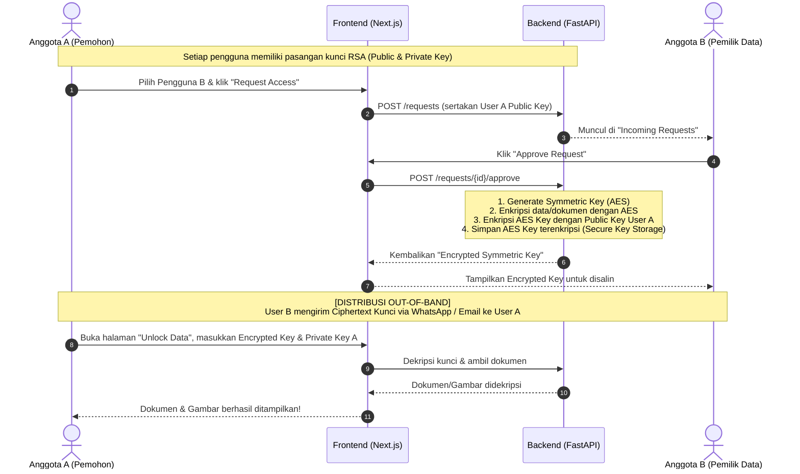
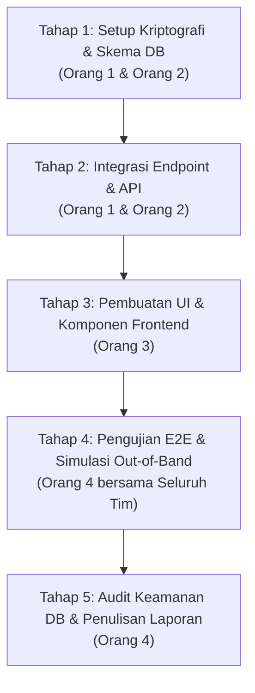

# Panduan Tugas: Assignment 2 - Key Management

> **Catatan:** skenario dan alur final ada di [ASSIGNMENT_2_SCENARIO_OPTIONS.md](ASSIGNMENT_2_SCENARIO_OPTIONS.md) dan [ASSIGNMENT_2_IMPLEMENTATION_PLAN.md](ASSIGNMENT_2_IMPLEMENTATION_PLAN.md). Perbedaan utama: private key **tidak** dikirim ke server; browser yang membuka kunci simetris. Dokumen ini tetap berguna sebagai penjelasan konsep.
**Mata Kuliah:** Keamanan Informasi  
**Topik:** Manajemen Kunci, Enkripsi Hibrida (*Hybrid Encryption*), dan Berbagi Data Aman (*Secure Data Sharing*)

---

## 1. Ringkasan & Konsep Tugas

Pada tugas lanjutan ini, sistem aplikasi web (VELTRIX BankKYC) yang sebelumnya sudah bisa mengenkripsi dokumen/gambar pribadi pengguna dikembangkan lebih lanjut agar mendukung **fitur berbagi data privat antar-pengguna secara aman**.

### Latar Belakang Masalah
Jika Pengguna B ingin membagikan file rahasia ke Pengguna A:
1. File dienkripsi dengan **kunci simetris** (misalnya AES-256) karena enkripsi simetris sangat cepat dan efisien untuk data besar seperti file dokumen dan gambar.
2. Masalah klasik kriptografi simetris adalah: **Bagaimana cara mengirimkan kunci simetris tersebut ke Pengguna A secara aman?**
3. Jika kunci simetris dikirim mentah-mentah lewat WA atau email (kanal publik / tidak aman), pihak ketiga bisa menyadapnya (*man-in-the-middle attack*).
4. **Solusinya (Enkripsi Asimetris):** Kunci simetris tersebut dibungkus/dienkripsi terlebih dahulu menggunakan **Public Key milik Pengguna A**. Hasil enkripsinya (*Encrypted Symmetric Key*) aman untuk dikirimkan melalui jalur publik (WA/email). Hanya Pengguna A yang bisa membukanya menggunakan **Private Key milik Pengguna A**.

---

## 2. Bedah 4 Poin Kebutuhan Tugas

| No | Poin di Slide | Maksud & Kebutuhan Teknis |
|---|---|---|
| **1** | *A user can request to see the private data of other users (including images and documents)* | Pengguna A (pemohon) dapat memilih profil/dokumen Pengguna B lalu menekan tombol **"Request Access"**. Permintaan ini akan masuk ke daftar permohonan Pengguna B. |
| **2** | *The requested user generates a symmetric key to share the data to the requesting user* | Saat Pengguna B menyetujui (*Approve*) permintaan, sistem/Pengguna B men-generate sebuah **Symmetric Key baru** (misal AES key) khusus untuk sesi berbagi dokumen tersebut. Dokumen dienkripsi dengan kunci ini. |
| **3** | *The symmetric key will be distributed to the requesting user by other means (e.g., email, WA, etc), but it needs to be encrypted by using asymmetric encryption* | Kunci simetris dienkripsi menggunakan **Public Key Pengguna A (RSA)**. Hasil enkripsi (ciphertext kunci) ditampilkan agar Pengguna B dapat menyalinnya (*copy*) dan mengirimkannya ke Pengguna A via WhatsApp/Email. Pengguna A memasukkan ciphertext tersebut dan men-decrypt-nya dengan **Private Key miliknya** di aplikasi untuk membuka dokumen. |
| **4** | *The symmetric keys must be stored securely in the system* | Kunci-kunci simetris yang tersimpan pada database/sistem tidak boleh berbentuk *plaintext* (teks terbuka), melainkan harus terenkripsi dengan aman (misal: *Key Wrapping* atau dienkripsi dengan Master Key sistem). |

---

## 3. Diagram Alur Sistem (Workflow)



---

## 4. Pembagian Tugas untuk 4 Orang

Pembagian tugas ini dirancang seimbang dan terisolasi dengan batas tanggung jawab (*clear interfaces*) yang jelas agar masing-masing anggota dapat bekerja secara paralel.

```
┌────────────────────────────────────────────────────────┐
│               PEMBAGIAN TUGAS KELOMPOK (4 ORANG)       │
├────────────────────┬───────────────────────────────────┤
│ Orang 1: Backend   │ Logika Kriptografi, RSA/AES,      │
│ Crypto Specialist  │ Key Wrapping & Secure Storage     │
├────────────────────┼───────────────────────────────────┤
│ Orang 2: Backend   │ Database Schema, REST API,        │
│ API & Auth         │ Workflow Request/Approve Access   │
├────────────────────┼───────────────────────────────────┤
│ Orang 3: Frontend  │ UI Request, Approve, Copy Token,  │
│ UI/UX Developer    │ Form Input Kunci & Viewer Dokumen │
├────────────────────┼───────────────────────────────────┤
│ Orang 4: QA &      │ Skenario Uji End-to-End, Audit    │
│ Technical Writer   │ Keamanan DB, Laporan Praktikum    │
└────────────────────┴───────────────────────────────────┘
```

---

### 👤 Orang 1: Backend Cryptography & Key Management Specialist
**Fokus:** Logika kriptografi murni di backend (Python `cryptography`).

* **Tanggung Jawab Utama:**
  1. **Asymmetric Key Pair Management:**
     - Membuat fungsi utilitas untuk *generate* pasangan kunci RSA (2048-bit / 4096-bit): `generate_rsa_keypair()`.
     - Fungsi ekspor/impor Public Key (PEM format) dan Private Key.
  2. **Hybrid Key Wrapping (Enkripsi/Dekripsi Kunci):**
     - Fungsi untuk men-generate kunci simetris baru (AES-GCM / Fernet).
     - Fungsi mengenkripsi kunci simetris menggunakan Public Key RSA pemohon (*Encrypt Key*).
     - Fungsi mendekripsi kunci simetris menggunakan Private Key RSA pemohon (*Decrypt Key*).
  3. **Secure Key Storage:**
     - Memastikan kunci simetris yang disimpan di database sistem tidak *plaintext* (dienkripsi menggunakan *System Master Key* / *Envelope Encryption*).

---

### 👤 Orang 2: Backend API & Database Architect
**Fokus:** Skema data, endpoint FastAPI, dan kontrol hak akses (*access control*).

* **Tanggung Jawab Utama:**
  1. **Skema Database (SQLAlchemy & Migrations):**
     - Tabel `user_keys`: Menyimpan Public Key user (dan opsi penyimpanan terenkripsi jika ada).
     - Tabel `data_access_requests`:
       - `id`, `requester_id`, `owner_id`, `target_document_id`
       - `status` (`PENDING`, `APPROVED`, `REJECTED`, `EXPIRED`)
       - `encrypted_symmetric_key` (string ciphertext)
       - `created_at`, `expires_at`
  2. **Endpoint REST API:**
     - `POST /api/v1/data-share/request`: Mengajukan permohonan akses.
     - `GET /api/v1/data-share/incoming`: Mengambil daftar permohonan yang masuk untuk pemilik data.
     - `GET /api/v1/data-share/outgoing`: Mengambil status permohonan yang diajukan pemohon.
     - `POST /api/v1/data-share/{request_id}/approve`: Menyetujui akses (memanggil modul Orang 1 untuk enkripsi kunci).
     - `POST /api/v1/data-share/{request_id}/view`: Mengambil data terenkripsi untuk dibuka pemohon.
  3. **Autorisasi & Validasi:**
     - Memastikan hanya pemilik data sah yang bisa *approve/reject*.

---

### 👤 Orang 3: Frontend & UI/UX Developer
**Fokus:** Antarmuka pengguna di Next.js (React + Tailwind CSS).

* **Tanggung Jawab Utama:**
  1. **UI Permintaan Akses (*Request Data*):**
     - Menambahkan daftar pengguna/dokumen lain dengan tombol **"Request Access"**.
     - Dialog konfirmasi saat mengajukan permintaan.
  2. **UI Manajemen Permintaan (*Incoming & Outgoing*):**
     - **Tab Incoming (Pemilik Data):** Menampilkan daftar siapa yang minta akses, tombol **"Approve"** dan **"Reject"**.
     - **Modal "Share Key":** Setelah klik Approve, muncul pop-up berisi *Encrypted Key* dengan tombol **"Copy to Clipboard"** dan petunjuk: *"Kirimkan teks ini ke pemohon melalui WhatsApp/Email"*.
     - **Tab Outgoing (Pemohon):** Menampilkan status permintaan (Pending / Approved).
  3. **UI Buka Data (*Unlock & Document Viewer*):**
     - Halaman/Modal input di mana pemohon menempelkan (*paste*) *Encrypted Key* dari WA/Email dan *Private Key* miliknya.
     - Penampil (*viewer*) gambar dan dokumen yang berhasil didekripsi.

---

### 👤 Orang 4: Security QA, Out-of-Band Flow Tester & Technical Writer
**Fokus:** Pengujian alur pengiriman out-of-band, verifikasi keamanan database, dan penulisan laporan akhir.

* **Tanggung Jawab Utama:**
  1. **End-to-End Simulation & QA:**
     - Menguji skenario nyata:
       - User A request -> User B approve -> Copy encrypted key ke chat WA/Email simulasi -> User A paste -> data terbuka.
     - Menguji kasus negatif (*negative testing*):
       - Mencoba mendekripsi dengan Private Key yang salah (harus gagal/ditolak).
       - Memeriksa apakah pihak ketiga yang menyadap *Encrypted Key* di WA bisa membuka data tanpa Private Key User A (verifikasi sifat enkripsi asimetris).
  2. **Verifikasi Penyimpanan Kunci (*Security Audit*):**
     - Membuka file database SQLite (`bankkyc.db`) untuk membuktikan ke dosen/asisten bahwa tidak ada kunci simetris yang tersimpan dalam format *plaintext*.
  3. **Penyusunan Laporan Praktikum (Paper / Markdown):**
     - Menuliskan teori enkripsi hibrida dan manajemen kunci.
     - Menyertakan tangkapan layar (*screenshots*) implementasi di aplikasi web.
     - Menjelaskan hasil uji coba keamanan dan analisis risiko distribusi out-of-band.

---

## 5. Rencana Kerja Bertahap (Sprint Timeline)



Dengan pembagian tugas ini, setiap anggota memiliki porsi kontribusi yang jelas dan seimbang saat dinilai oleh dosen/asisten praktikum.
