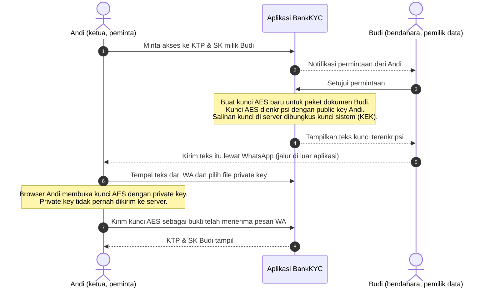

# Assignment 2 — Usulan Skenario Key Management

**Proyek:** VELTRIX BankKYC (simulasi pembukaan rekening dengan dokumen KYC terenkripsi)  
**Status:** skenario disepakati tim (Opsi A: rekening organisasi mahasiswa); menunggu konfirmasi asisten dosen  
**Rencana pengerjaan:** [ASSIGNMENT_2_IMPLEMENTATION_PLAN.md](ASSIGNMENT_2_IMPLEMENTATION_PLAN.md)

---

## Ringkasan

Kami mengusulkan skenario **pembukaan rekening organisasi mahasiswa** (misalnya HIMA). Ketua dan bendahara sama-sama harus menyerahkan dokumen ke bank. Sebelum pengajuan dikirim, ketua perlu mengecek dokumen bendahara, dan **bendahara harus memberi izin dulu**. Izin itu berupa kunci simetris yang dikirim lewat WA dalam bentuk terenkripsi dengan kriptografi asimetris.

Skenario ini memenuhi keempat poin tugas, dekat dengan kehidupan mahasiswa, dan cukup memakai akun pemohon yang sudah ada di aplikasi.

---

## 1. Kebutuhan tugas

1. User dapat **meminta** melihat data privat user lain, termasuk gambar dan dokumen.
2. User yang diminta **membuat kunci simetris** untuk membagikan data tersebut.
3. Kunci simetris dikirim lewat **jalur lain** (email, WA, dll.), tetapi **dienkripsi dengan kriptografi asimetris**.
4. Kunci simetris **disimpan dengan aman** di sistem.

Artinya, akses harus berbentuk **permintaan → persetujuan pemilik data**, bukan akses otomatis karena jabatan.

---

## 2. Skenario yang diusulkan: rekening organisasi mahasiswa

### Latar belakang

HIMA Informatika ingin punya rekening sendiri untuk dana kegiatan, sponsor, dan iuran, supaya uang organisasi tidak bercampur dengan rekening pribadi pengurus. Untuk membukanya, bank meminta dokumen **setiap pengurus yang berwenang menandatangani**: biasanya KTP ketua dan bendahara, ditambah SK kepengurusan dari kampus. Syarat persisnya berbeda-beda tiap bank.

Rekeningnya atas nama organisasi, bukan atas nama pribadi. Ketua dan bendahara adalah penandatangan yang ditunjuk. Karena dokumen semua penandatangan diajukan bersama, data mereka harus konsisten: nama dan NIK di KTP harus sama dengan yang tercantum di SK.

### Tokoh

| Tokoh | Peran | Data privat yang dimiliki |
|---|---|---|
| **Andi** | Ketua HIMA, menyiapkan pengajuan rekening | KTP, SK kepengurusan |
| **Budi** | Bendahara HIMA, penandatangan kedua | KTP, SK kepengurusan |

Keduanya memakai akun **pemohon** biasa di aplikasi. Dokumen masing-masing sudah tersimpan terenkripsi sejak Assignment 1.

### Alur

Akun Andi saja tidak cukup untuk membuka dokumen. Andi juga harus memiliki pesan WA dari Budi dan private key miliknya, jadi akses butuh dua hal: login dan pesan dari pemilik data.

### Kalau pengurusnya lebih dari dua

Pola yang sama berlaku untuk rekening perusahaan, yang pengurusnya bisa banyak (direksi, komisaris, pemilik manfaat). Satu orang koordinator mengirim **permintaan terpisah ke tiap pengurus**. Setiap pengurus menyetujui sendiri, membuat kuncinya sendiri, dan bisa mencabut aksesnya sendiri tanpa memengaruhi yang lain. Karena itu sistem tidak memerlukan satu "kunci grup"; cukup satu kunci per permintaan. Untuk demo, 2–3 orang sudah cukup.

### Pemetaan ke poin tugas

| Poin tugas | Di skenario ini |
|---|---|
| 1. User meminta data privat user lain | Andi meminta melihat KTP dan SK Budi |
| 2. Pemilik membuat kunci simetris | Saat Budi menyetujui, dibuat kunci AES-256 khusus untuk permintaan ini |
| 3. Kunci dikirim lewat jalur lain, terenkripsi asimetris | Kunci AES dienkripsi dengan public key Andi (RSA-OAEP), lalu dikirim Budi lewat WA |
| 4. Kunci disimpan aman | Salinan kunci di database dibungkus kunci sistem (*envelope encryption*), tidak pernah tersimpan mentah |

### Kenapa aman walaupun lewat WA

| Kejadian | Akibat |
|---|---|
| Chat WA disadap atau diteruskan ke orang lain | Teks itu hanya kunci terenkripsi; tanpa private key Andi tidak bisa dibuka. Server juga tetap memeriksa bahwa yang membuka adalah akun Andi. |
| Database bocor | Kunci AES tersimpan terbungkus kunci sistem, dan dokumennya terenkripsi. |
| Budi berubah pikiran | Budi bisa mencabut akses; server menolak permintaan yang sudah dicabut atau kedaluwarsa. |
| Public key Andi ditukar penyerang | Public key diambil dari server setelah login, bukan dari chat. Bisa ditambah tampilan *fingerprint* untuk dicocokkan Andi dan Budi. |

---

## 3. Bagaimana di dunia nyata (Indonesia)

Supaya jelas mana yang nyata dan mana yang penyederhanaan untuk tugas:

- **Dokumen KYC disimpan bank yang mengumpulkannya.** Bank tidak memiliki data kependudukan; bank hanya mendapat hak verifikasi ke Dukcapil lewat perjanjian kerja sama. Jawaban Dukcapil hanya "SESUAI" atau "TIDAK SESUAI" per elemen data, bukan datanya.
- **Pemeriksaan pengurus dan pemilik manfaat itu nyata.** POJK 8/2023 tentang APU-PPT mewajibkan bank menerapkan *customer due diligence* (CDD), termasuk terhadap pemilik manfaat (*beneficial owner*) nasabah.
- **Berbagi data perlu dasar yang sah.** UU No. 27/2022 tentang Pelindungan Data Pribadi menjadikan persetujuan pemilik data sebagai salah satu dasar pemrosesan. Karena itu, skenario "pemilik data menyetujui dulu" masuk akal.
- **Yang disederhanakan:** bank sungguhan tidak mengirim kunci lewat WA; kunci dikelola dengan HSM/KMS dan sertifikat. Jalur WA di tugas ini setara dengan pengiriman rahasia lewat jalur terpisah (*out-of-band*), seperti PIN mailer atau kode aktivasi via SMS. Aplikasi kita juga tidak terhubung ke Dukcapil atau bank sungguhan; semuanya simulasi dengan data dummy.

---

## 4. Opsi lain yang sudah kami pertimbangkan

| Opsi | Cerita singkat | Kenapa tidak dipilih |
|---|---|---|
| **Rekening bersama perorangan** (mis. suami-istri, "A dan/atau B") | Dua orang membuka satu rekening atas nama keduanya | Valid dan polanya sama. Kurang dekat dengan konteks mahasiswa, tapi bisa jadi cadangan. |
| **Rekening perusahaan** | Koordinator mengumpulkan dokumen direksi, komisaris, dan pemilik manfaat | Pola yang sama dengan skenario utama, hanya jumlah pengurusnya lebih banyak. Dipakai sebagai penjelasan bahwa desain berlaku untuk lebih dari dua orang. |
| **Tabungan anak / pelajar** | Anak mengurus tabungan pelajar dan perlu KTP serta KK orang tua | Bisa, asal yang menyetujui adalah orang tua: UU PDP mewajibkan persetujuan orang tua/wali untuk data anak. Tidak dipilih karena perlu jenis dokumen baru (akta lahir, KIA) dan aturan usia. |
| **Berbagi KYC ke lembaga mitra** (asuransi, multifinance, bank lain) | Petugas lembaga mitra meminta data KYC nasabah; nasabah menyetujui | Paling mirip praktik industri, tapi perlu role baru. Di Indonesia, standar berbagi data atas persetujuan nasabah (SNAP BI) baru mengatur pembayaran, belum dokumen KYC. |
| **Reviewer minta izin ke pemohon** | Reviewer bank meminta akses ke dokumen pemohon | Tidak realistis: di bank, reviewer mengakses data berdasarkan tugas, bukan izin per dokumen. Juga bertentangan dengan revisi Assignment 1 yang meminta reviewer bisa langsung memeriksa isi dokumen. |
| **Auditor atau aparat penegak hukum** | Pihak berwenang meminta data nasabah | Akses mereka berdasarkan kewenangan hukum, bukan persetujuan pemilik, sehingga tidak sesuai poin 2 tugas. |
| **Kantong bersama** (seperti di aplikasi Jago) | Beberapa nasabah mengelola dana bersama | Yang dibagi saldo dan transaksi, bukan dokumen. Aplikasi kita juga belum punya fitur saldo. |

---

## 5. Keputusan teknis

| Hal | Usulan | Alasan |
|---|---|---|
| Kunci simetris | AES-256-GCM | Sama dengan Assignment 1: menjaga kerahasiaan sekaligus mendeteksi perubahan data |
| Kunci asimetris | RSA-OAEP 2048-bit (SHA-256) | Didukung browser (Web Crypto API) dan Python; tidak memakai PKCS#1 v1.5 yang lemah |
| Tempat private key | **Hanya di perangkat user** (dibuat di browser, disimpan/diunduh user) | Kalau server pernah memegang private key, server bisa membuka semua data dan enkripsi asimetris kehilangan makna |
| Isi pesan WA | Satu teks Base64: kunci AES terenkripsi + ID permintaan | Dokumennya tidak ikut dikirim; tetap diambil dari server setelah login |
| Membuka dokumen | Browser membuka kunci AES dengan private key, lalu mengirim kunci AES ke server | Server hanya mau membuka dokumen dengan kunci dari pesan WA, bukan dengan salinan yang ia simpan. Ini membuktikan peminta benar-benar menerima pesan dari pemilik. |
| Penyimpanan kunci di server | Dibungkus kunci sistem (*envelope encryption*) yang sudah dipakai di Assignment 1 | Database hanya berisi ciphertext |
| Masa berlaku | Ada batas waktu, dan pemilik bisa mencabut akses | Akses tidak berlaku selamanya |
| Jejak audit | Catat siapa meminta, kapan disetujui, kapan dibuka | Bisa ditunjukkan saat demo |

---

## 6. Yang masih perlu disepakati

Usulan default tim sudah ada di rencana pengerjaan; yang masih perlu dikonfirmasi:

1. Apakah asdos setuju dengan skenario rekening organisasi mahasiswa?
2. Cakupan satu permintaan: **satu paket** (pemilik memilih dokumen mana saja yang dibagikan). Apakah ini cukup?
3. Masa berlaku akses: **7 hari**, dan pemilik bisa mencabut lebih awal. Apakah perlu lebih pendek?
4. Private key **diunduh sebagai file .pem** tanpa password. Apakah perlu dilindungi password?

---

## Sumber

- [OJK — POJK 8/2023 tentang Penerapan Program APU-PPT](https://ojk.go.id/apu-ppt/id/peraturan/pojk/Pages/POJK-8-2023-.aspx)
- [UU No. 27 Tahun 2022 tentang Pelindungan Data Pribadi](https://peraturan.bpk.go.id/Details/229798/uu-no-27-tahun-2022)
- [CNN Indonesia — Kemendagri: lembaga hanya diberi akses verifikasi, bukan data](https://www.cnnindonesia.com/nasional/20200611131940-20-512199/kemendagri-bantah-beri-data-penduduk-ke-swasta-cuma-akses)
- [JPNN — Dirjen Dukcapil: mitra kerja sama hanya diberi akses verifikasi data](https://m.jpnn.com/news/dirjen-dukcapil-mitra-kerja-sama-hanya-diberi-akses-verifikasi-data)
- [Jambura Law Review — Standar Open API Pembayaran (SNAP) dan persetujuan nasabah](https://ejurnal.ung.ac.id/index.php/jalrev/article/download/15377/4861)
- [Liputan6 — Fitur Kantong Bersama Bank Jago](https://www.liputan6.com/bisnis/read/5057361/ibu-ibu-arisan-tak-perlu-pusing-atur-keuangan-bank-jago-beri-solusi)
