# Assignment 2 — Hasil Verifikasi End-to-End (Key Management & Berbagi Data)

**Tanggal uji:** 26 November 2026
**Skenario:** rekening organisasi HIMA ([skenario](ASSIGNMENT_2_SCENARIO_OPTIONS.md)). Andi (ketua, `andi_demo`) meminta dokumen Budi (bendahara, `demo_user`); Citra (`citra_demo`) berperan sebagai pihak ketiga.
**Rencana uji:** §3 di [rencana pengerjaan](ASSIGNMENT_2_IMPLEMENTATION_PLAN.md#3-pengujian)

Semua screenshot berasal dari **satu alur yang berkesinambungan**, sehingga ID permintaan, paket kunci, dan isi database di setiap gambar saling cocok.

## Lingkungan uji

| Komponen | Keterangan |
|---|---|
| Aplikasi | Commit `cb653e2` (`main`): backend FastAPI dan frontend Next.js dalam mode live |
| Database | SQLite baru yang terpisah dari database lokal tim, dengan KEK dan secret yang dibuat khusus untuk uji ini |
| Browser | Microsoft Edge, digerakkan Playwright (`frontend/node_modules/playwright`), viewport 1280 × 900 |
| Data | Sintetis: KTP `ktp_0001_clear.png` dan formulir `bank_account_form_digital.pdf` dari `backend/fixtures/synthetic_kyc/`, NIK `DUMMY-…` |
| Email | MailDev 2.2.1 lokal (SMTP `127.0.0.1:1025`); alamat `@veltrix.test`, bukan akun email sungguhan |

Akun dan pengajuan Budi (profil, KTP, formulir) disiapkan lewat API. Semua langkah berbagi data dijalankan lewat antarmuka: membuat kunci, meminta, menyetujui, membuka paket, dan mencabut akses. Pengecualiannya E07 dan E09, yang dijelaskan di bawah.

## Ringkasan hasil

| # | Skenario | Hasil | Yang diamati | Bukti |
|---|---|---|---|---|
| **E01** | Membuat pasangan kunci | PASSED | Andi menekan **Buat kunci**. File `veltrix-private-key-andi_demo.pem` terunduh, public key terdaftar dengan fingerprint `3e5a91292bd43086`. Private key tidak dikirim ke server. | [01](screenshots/01-andi-key.png) |
| **E02** | Pengajuan Budi lengkap | PASSED | `VTX-2026-59E1606A40A68302` berisi profil, KTP dummy, dan formulir rekening (3/4 kategori; video tidak dibutuhkan untuk demo ini) | [09](screenshots/09-budi-application.png) |
| **E03** | Andi meminta akses | PASSED | Permintaan "Pengajuan rekening HIMA Informatika: cek data bendahara" untuk profil, KTP, dan formulir berstatus **Menunggu** | [02](screenshots/02-andi-requested.png) |
| **E04** | Budi mencocokkan fingerprint lalu menyetujui | PASSED | Modal Setujui menampilkan fingerprint kunci Andi. Setelah disetujui, muncul paket `VELTRIX-SHARE-1.…` (RSA-OAEP-256). | [03](screenshots/03-budi-approve-modal.png), [04](screenshots/04-budi-package.png) |
| **E05** | Paket dikirim lewat email | PASSED | Email "VELTRIX Encrypted Share Key Package" dari Budi tiba di inbox Andi dengan paket utuh | [15](screenshots/15-andi-email-package.png) |
| **E06** | Andi membuka dokumen | PASSED | Private key orang lain ditolak di browser ("Gagal mendekripsi kunci simetris"). Dengan private key Andi, profil dan KTP Budi terbuka di memori. | [05](screenshots/05-andi-wrong-key.png), [06](screenshots/06-andi-open-item1.png), [07](screenshots/07-andi-open-item2.png) |
| **E07** | Citra memakai paket yang sama | PASSED | Halaman Citra tidak punya permintaan. Dengan kunci AES yang **benar** dari paket, `POST …/open` dari sesi Citra ditolak **HTTP 403 `SHARE_OPEN_DENIED`**. | [10](screenshots/10-citra-no-access.png), [11](screenshots/11-citra-denied.png) |
| **E08** | Budi mencabut akses | PASSED | Setelah Budi menekan **Cabut akses**, permintaan Andi berstatus **Akses dicabut** dan tombol Buka dokumen hilang | [08](screenshots/08-andi-revoked.png) |
| **E09** | Isi tabel di SQLite | PASSED | `share_requests` dan `share_items` hanya berisi ciphertext, nonce, dan tag. Nama, NIK, email, header PNG/PDF, dan kunci berbagi mentah tidak ditemukan di file database. | [12](screenshots/12-db-ciphertext.png) |
| **E10** | Restart server | PASSED | Backend dimatikan lalu dinyalakan lagi; permintaan tetap **Aktif** dengan data yang sama | [13](screenshots/13-before-restart.png), [14](screenshots/14-after-restart.png) |

### Catatan cara uji

- **E01:** hanya Andi yang perlu kunci, karena Andi yang meminta. Budi sebagai pemilik data tidak membutuhkan kunci untuk menyetujui. Itu sebabnya panel kunci di screenshot Budi berstatus "Belum ada kunci".
- **E07 dan E09 bukan tampilan aplikasi.** Aplikasi memang tidak menyediakan tombol bagi Citra untuk membuka paket milik orang lain. E07 adalah respons asli dari `fetch` yang dijalankan di sesi browser Citra yang sedang login. E09 adalah hasil query ke file SQLite uji, ditampilkan sebagai halaman teks.
- **E08:** penolakan `open` setelah dicabut diuji otomatis (T05, `test_profile_share_open_rotate_revoke_and_scope`). Screenshot menunjukkan status dari sisi Andi.
- **E05:** tampilan email diberi pembungkus baris agar paket yang panjang terlihat utuh. Isi email tidak diubah.

## Tes otomatis

```powershell
cd backend
.venv\Scripts\python.exe -m pytest -q
```

| Rangkaian | Hasil (26 November 2026) |
|---|---|
| `tests/test_sharing_api.py` + `tests/test_assignment2_security.py` | **11 passed** |
| Seluruh tes backend (Assignment 1 + 2) | **114 passed**, 1 warning dari library OCR (Paddle, `ccache`), 8 menit 49 detik |

Rincian kasus keamanan (penyadap, tampering paket, penukaran item antar-permintaan, rotasi kunci) ada di [laporan keamanan Assignment 2](../verification/ASSIGNMENT_2_SECURITY_REPORT.md). Verifikasi E01–E10 lewat API dan audit penyimpanan oleh Jorell (J-QA-02, J-QA-03, 24 November 2026) ada di [VERIFICATION_API_AUDIT.md](VERIFICATION_API_AUDIT.md).

## Galeri bukti

### E01 — Andi membuat kunci RSA-2048

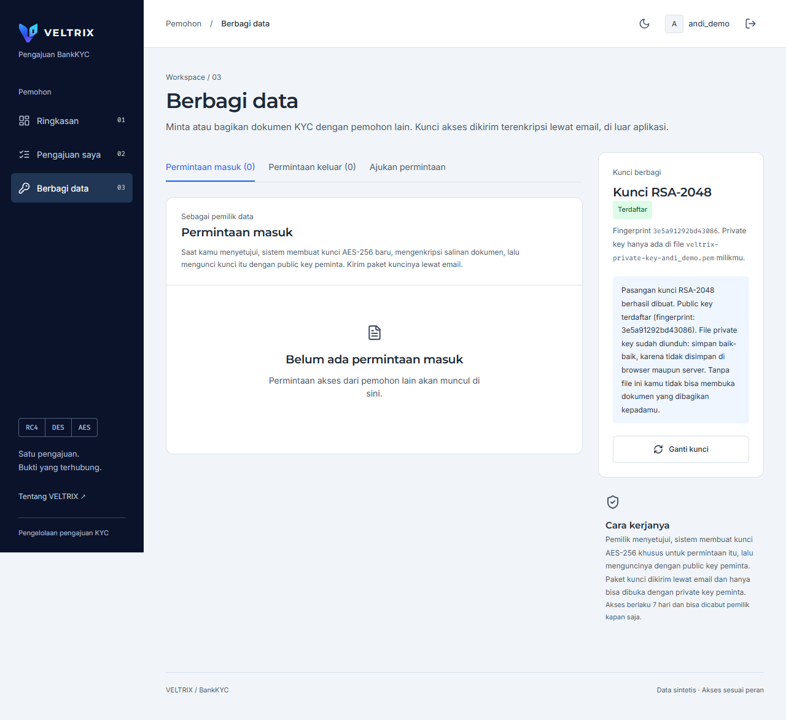

### E02 — Pengajuan Budi

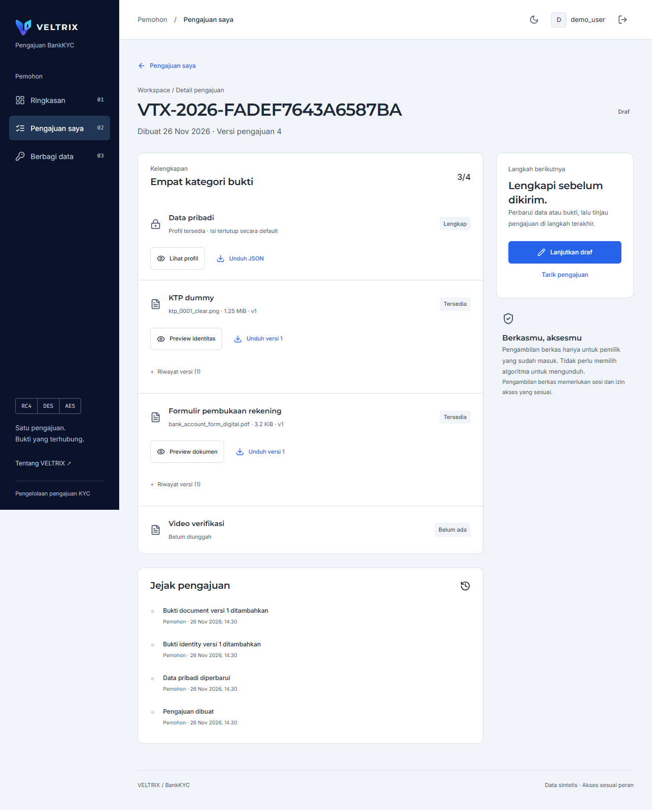

### E03 — Andi meminta akses

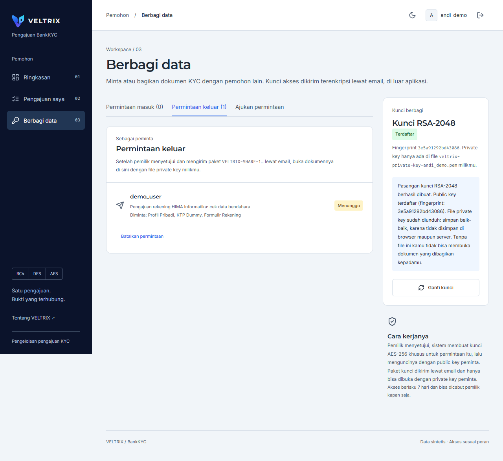

### E04 — Budi menyetujui dan mendapat paket kunci

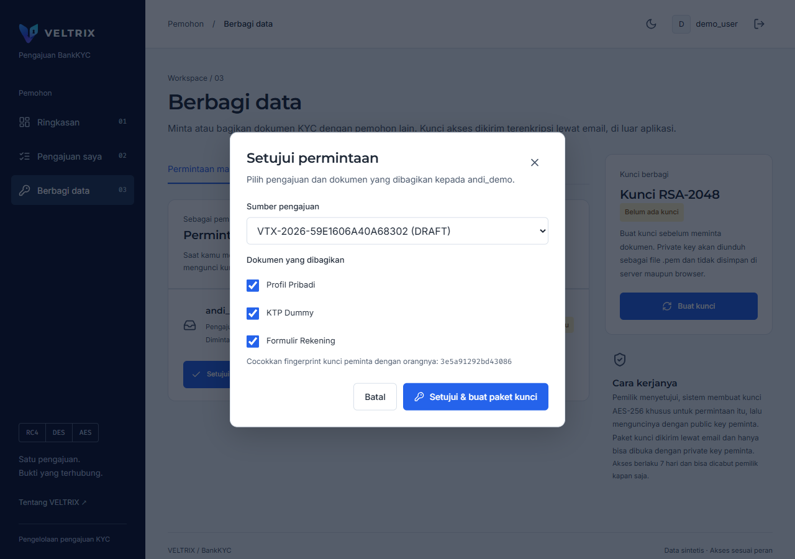

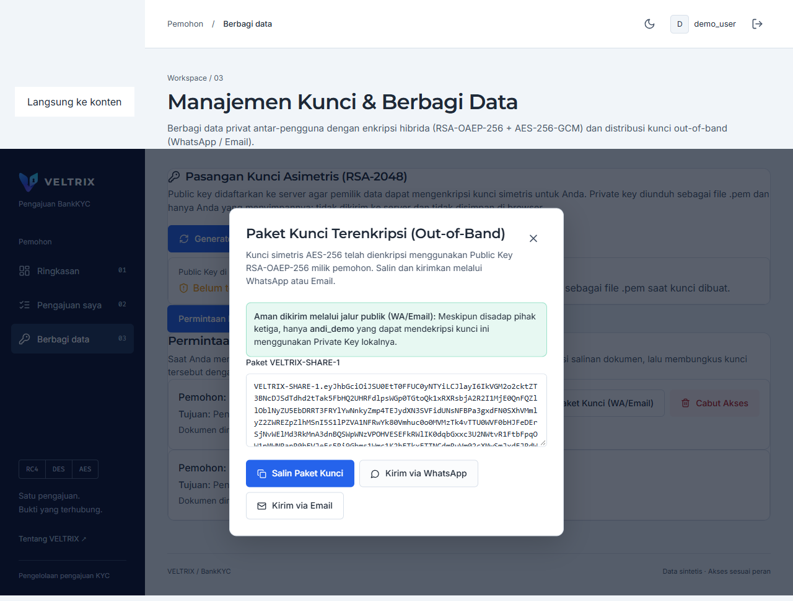

### E05 — Paket diterima Andi lewat email

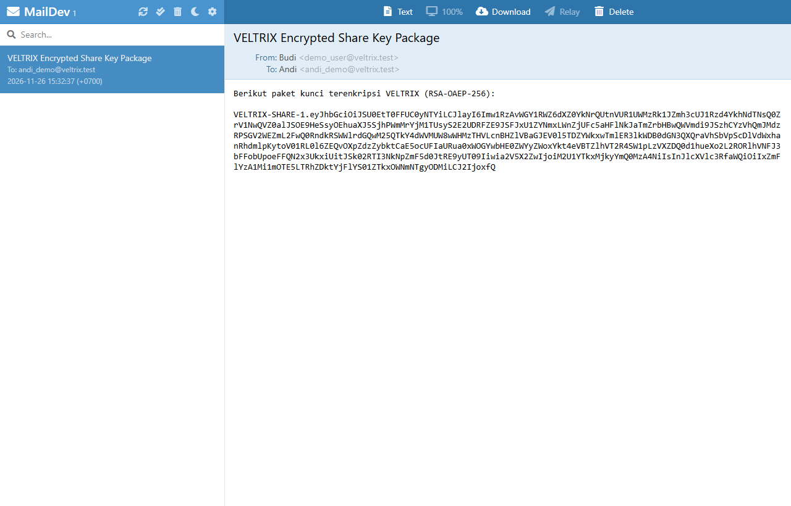

### E06 — Andi membuka dokumen

Private key yang salah ditolak:

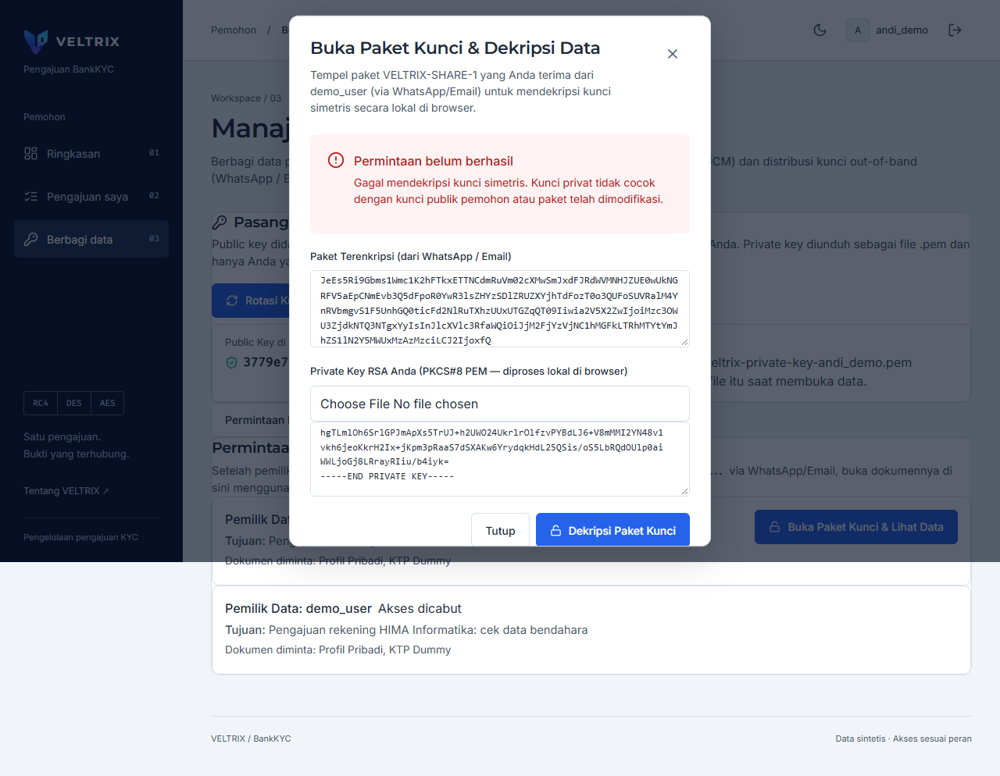

Dengan private key Andi, profil dan KTP Budi terbuka:

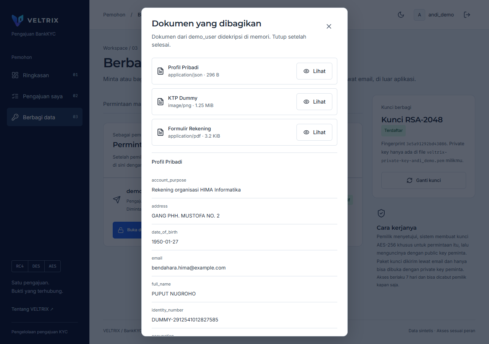

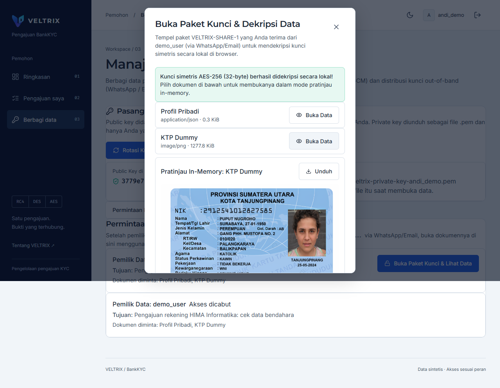

### E07 — Citra tidak bisa memakai paket Andi

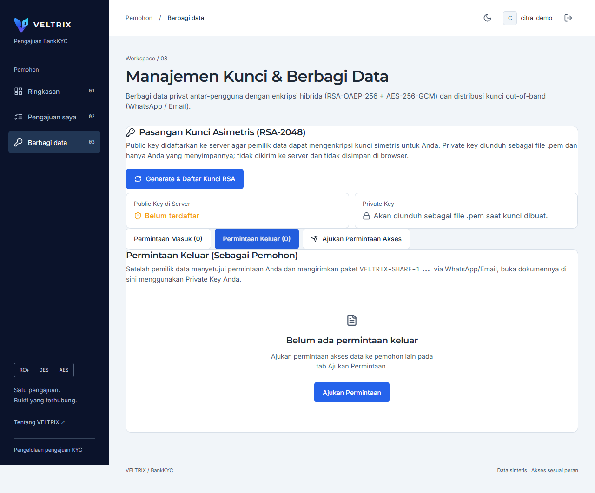

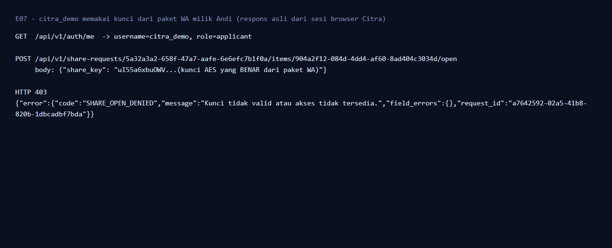

### E08 — Budi mencabut akses

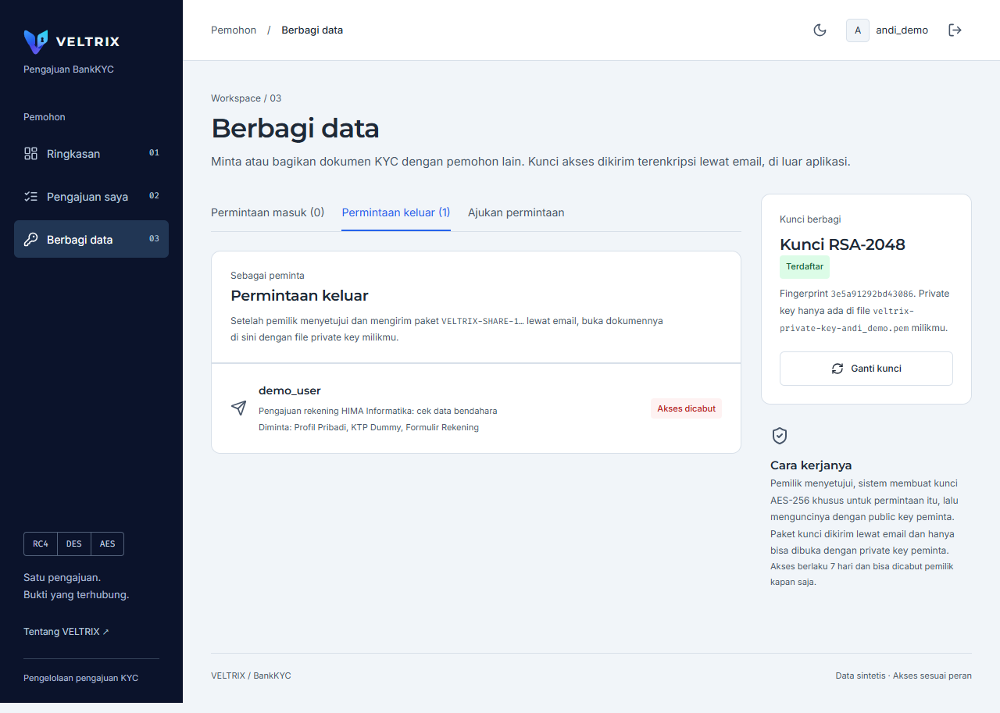

### E09 — Isi database hanya ciphertext

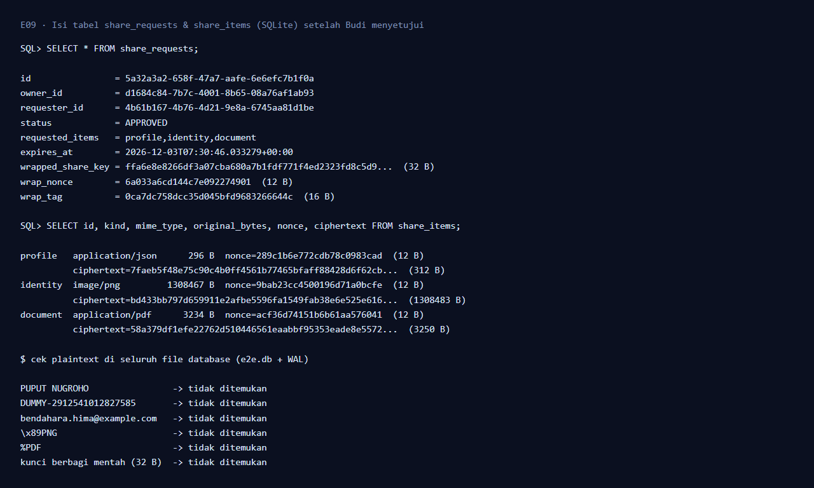

### E10 — Data tetap ada setelah restart

Sebelum restart:


Sesudah restart:

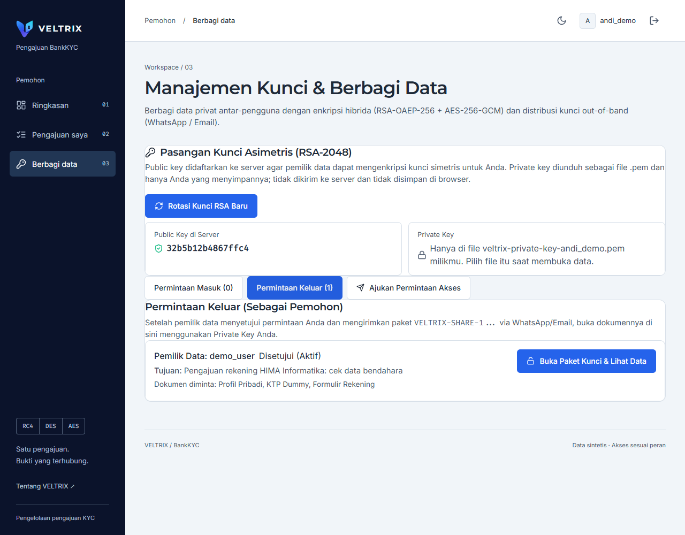

## Batasan

- Uji dilakukan di satu laptop Windows dengan SQLite. MySQL dan deployment cloud belum diuji untuk fitur berbagi data.
- Email memakai server lokal, bukan penyedia email sungguhan; yang dibuktikan adalah isi paket yang dikirim, bukan keamanan jalur emailnya.
- Batasan desain (server dipercaya, private key berupa file tanpa password, dan lainnya) ada di §6 [rencana pengerjaan](ASSIGNMENT_2_IMPLEMENTATION_PLAN.md).
