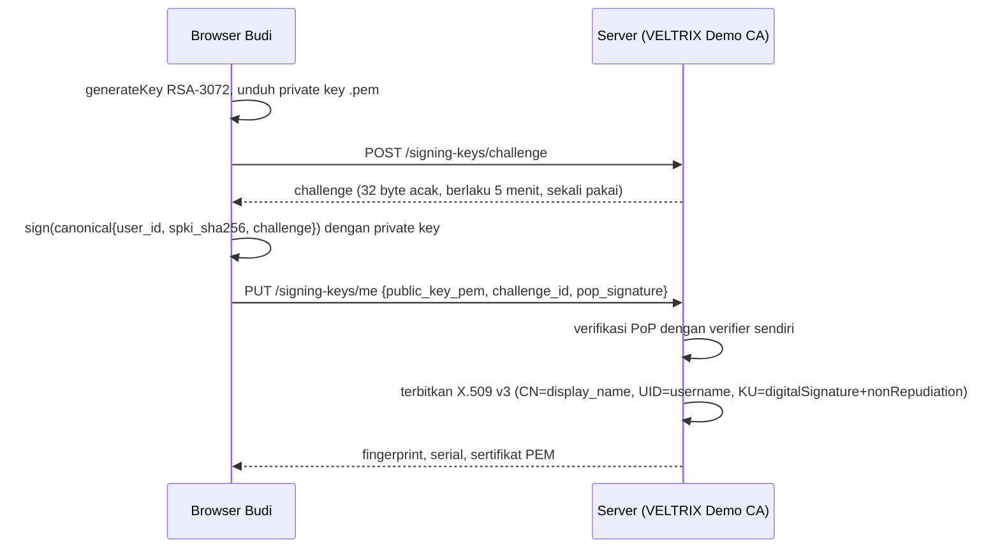
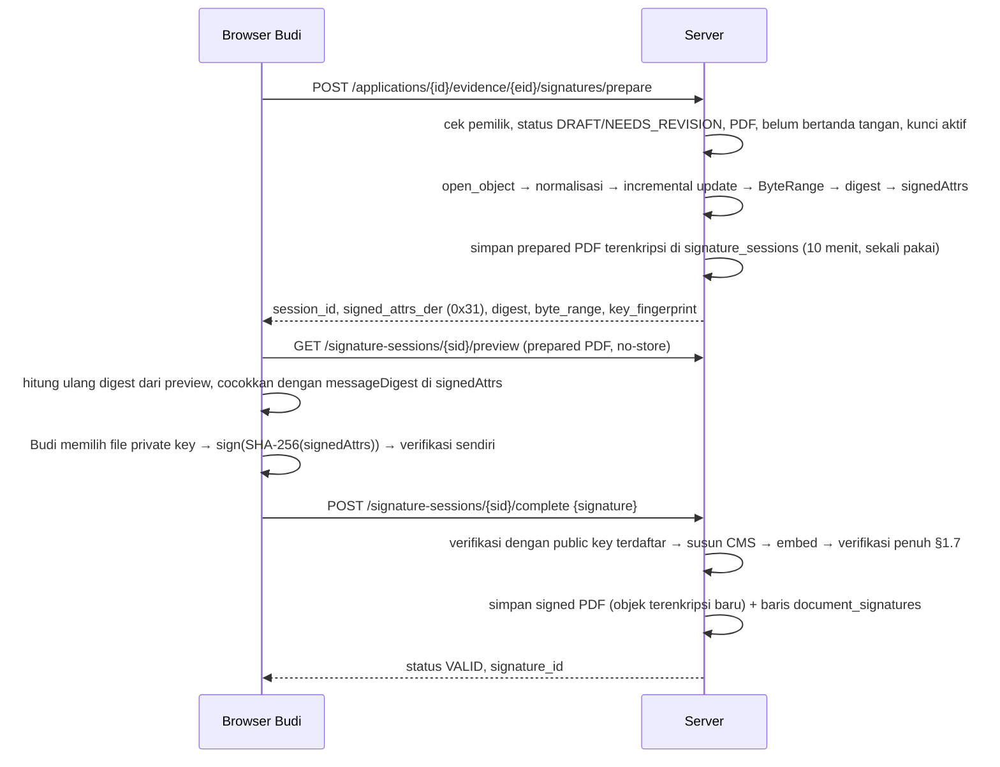
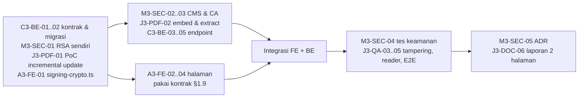

# Assignment 3 — Rencana Pengerjaan: Tanda Tangan Digital pada PDF KYC

**Skenario:** tetap sama dengan Assignment 2, yaitu rekening organisasi mahasiswa (lihat [ASSIGNMENT_2_SCENARIO_OPTIONS.md](../assignment-2/ASSIGNMENT_2_SCENARIO_OPTIONS.md))  
**Basis kode:** VELTRIX BankKYC di `main` (backend `backend/kyc/`, frontend `frontend/src/`)  
**Pembagian tugas:** [ASSIGNMENT_3_TASK_DISTRIBUTION.md](ASSIGNMENT_3_TASK_DISTRIBUTION.md)  
**Prinsip:** fitur ini menambah kemampuan pada sistem yang sudah ada. Enkripsi Assignment 1 dan alur berbagi Assignment 2 tidak diganti, dan tidak ada proyek baru.

Dokumen ini menjadi acuan teknis bila tim setuju, dan menggantikan draf awal `VELTRIX_BankKYC_Assignment3_Task_Allocation.md` (sudah dihapus; versi lamanya ada di riwayat Git). Ada dua perbedaan utama. Pertama, **private key tidak pernah dikirim ke server.** Aturan ini konsisten dengan DEC2-03, sedangkan dokumen lama menyebut private key disimpan di server. Kedua, semua pilihan yang sebelumnya masih terbuka (algoritma, format PDF, library, cara mengikat kunci ke akun) sudah diputuskan di sini.

---

## 0. Ringkasan alur final

1. Setiap pemohon membuat **pasangan kunci tanda tangan** (RSA-3072) sekali di browser. Kunci ini terpisah dari kunci RSA-OAEP Assignment 2. Private key diunduh sebagai file `veltrix-signing-key-<username>.pem`.
2. Browser membuktikan bahwa ia memegang private key (*proof of possession*) dengan menandatangani tantangan dari server. Setelah itu server, yang berperan sebagai **VELTRIX Demo CA**, menerbitkan **sertifikat X.509** yang mengikat public key itu ke akun.
3. **Budi** (bendahara, pemohon) mengunggah formulir pembukaan rekening dalam bentuk PDF ke pengajuannya, seperti di Assignment 1.
4. Budi menekan **Tanda tangani**. Server lalu:
   - membuka PDF dari penyimpanan terenkripsi (`open_object`);
   - menambahkan *signature field* lewat **incremental update**, yaitu bagian baru yang ditambahkan di akhir file, dengan placeholder `/ByteRange` dan `/Contents`;
   - menghitung SHA-256 atas semua byte file **kecuali** isi `/Contents`;
   - menyusun *signed attributes* CMS, yang berisi digest tersebut, lalu mengirimkannya ke browser.
5. **Browser** menandatangani signed attributes dengan private key Budi memakai implementasi RSASSA-PKCS1-v1_5 **buatan tim** (§1.2). Browser memeriksa hasilnya sendiri dengan public key, lalu mengirim **nilai signature saja** ke server.
6. Server memverifikasi signature dengan public key Budi yang terdaftar. Bila valid, server membungkusnya menjadi **CMS SignedData** (beserta sertifikat Budi dan sertifikat CA), lalu menanamkannya ke `/Contents`. Hasilnya adalah PDF bertanda tangan yang disimpan terenkripsi sebagai objek baru. PDF asli tetap disimpan.
7. **Reviewer** yang ditugaskan memverifikasi signature sebelum memutuskan pengajuan. **Andi** (ketua HIMA) dapat memverifikasi PDF yang ia terima lewat fitur berbagi Assignment 2. **Pihak ketiga** dapat memverifikasi di Adobe Reader atau `pdfsig` setelah mengimpor sertifikat VELTRIX Demo CA.

### Siapa menandatangani dan memverifikasi apa

| Pihak | Menandatangani | Memverifikasi | Tujuan |
|---|---|---|---|
| Budi (pemohon, pemilik dokumen) | Formulir pembukaan rekening PDF miliknya sendiri | Status signature dokumennya sendiri | Menyatakan "isi formulir ini benar dan saya yang mengajukan" |
| Reviewer yang ditugaskan | — | Signature formulir pada pengajuan yang ia review | Memastikan dokumen yang direview sama dengan yang ditandatangani pemohon dan tidak diubah sesudahnya, termasuk oleh server atau admin |
| Andi (peminta di Assignment 2) | — | PDF yang dibagikan Budi kepadanya | Assignment 2 menjaga kerahasiaan; Assignment 3 membuktikan bahwa formulir itu memang dari Budi dan masih utuh |
| Pihak ketiga (bank, auditor, PDF reader) | — | Signed PDF yang diunduh | Verifikasi di luar aplikasi, tanpa perlu mempercayai server VELTRIX |
| Server / admin | Hanya sertifikat (sebagai CA), **tidak pernah** dokumen | Signature saat `complete` dan saat diminta | Server tidak bisa memalsukan tanda tangan Budi karena tidak memegang private key-nya |

### Siapa memegang apa

| Rahasia / data | Disimpan di | Siapa bisa memakainya |
|---|---|---|
| Private key tanda tangan Budi | File `.pem` di perangkat Budi | Hanya Budi, di browser, saat menandatangani |
| Public key + sertifikat Budi | DB `user_signing_keys` | Siapa saja, untuk verifikasi |
| Private key VELTRIX Demo CA | DB `pki_authority`, **terbungkus KEK** | Server, hanya untuk menerbitkan sertifikat |
| Sertifikat root VELTRIX Demo CA | DB + endpoint publik `GET /pki/ca.pem` | Siapa saja; diimpor ke PDF reader untuk demo bonus |
| PDF yang disiapkan (sesi tanda tangan) | `encrypted_objects` (envelope A1), kedaluwarsa 10 menit | Server, untuk menyelesaikan sesi |
| Signed PDF | `encrypted_objects` (envelope A1) | Pemilik dan reviewer yang ditugaskan, sesuai aturan akses yang sudah ada |

### Kenapa penandatanganan dilakukan di browser, bukan di server

Jika private key disimpan di server, siapa pun yang menguasai server (admin, penyerang yang membocorkan DB beserta KEK, atau bug) bisa menandatangani dokumen atas nama Budi. Akibatnya signature tidak lagi membuktikan apa-apa tentang Budi. Dengan penandatanganan di browser, server hanya bisa menyiapkan *apa yang akan ditandatangani*. Server tidak bisa membuat signature yang valid tanpa file private key Budi. Biayanya, alur menjadi dua langkah (`prepare` → `complete`), dan Budi harus menyimpan file kuncinya. Pertukaran ini sama dengan yang sudah diterima tim di Assignment 2.

---

## 1. Desain teknis

### 1.1 Kriptografi

| Komponen | Pilihan | Alasan |
|---|---|---|
| Pasangan kunci tanda tangan | RSA-3072, e = 65537, dibuat dengan `crypto.subtle.generateKey` (`RSASSA-PKCS1-v1_5`) | Menurut NIST SP 800-57, RSA-2048 hanya dianjurkan sampai 2030. Arsip KYC disimpan bertahun-tahun, jadi signature harus tetap tidak bisa dipalsukan lebih lama dari paket kunci berbagi Assignment 2 yang hanya berlaku 7 hari. RSA dipilih karena didukung luas oleh PDF reader. |
| Pemisahan kunci | Kunci tanda tangan ≠ kunci RSA-OAEP Assignment 2 | Satu kunci untuk satu tujuan (*key separation*). Mengganti kunci berbagi tidak boleh membatalkan signature lama, dan sebaliknya. |
| Hash | SHA-256 (Web Crypto `digest`, Python `hashlib`) | Standar CMS/PDF, didukung semua reader, dan tahan collision untuk kebutuhan ini |
| Skema signature | RSASSA-PKCS1-v1_5 dengan SHA-256 (`sha256WithRSAEncryption`) | Paling luas didukung untuk `/adbe.pkcs7.detached`. Skemanya deterministik, sehingga implementasi tim bisa dibandingkan byte demi byte dengan library (§3.1 T02). PSS dicatat sebagai alternatif di ADR. |
| Format PDF | ISO 32000 signature field, `/Filter /Adobe.PPKLite`, `/SubFilter /adbe.pkcs7.detached` | Format standar yang dibaca Adobe, Foxit, dan poppler (`pdfsig`). Ini syarat untuk nilai bonus. |
| Wadah signature | CMS `SignedData` (RFC 5652), detached, satu `SignerInfo` | Dibutuhkan oleh `/adbe.pkcs7.detached`; memuat sertifikat agar reader tahu siapa penandatangannya |
| Signed attributes | `contentType`, `signingTime`, `messageDigest`, `signingCertificateV2` | `signingCertificateV2` mengikat signature ke sertifikat tertentu sehingga sertifikat tidak bisa ditukar |
| Pengikatan identitas | Sertifikat X.509 v3 diterbitkan VELTRIX Demo CA setelah proof of possession | Reader pihak ketiga hanya bisa menampilkan nama penandatangan bila ada sertifikat. CA lokal adalah bentuk paling sederhana yang jujur untuk prototipe. |
| Kunci CA | RSA-3072, dibuat saat `provision`, private key dibungkus AES-256-GCM dengan KEK yang sudah ada (AAD `purpose='ca-key'`) | Memakai ulang mekanisme KEK dari A1/A2 tanpa rahasia baru di `.env` |

### 1.2 Batas penggunaan library (logika signing & verifikasi buatan sendiri)

Tugas mengizinkan library untuk membuat key pair, menghitung hash, enkripsi/dekripsi, dan membaca/menulis PDF. Logika signing dan verifikasi harus buatan tim.

| Dibuat dengan library | Dibuat sendiri oleh tim |
|---|---|
| Pembuatan key pair (Web Crypto) | Encoding EMSA-PKCS1-v1_5: `0x00‖0x01‖FF…FF‖0x00‖DigestInfo(SHA-256)‖H` |
| SHA-256 (Web Crypto, `hashlib`) | RSASP1 (`s = m^d mod n`, dengan CRT dan *blinding*) di TypeScript (BigInt) dan Python (`pow`) |
| Impor PEM → parameter JWK (`n, e, d, p, q, dp, dq, qi`) lewat Web Crypto | RSAVP1 (`m = s^e mod n`) dan verifikasi *encode-then-compare* |
| Baca struktur PDF (`pypdf`) | Penulisan incremental update, penempatan placeholder, perhitungan dan patch `/ByteRange` |
| Encode/decode DER ASN.1 (`asn1crypto`) | Penyusunan signed attributes, SignedData, dan sertifikat; semua aturan verifikasi di §1.7 |

Untuk tanda tangan, `pycryptodome` (modul `pkcs1_15`) dan `pyHanko` atau `pdfsig` **hanya dipakai di tes** sebagai pembanding independen; kode aplikasi tidak memanggil fungsi signing/verifikasi dari library itu. `pycryptodome` tetap dipakai aplikasi untuk enkripsi Assignment 1 dan 2 seperti sebelumnya. Interpretasi ini perlu dikonfirmasi ke asdos (§8).

**Konstanta DigestInfo SHA-256** (prefix DER sebelum hash 32 byte):

```
30 31 30 0d 06 09 60 86 48 01 65 03 04 02 01 05 00 04 20
```

**Verifikasi encode-then-compare.** Verifier menghitung `m = s^e mod n`, membuat ulang `EM` yang diharapkan dari hash, lalu membandingkan seluruh blok byte demi byte dengan `hmac.compare_digest`. Verifier **tidak** mem-parsing padding. Cara ini menutup celah pemalsuan Bleichenbacher 2006, yang memanfaatkan parser padding yang longgar ketika e = 3. Verifier juga menolak e ≠ 65537, kunci < 2048 bit, dan `s ≥ n`.

**Proteksi di browser.** Blinding dipakai untuk mengurangi kebocoran waktu dari BigInt: pilih `r` acak, hitung `m' = m·r^e`, `s' = m'^d`, lalu `s = s'·r⁻¹ mod n`. Signature juga **diverifikasi sendiri sebelum dikirim**, untuk mencegah *fault attack* pada CRT, di mana satu signature yang salah bisa membocorkan faktor `n`. Parameter private key hanya ada di variabel lokal fungsi dan dibuang setelah selesai.

### 1.3 Pendaftaran kunci tanda tangan & sertifikat



- Proof of possession mencegah seseorang mendaftarkan public key milik orang lain atas namanya sendiri. Tanpa PoP, sertifikat bisa diterbitkan untuk kunci yang tidak dipegang pendaftarnya.
- Sertifikat berlaku 2 tahun. Ekstensinya: `basicConstraints CA:FALSE`, `keyUsage digitalSignature, nonRepudiation`, `subjectKeyIdentifier`, dan `authorityKeyIdentifier`.
- **Ganti kunci:** kunci lama diberi `revoked_at` dan alasan, tetapi **tidak dihapus**, karena signature lama harus tetap bisa diverifikasi. Signature yang `signed_at`-nya (waktu server) sesudah `revoked_at` dianggap `KEY_REVOKED`.

### 1.4 Struktur PDF yang ditandatangani

1. **Normalisasi.** PDF dibaca dengan `pypdf` (`strict=True`) lalu ditulis ulang (`PdfWriter(clone_from=…)`), sehingga file memakai tabel xref klasik. Tujuannya agar incremental update cukup ditulis dalam satu format xref. Hasil normalisasi adalah dokumen yang ditampilkan ke Budi dan ditandatangani; file unggahan asli tetap tersimpan.
2. **Tolak** PDF yang terenkripsi, yang sudah memiliki field `/Sig`, atau yang `/AcroForm /SigFlags`-nya sudah diset. Dalam lingkup tugas ini, satu dokumen hanya punya satu penandatangan.
3. **Incremental update** yang ditulis sendiri setelah `%%EOF` dokumen hasil normalisasi:

```
<dokumen ternormalisasi> %%EOF
N 0 obj  << /Type /Sig /Filter /Adobe.PPKLite /SubFilter /adbe.pkcs7.detached
           /ByteRange [0 ########## ########## ##########]
           /Contents <0000…0000>          % 8192 byte → 16384 karakter hex
           /M (D:20261126143000+07'00') /Name (Budi Santoso)
           /Reason (Pernyataan kebenaran data KYC) /Location (VELTRIX BankKYC) >>  endobj
N+1 0 obj << /Type /Annot /Subtype /Widget /FT /Sig /T (VeltrixSignature1) /V N 0 R
           /F 132 /Rect [0 0 0 0] /P <ref halaman 1> >>  endobj        % tak terlihat (P0)
<halaman 1 diperbarui: /Annots + N+1 0 R>
<catalog diperbarui: /AcroForm << /Fields [N+1 0 R] /SigFlags 3 >>>
xref … trailer << /Size … /Root … /Prev <startxref lama> /ID [...] >> startxref … %%EOF
```

4. **ByteRange.** Setelah seluruh update ditulis, cari offset `<` dan `>` dari `/Contents`. Hasilnya `ByteRange = [0, a, b, L − b]`, dengan `a` = offset `<`, `b` = offset setelah `>`, dan `L` = panjang file. Nilai ini di-patch ke placeholder lebar tetap (rata kiri, diisi spasi) sehingga tidak ada offset yang bergeser.
5. **Digest** = `SHA-256(file[0:a] ‖ file[b:L])`.
6. **Embed.** DER CMS diubah ke hex dan diisi `0` sampai 16384 karakter, lalu ditulis ke celah `<…>`. Jika CMS lebih besar dari 8192 byte, proses ditolak; perkiraan CMS untuk RSA-3072 dengan 2 sertifikat sekitar 2,5 KB.

P2 (opsional): widget yang terlihat, berupa kotak "Ditandatangani secara digital oleh Budi Santoso" dengan `/AP`, di halaman terakhir.

### 1.5 CMS SignedData

```
ContentInfo { contentType: id-signedData,
  SignedData { version 1, digestAlgorithms {sha256}, encapContentInfo { id-data, (tanpa content) },
    certificates [ sertifikat Budi, sertifikat VELTRIX Demo CA ],
    signerInfos [ { version 1, sid: issuerAndSerialNumber(sertifikat Budi),
      digestAlgorithm sha256,
      signedAttrs [0] { contentType=id-data, signingTime, messageDigest=<digest §1.4>,
                        signingCertificateV2=<SHA-256 sertifikat Budi> },
      signatureAlgorithm sha256WithRSAEncryption, signature <dari browser> } ] } }
```

Detail yang sering salah: yang di-hash dan ditandatangani adalah DER signed attributes dengan tag **`SET OF` (0x31)**, bukan tag `[0] IMPLICIT` (0xA0) yang tertulis di dalam SignerInfo. Server mengirim bentuk `0x31` ke browser, lalu menanamkan bentuk `0xA0`.

### 1.6 Alur prepare → sign → complete



Browser menghitung ulang digest dari PDF yang ditampilkan (P1). Langkah ini menutup risiko server yang rusak atau disusupi mengirim *signedAttrs* untuk dokumen lain, sehingga yang ditandatangani sama dengan yang ditampilkan (*what you see is what you sign*).

Sesi terikat ke `evidence_id`, `case_version`, `signer_id`, dan `signing_key_id`. Sesi ditolak bila sudah dipakai, kedaluwarsa, atau pengajuan berubah versi sejak `prepare`.

### 1.7 Aturan verifikasi & status hasil

Verifier (`kyc/pdf_verify.py` + `kyc/cms.py`) menjalankan pemeriksaan berikut secara berurutan. Pemeriksaan berhenti pada kegagalan pertama.

1. File diawali `%PDF-`, ukuran ≤ 10 MB, dan bisa dibaca `pypdf`.
2. Tepat **satu** field `/Sig`. `/SubFilter` harus `/adbe.pkcs7.detached`.
3. `/ByteRange` terdiri dari 4 bilangan bulat `[0, a, b, c]` dengan `0 < a < b`, celah `file[a:b]` persis berisi string hex `<…>` dari `/Contents`, dan **`b + c == panjang file`**. Jika `b + c < panjang file`, ada byte tambahan setelah penandatanganan, sehingga statusnya `MODIFIED_AFTER_SIGNING`. Aturan ini menutup *Incremental Saving Attack*, *Signature Wrapping*, dan *Shadow attack* (Mladenov dkk., CCS 2019; Mainka dkk., NDSS 2021).
4. Nilai `/Contents` yang dibaca langsung dari byte mentah harus sama dengan yang di-parse `pypdf`.
5. CMS harus `SignedData` dengan satu SignerInfo. `digestAlgorithm` harus sha256 dan `signatureAlgorithm` harus `rsaEncryption` atau `sha256WithRSAEncryption`; algoritma lain ditolak, termasuk SHA-1 dan MD5. `encapContentInfo` tidak boleh berisi content.
6. `messageDigest` = SHA-256 byte range. Jika berbeda, statusnya `INVALID`.
7. `signingCertificateV2` cocok dengan sertifikat yang ditunjuk `sid`.
8. Signature atas signed attributes valid dengan public key sertifikat (§1.2). Jika tidak, statusnya `INVALID`.
9. Rantai sertifikat: sertifikat ditandatangani VELTRIX Demo CA dan masih dalam masa berlaku. Jika tidak, statusnya `VALID_UNTRUSTED`.
10. Kunci terdaftar di `user_signing_keys` dan belum dicabut saat `signed_at`. Untuk dokumen yang tersimpan di aplikasi, penandatangan juga harus pemilik pengajuan. Jika tidak, statusnya `KEY_REVOKED` atau `SIGNER_MISMATCH`.

| Status | Arti untuk user |
|---|---|
| `VALID` | Signature cocok, dokumen tidak berubah, dan penandatangan adalah pemilik kunci terdaftar |
| `VALID_UNTRUSTED` | Secara matematis cocok, tetapi sertifikat tidak diterbitkan VELTRIX atau tidak dikenal |
| `INVALID` | Isi dokumen atau signature telah berubah |
| `MODIFIED_AFTER_SIGNING` | Bagian yang ditandatangani utuh, tetapi ada tambahan setelah penandatanganan |
| `KEY_REVOKED` / `SIGNER_MISMATCH` | Kunci sudah dicabut, atau penandatangan bukan pemilik dokumen |
| `NOT_SIGNED` | Tidak ada signature di PDF |
| `MALFORMED` | Struktur PDF/CMS tidak bisa dibaca dengan aman |

Hasil verifikasi menampilkan alasan rinci. Ini berbeda dari `open` di Assignment 2 yang sengaja memakai pesan generik. Alasannya, verifikasi tidak melibatkan rahasia, dan verifier perlu tahu *mengapa* dokumen ditolak. Respons tidak pernah menyertakan byte dokumen.

Penting untuk UI dan laporan: status `VALID` **bukan** berarti isi formulir benar atau identitas Budi telah diverifikasi bank. Status ini hanya berarti dokumen tidak berubah sejak ditandatangani dengan kunci yang terdaftar pada akun Budi.

### 1.8 Database — migrasi baru `0004_digital_signature.py`

Migrasi ini tidak mengubah tabel atau migrasi `0001`–`0003`.

**`user_signing_keys`**

| Kolom | Tipe | Keterangan |
|---|---|---|
| `id` | String(36) PK | |
| `user_id` | FK `kyc_users.id` | |
| `public_key_pem` | Text | SPKI PEM, RSA ≥ 3072 bit |
| `fingerprint` | String(64) | SHA-256 SPKI |
| `certificate_der` | LargeBinary | Sertifikat X.509 yang diterbitkan |
| `cert_serial` | String(40), unique | |
| `created_at`, `revoked_at`, `revoke_reason` | String | Kunci lama tidak dihapus |

Satu kunci aktif per user, dengan pola indeks parsial yang sama seperti `user_public_keys`.

**`signing_key_challenges`**: `id`, `user_id`, `challenge` (32 byte), `expires_at`, `used_at`.

**`pki_authority`**: `id`, `certificate_der`, `wrapped_private_key`, `wrap_nonce`, `wrap_tag`, `created_at`.

**`signature_sessions`**

| Kolom | Keterangan |
|---|---|
| `id`, `application_id`, `evidence_id`, `signer_id`, `signing_key_id`, `case_version` | Pengikat sesi |
| `prepared_object_id` | FK `encrypted_objects.id`, berisi prepared PDF terenkripsi |
| `signed_attrs` | DER, tidak rahasia |
| `byte_range`, `digest` | Untuk dicocokkan saat `complete` |
| `created_at`, `expires_at`, `used_at` | Kedaluwarsa 10 menit; objek dihapus saat kedaluwarsa atau setelah selesai |

**`document_signatures`**

| Kolom | Keterangan |
|---|---|
| `id`, `application_id`, `evidence_id`, `signer_id`, `signing_key_id` | |
| `signed_object_id` | FK `encrypted_objects.id`, signed PDF terenkripsi |
| `signed_sha256` | SHA-256 seluruh signed PDF, sebagai sidik dokumen |
| `signed_at` | **Waktu server** saat `complete`, waktu yang dipercaya aplikasi |
| `last_status`, `last_verified_at` | Hasil verifikasi terakhir |

### 1.9 API (prefix `/api/v1`, semua butuh login dan CSRF seperti endpoint lain)

| Method & path | Pemanggil | Fungsi |
|---|---|---|
| `GET /signing-keys/me` | Pemohon | Kunci aktif, fingerprint, sertifikat, dan riwayat kunci yang dicabut |
| `POST /signing-keys/challenge` | Pemohon | Tantangan PoP |
| `PUT /signing-keys/me` | Pemohon | Body: `public_key_pem`, `challenge_id`, `pop_signature`. Menerbitkan sertifikat; kunci lama dicabut |
| `GET /pki/ca.pem` | Publik | Sertifikat root VELTRIX Demo CA, untuk diimpor ke PDF reader |
| `POST /applications/{id}/evidence/{eid}/signatures/prepare` | Pemilik | Membuat sesi tanda tangan (§1.6) |
| `GET /signature-sessions/{sid}/preview` | Pemilik sesi | Prepared PDF, `Cache-Control: no-store` |
| `POST /signature-sessions/{sid}/complete` | Pemilik sesi | Body: `signature` (base64). Balikan: `signature_id`, `status` |
| `GET /applications/{id}/signatures` | Pemilik, reviewer yang ditugaskan | Daftar signature dan status terakhir |
| `POST /applications/{id}/signatures/{sig}/verify` | Pemilik, reviewer yang ditugaskan | Verifikasi ulang signed PDF tersimpan |
| `GET /applications/{id}/signatures/{sig}/download` | Pemilik | Unduh signed PDF |
| `GET /applications/{id}/signatures/{sig}/review-preview` | Reviewer yang ditugaskan | Pratinjau di memori, mengikuti pola review-preview yang ada |
| `POST /signatures/verify` | Semua user login | Unggah PDF apa pun (≤ 10 MB) dan dapatkan hasil §1.7. File tidak disimpan. |

Aturan keamanan di server:

- Hanya pemilik pengajuan yang boleh `prepare`/`complete`, dan hanya saat status `DRAFT` atau `NEEDS_REVISION`. Admin dan reviewer tidak bisa menandatangani.
- Hanya `category='document'` dengan MIME `application/pdf`. Formulir DOCX ditolak dengan pesan "unggah formulir dalam format PDF untuk ditandatangani".
- `complete` memverifikasi signature **sebelum** menanam dan menyimpan, sehingga data sampah tidak pernah tersimpan sebagai signed PDF.
- `rate_limit` diterapkan pada `challenge`, `prepare`, `complete`, dan `signatures/verify`.
- Event `security_events`: `SIGN_KEY_REGISTERED`, `SIGN_KEY_REVOKED`, `SIGN_PREPARED`, `SIGN_COMPLETED`, `SIGN_REJECTED`, `SIG_VERIFIED`, `SIG_VERIFY_FAILED`. Kunci, signature mentah, dan isi dokumen tidak pernah dicatat.
- **P1 aturan alur:** `submit`/`resubmit` ditolak bila versi terbaru formulir PDF belum memiliki signature `VALID`. Aturan ini diatur lewat `VELTRIX_REQUIRE_SIGNED_FORM`: `true` di `.env.example`, `false` untuk tes Assignment 1 yang lama.
- **P1 integrasi Assignment 2:** saat Budi menyetujui permintaan berbagi item `document`, salinan yang dibagikan diambil dari signed PDF terbaru bila ada. Dengan begitu Andi bisa memverifikasinya.

### 1.10 Frontend

| Halaman / komponen | Isi |
|---|---|
| **Kunci tanda tangan** (bagian baru di halaman kunci, di samping kunci berbagi A2) | Tombol "Buat kunci tanda tangan" → unduh `veltrix-signing-key-<username>.pem` → PoP → tampilkan fingerprint, serial sertifikat, dan masa berlaku. Peringatan: "Siapa pun yang memegang file ini bisa menandatangani atas nama Anda." Tombol "Ganti kunci" dengan konfirmasi bahwa signature lama tetap valid, tetapi kunci lama tidak bisa dipakai lagi. |
| **Detail pengajuan** (`applicant/applications/[id]`) | Pada formulir PDF: lencana status signature dan tombol **Tanda tangani**. Modal tanda tangan menampilkan pratinjau prepared PDF, SHA-256 dokumen, dan fingerprint kunci; Budi memilih file private key; progres; hasil. Tombol **Unduh PDF bertanda tangan**. |
| **Reviewer** (`reviewer/applications/[id]`) | Panel "Tanda tangan digital": penandatangan, fingerprint, waktu server, status, dan tombol **Verifikasi ulang**. Peringatan merah bila status bukan `VALID`. |
| **Verifikasi PDF** (`/verify`, semua role) | Unggah PDF → kartu hasil dengan status, alasan, penandatangan dari sertifikat, dan fingerprint. Tautan unduh `ca.pem` beserta panduan singkat impor ke Adobe Reader. |

Kode kriptografi browser dikumpulkan di `frontend/src/lib/signing-crypto.ts`:

- `generateSigningKeyPair()` mengembalikan public key PEM, private key PEM, dan fingerprint;
- `loadPrivateKeyParams(pem)` mengimpor PKCS#8 lewat Web Crypto lalu mengekspor JWK dan mengubahnya ke BigInt;
- `emsaPkcs1v15Encode(hash, k)`, `rsasp1(m, params)` (CRT + blinding), `rsavp1(s, n, e)`;
- `signSignedAttrs(signedAttrsDer, privateKeyPem)` mengembalikan signature dan sudah memverifikasinya sendiri;
- `signPopChallenge(...)` untuk pendaftaran kunci.

Aturan frontend mengikuti Assignment 2: file private key dibaca dengan `FileReader` dan tidak disimpan di state global, `localStorage`, atau log. Mode mock menampilkan pesan "Fitur tanda tangan hanya tersedia di mode live".

---

## 2. Pembagian tugas

Pembagian tugas per anggota (ID tugas, Output, DoD, branch, contoh issue) ada di [ASSIGNMENT_3_TASK_DISTRIBUTION.md](ASSIGNMENT_3_TASK_DISTRIBUTION.md).

---

## 3. Pengujian

### 3.1 Tes otomatis backend (`pytest`, `tests/test_signature_*.py`)

| # | Kasus | Hasil yang diharapkan |
|---|---|---|
| T01 | Alur lengkap: daftar kunci → prepare → sign (implementasi Python tim di tes) → complete → verify | `VALID`; PDF masih bisa dibuka `pypdf` dengan jumlah halaman sama |
| T02 | EMSA + RSASP1 buatan tim vs `pycryptodome` `pkcs1_15` untuk 50 pesan acak | Signature **identik byte demi byte** |
| T03 | Verifikasi dengan public key akun lain | `INVALID` |
| T04 | Ubah 1 byte di dalam byte range (isi halaman) | `INVALID` (messageDigest beda) |
| T05 | Ubah 1 karakter hex di `/Contents` | `INVALID` atau `MALFORMED`, tidak pernah `VALID` |
| T06 | Ubah nilai `/ByteRange` (geser, perkecil, celah tidak pas) | `MALFORMED` atau `INVALID` |
| T07 | Tambah incremental update setelah tanda tangan (ganti teks halaman) | `MODIFIED_AFTER_SIGNING` |
| T08 | Salin `/Contents` dari PDF bertanda tangan A ke PDF B | `INVALID` |
| T09 | Signature dengan e = 3 dan padding palsu ala Bleichenbacher 2006 | Ditolak |
| T10 | CMS memakai SHA-1 atau MD5 | Ditolak |
| T11 | Sertifikat self-signed (bukan dari VELTRIX CA) dengan signature yang valid | `VALID_UNTRUSTED` |
| T12 | Kunci dicabut, lalu sesi baru ditandatangani dengan kunci lama | `complete` ditolak; signature lama tetap `VALID` |
| T13 | User lain, reviewer, atau admin memanggil `prepare`/`complete` | Ditolak (403/404) |
| T14 | `complete` dua kali, setelah 10 menit, atau setelah versi pengajuan berubah | Ditolak (409) |
| T15 | PoP salah atau challenge dipakai ulang | Ditolak (422) |
| T16 | PDF terenkripsi, sudah bertanda tangan, rusak, DOCX | Ditolak dengan pesan jelas |
| T17 | Log, `security_events`, dan DB diperiksa | Tidak ada private key, signature mentah di log, atau PDF plaintext |
| T18 | `pdfsig` (poppler) pada signed PDF + CA diimpor ke NSS db sementara | "Signature is Valid", "Certificate is Trusted". Dilewati (*skip*) bila `pdfsig` tidak ada. |
| T19 | Tes Assignment 1 dan 2 | Tetap lolos |

Tes TypeScript (`signing-crypto.test.ts`) memakai **test vector bersama** yang dihasilkan Python (kunci, pesan, signature yang diharapkan). Implementasi browser dan server harus menghasilkan signature yang sama.

### 3.2 Skenario demo end-to-end

| # | Langkah | Bukti |
|---|---|---|
| E01 | Budi belum punya kunci → membuat kunci tanda tangan | Screenshot halaman kunci (fingerprint, serial), file `.pem` tidak ditampilkan isinya |
| E02 | Budi mengunggah formulir PDF ke pengajuan | Screenshot detail pengajuan |
| E03 | Budi menandatangani: modal pratinjau → pilih kunci → `VALID` | Screenshot modal dan hasil |
| E04 | Budi mengunduh signed PDF, membukanya di Adobe Reader **sebelum** CA diimpor | Screenshot panel signature ("identity unknown") |
| E05 | Impor `ca.pem` sebagai trusted certificate → buka lagi | Screenshot "Signature is valid" (bukti bonus) |
| E06 | `pdfsig signed.pdf` di terminal | Screenshot output |
| E07 | Edit signed PDF di editor lain lalu simpan → verifikasi di `/verify` dan Adobe | Screenshot `MODIFIED_AFTER_SIGNING` / `INVALID` di kedua tempat |
| E08 | Reviewer yang ditugaskan memverifikasi sebelum memutuskan | Screenshot panel reviewer |
| E09 | Budi membagikan formulir ke Andi (A2); Andi membuka dan memverifikasinya di `/verify` | Screenshot hasil `VALID` atas nama Budi |
| E10 | Citra mengunggah PDF yang ditandatangani dengan kunci Citra sendiri tetapi mengaku dari Budi | Screenshot: penandatangan tampil sebagai Citra / `SIGNER_MISMATCH` |
| E11 | Budi mengganti kunci → signature lama tetap `VALID`, kunci lama tidak bisa dipakai | Screenshot |
| E12 | Isi tabel `document_signatures` / `signature_sessions` di SQLite | Screenshot: hanya metadata dan ciphertext |

### 3.3 Matriks kompatibilitas PDF reader (bonus)

| Reader | Versi | Signature terdeteksi | Valid tanpa impor CA | Valid setelah impor CA | Setelah dokumen diubah |
|---|---|---|---|---|---|
| Adobe Acrobat Reader | | | | | |
| Foxit PDF Reader | | | | | |
| Okular / `pdfsig` (poppler) | | | | | |
| Viewer Chrome/Edge | | Catat apa adanya; biasanya tidak memvalidasi | | | |

Isi tabel dengan hasil yang benar-benar diamati. Jangan mengklaim kompatibel sebelum diuji.

---

## 4. Urutan kerja



1. **Hari 1–2:** kunci kontrak API (§1.9) dan format sesi. **Proof of concept paling berisiko lebih dulu:** PDF dengan incremental update dan CMS hasil tim harus lolos `pdfsig` sebelum UI dibuat.
2. **Hari 3–4:** endpoint, CMS/CA, embed/extract, halaman frontend.
3. **Hari 5:** integrasi, tes T01–T19, tampering, matriks reader.
4. **Hari 6–7:** ADR, laporan, screenshot E01–E12, latihan demo.

**Syarat sebelum integrasi:** kontrak API dan format `signed_attrs` tidak boleh berubah tanpa memberi tahu semua anggota.

---

## 5. Definition of Done

- [ ] Pemohon tanpa kunci bisa membuat pasangan kunci tanda tangan; private key hanya ada di perangkat user.
- [ ] Public key terikat ke akun lewat PoP dan sertifikat VELTRIX Demo CA.
- [ ] Pemohon bisa menandatangani PDF miliknya sendiri; signature tertanam di PDF (`/ByteRange` + `/Contents`, CMS detached).
- [ ] Aplikasi bisa memverifikasi signature dan membedakan semua status di §1.7.
- [ ] Kunci salah, isi diubah, signature diubah, dan tambahan setelah penandatanganan terdeteksi (T03–T08).
- [ ] Implementasi RSASSA tim identik dengan library pembanding (T02).
- [ ] Tes T01–T19 lolos; tes Assignment 1 dan 2 tetap lolos.
- [ ] Demo E01–E12 punya bukti screenshot.
- [ ] Matriks reader §3.3 terisi dengan hasil nyata.
- [ ] ADR dan laporan (≤ 2 halaman A4) menjelaskan alasan desain, analisis, dan batasan.
- [ ] Setiap anggota punya commit/PR atas pekerjaannya; link percakapan AI dan screenshot dilampirkan.

---

## 6. Bahan analisis untuk laporan

Ancaman dipilih karena relevan untuk skenario KYC. Dokumen yang ditandatangani menjadi dasar keputusan membuka rekening, sehingga pihak yang paling berkepentingan untuk mengubah atau menyangkal isi dokumen adalah pemohon, orang dalam, dan pihak yang menerima dokumen lewat berbagi.

| # | Apa yang bisa salah | Desain yang menahannya | Bukti |
|---|---|---|---|
| R1 | Admin atau penyerang DB mengubah formulir setelah ditandatangani | Digest atas byte range; server tidak memegang private key Budi sehingga tidak bisa membuat signature dengan kunci **asli** Budi. Batasan: server sebagai CA masih bisa menerbitkan sertifikat untuk kunci palsu atas nama Budi dan menandatangani ulang; hasilnya terdeteksi dari fingerprint kunci yang berbeda dan event `SIGN_KEY_REGISTERED` (§7) | T04, E07 |
| R2 | Konten ditambahkan setelah penandatanganan (ISA/Shadow attack) | Aturan `b + c == panjang file`, satu signature saja | T07, E07 |
| R3 | Signature dipindah ke dokumen lain | `messageDigest` terikat byte range dokumen | T08 |
| R4 | Orang lain mendaftarkan kunci atas nama Budi | Butuh login Budi + PoP; event `SIGN_KEY_REGISTERED`; fingerprint tampil ke Budi | T15 |
| R5 | Server yang disusupi menyodorkan hash dokumen lain untuk ditandatangani | Browser menghitung ulang digest dari pratinjau (P1) | Tes FE |
| R6 | Pemalsuan RSA akibat verifier yang longgar | Encode-then-compare, e = 65537, allowlist algoritma | T09, T10 |
| R7 | File private key Budi dicuri | Ganti/cabut kunci; `signed_at` waktu server menandai signature sesudah pencabutan | T12, E11 |
| R8 | Pemohon menyangkal pernah menandatangani | Signature + sertifikat + event audit. Batasan: tanpa TSA, signingTime di PDF adalah klaim penandatangan | §7 |
| R9 | User menganggap "valid" berarti "isi benar" | Teks UI dan status yang dipisah (`VALID_UNTRUSTED`, `SIGNER_MISMATCH`) | E10 |
| R10 | PDF/CMS berbahaya membuat parser crash (DoS) | Batas ukuran, `/Contents` ≤ 8192 byte, parsing dalam try, status `MALFORMED` | T16 |

---

## 7. Batasan yang ditulis jujur di laporan

- **Server adalah CA.** Server yang jahat bisa menerbitkan sertifikat untuk kunci palsu atas nama Budi. Server tetap tidak bisa memalsukan signature dengan kunci *asli* Budi. Mitigasi di aplikasi adalah log pendaftaran kunci dan fingerprint yang tampil ke pemilik. Bank sungguhan memakai CA tepercaya (misalnya penyelenggara sertifikasi elektronik terdaftar) atau HSM.
- **Tidak ada Time-Stamp Authority (RFC 3161).** Waktu di PDF adalah klaim penandatangan; waktu yang dipercaya hanya `signed_at` di DB VELTRIX.
- **Tidak ada CRL/OCSP.** Pencabutan hanya diketahui oleh verifier VELTRIX, sedangkan PDF reader pihak ketiga tidak tahu kunci sudah dicabut.
- **Implementasi BigInt di browser tidak constant-time.** Blinding hanya mengurangi risiko, tidak menghilangkannya.
- **Private key berupa file PEM tanpa password.** Kebijakan ini mengikuti Assignment 2. Opsi P2: bungkus dengan PBKDF2 + AES-GCM.
- Satu penandatangan per dokumen; tanda tangan bertingkat (pemohon + reviewer) di luar lingkup.
- Normalisasi PDF mengubah byte file (tidak mengubah tampilan); dokumen yang ditandatangani adalah versi ternormalisasi, dan unggahan asli tetap tersimpan.
- Semua data dan identitas sintetis.

---

## 8. Perlu dikonfirmasi ke asdos

| Pertanyaan | Usulan tim |
|---|---|
| Apakah EMSA-PKCS1-v1_5 + RSASP1/RSAVP1 buatan sendiri, dengan library hanya untuk key generation, SHA-256, PDF, dan DER, sudah memenuhi "signing and verification logic must be your own"? | Ya, ditambah tes pembanding T02 |
| Apakah skenario "Budi menandatangani formulir pembukaan rekening, reviewer dan Andi memverifikasi" sudah sesuai dengan "keeping the same scenario"? | Ya, melanjutkan skenario HIMA Assignment 2 |
| Apakah CA lokal + impor `ca.pem` ke reader dianggap cukup untuk bonus "verified by third-party PDF readers"? | Ya, dengan bukti sebelum dan sesudah impor (E04–E05) |
