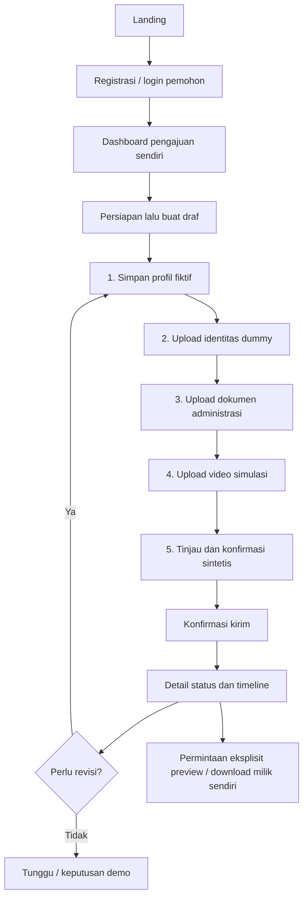

# VELTRIX BankKYC: Frontend Product Requirements

Versi 1.2 · 27 Oktober 2026 · Animasi hero tanpa kontrol tambahan, login standar, dan bahasa antarmuka

Status: antarmuka BankKYC telah terhubung ke backend FastAPI v2 dalam mode live. Database lokal memakai SQLite persisten; konfigurasi MySQL tersedia. Browser mock tetap menjadi fasilitas tes terpisah, bukan status runtime lokal saat ini.

Handoff dan status implementasi BE: [Backend PRD v1.1](VELTRIX_BankKYC_BE_PRD.md). Kontrak response/path mengikuti FE ini. Reset cache CSRF setelah login/register dan response download profil biner sudah tersedia. Batas job lab dan target pengembangan selanjutnya tetap perlu diperhatikan; hasil pemeriksaan dicatat di [VERIFIKASI.md](../verification/VERIFIKASI.md).

## 1. Sumber keputusan dan batas dokumen

Dokumen ini menjadi acuan FE terbaru untuk alur BankKYC. Acuan produk: [BankKYC PRD v2.1](VELTRIX_BankKYC_PRD.md). Acuan identitas: [GSM v0.1](../design/VELTRIX_GSM_v0.1.md) dan [brand identity board](<../references/Veltrix Secure Brand Identity Board.png>). Logo, warna, dan font dari GSM tetap berlaku.

Kesepakatan stack: Next.js + TypeScript untuk FE, FastAPI untuk BE, **MySQL** untuk database relasional. SQLite dalam backend lama merupakan fasilitas pengembangan historis, bukan perubahan terhadap pilihan MySQL untuk target BankKYC.

Dua paste komponen dari pengguna menjadi referensi komposisi hero dan elemen yang tersusun berdasarkan posisi scroll. Klarifikasi pengguna: animasi pergantian headline tetap aktif; yang dihapus hanya tombol jeda dan tulisan tambahan di bawah hero. Implementasi disesuaikan dengan KYC, bukan menyalin teks promosi atau ikon aplikasi pada contoh. Tidak ada klaim kompatibilitas produksi atau lisensi upstream yang belum diverifikasi; provenance dicatat di [referensi komponen](../design/REFERENCES.md).

PRD internal ini tidak dibatasi dua halaman. Laporan penilaian akhir tetap maksimum dua halaman A4 sesuai assignment.

### 1.1 Bahasa antarmuka

Tampilan publik dan ruang kerja memakai bahasa tugas pengguna. Jangan menampilkan label `Demo FE`, `FE`, `frontend`, `backend`, `API mock/live`, label tugas/akademik sebagai dekorasi, atau petunjuk implementasi internal. Topbar cukup menampilkan navigasi, tema, identitas akun, dan keluar. Login hanya memakai username/password, tanpa pemilih peran atau pintasan akun latihan. Label terminal ditampilkan sebagai “Diterima” dan “Ditolak” tanpa mengubah enum kontrak API `ACCEPTED_DEMO`/`REJECTED_DEMO` atau menyiratkan pembukaan rekening nyata.

Batas kemampuan tetap dijelaskan secara jujur: pemberitahuan masuk/beranda menyatakan data sintetis, belum dienkripsi, tersimpan sementara di browser, dan hilang saat muat ulang. Pengajuan baru/detail mengingatkan batas penyimpanan. Laboratorium serta CSV tetap menandai angka ilustrasi sebagai simulasi yang belum diukur. Detail integrasi dan pekerjaan yang belum selesai berada dalam dokumentasi pengembang.

## 2. Positioning dan skenario

VELTRIX adalah simulasi onboarding rekening bank dan pengelolaan bukti KYC. Pemohon menyiapkan profil fiktif, scan identitas dummy, dokumen administrasi, dan video verifikasi sintetis. Satu pengajuan menyatukan bukti, versi, status, dan catatan operasional.

Unit utama adalah **pengajuan**, bukan file mandiri. Setiap berkas harus terkait dengan pengajuan milik pemohon. Produk tidak membuka rekening sungguhan, melakukan transaksi, menghubungi bank, menjalankan OCR/liveness, memverifikasi wajah, atau membuat keputusan KYC regulatori.

Desain privasi mengikuti pemetaan GDPR/UU PDP dalam PRD produk. FE tidak menyatakan aplikasi sudah tersertifikasi atau patuh secara hukum. Analisis dasar pemrosesan, klasifikasi data, hak subjek data, dan retention harus diverifikasi tim sebelum laporan final. Tidak ada checkbox yang mengklaim persetujuan penggunaan data nyata; checkbox pengiriman adalah pernyataan bahwa **semua data sintetis**.

## 3. Tujuan dan ukuran keberhasilan

1. Pengunjung memahami skenario BankKYC dan batas demo sebelum membuat akun.
2. Pemohon dapat membuat draf, menyimpan profil, mengunggah tiga kategori bukti, dan mengirim hanya setelah empat kategori lengkap.
3. Catatan revisi menghasilkan langkah berikutnya yang jelas; unggah ulang menambah versi, tidak menimpa versi sebelumnya.
4. Pemilik dapat meminta profil, preview, dan unduhan bukti secara eksplisit tanpa memilih cipher.
5. Reviewer hanya mendapat metadata pengajuan yang ditugaskan. Admin hanya mengelola penugasan. Evaluator hanya memakai fixture lab terpisah.
6. Loading, empty, error, konflik versi, sesi kedaluwarsa, dan status hanya baca mempunyai respons UI yang jelas.
7. Seluruh alur utama dapat dipakai dengan keyboard, pada layar kecil, di tema terang/gelap, dan dengan reduced motion.
8. Tim dapat membedakan fungsi FE yang sudah berjalan dari persyaratan backend dan bukti eksperimen yang masih harus dikerjakan.

Tidak ada target conversion rate atau angka performa hasil rekaan. Kelulusan didasarkan pada acceptance criteria dan pengujian yang dicatat.

## 4. Peran dan batas akses

| Peran | Yang boleh dilakukan | Yang tidak tersedia |
| --- | --- | --- |
| Pemohon | Draf sendiri, profil sendiri, upload/versi, submit/resubmit, penarikan pada status yang diizinkan, status/timeline, retrieval bukti sendiri | Pengajuan orang lain, penugasan reviewer, keputusan reviewer, data lab operasional |
| Reviewer | Antrean yang ditugaskan, metadata kelengkapan/format/ukuran/versi, mulai tinjauan, revisi, keputusan demo | Nama berkas asli, isi profil, plaintext, preview, download, pengajuan tak ditugaskan |
| Admin operasional | Daftar metadata pengajuan masuk, daftar reviewer, penugasan sebelum tinjauan | Isi bukti/profil, dekripsi, kunci, keputusan pengajuan |
| Evaluator | Konfigurasi fixture, eksperimen lab, hasil/riwayat/ekspor sendiri, rencana verifikasi | Pengajuan pemohon, pengambilan dokumen nasabah |

Peran akun baru selalu `applicant`. Registrasi dan login tidak menawarkan pilihan peran. Pengguna mengisi kredensial; peran berasal dari respons autentikasi dan menentukan halaman tujuan. Akun fixture per peran tetap tersedia untuk pengembang melalui kredensial yang dicatat di README, tanpa pintasan di antarmuka.

Menyembunyikan menu bukan otorisasi. Backend harus menguji session, role, ownership, dan assignment pada setiap endpoint. Identitas pemilik diambil dari session, bukan payload browser. Resource yang tidak dimiliki/tidak ditugaskan mengembalikan 404 agar tidak membocorkan keberadaannya.

## 5. Informasi dan peta halaman

| Route | Aktor | Isi dan tindakan utama |
| --- | --- | --- |
| `/` | Publik | Hero, contoh pengajuan sintetis, empat kategori bukti, alur, hak akses, penjelasan lab, CTA registrasi/login |
| `/register` | Publik | Username/password/konfirmasi, validasi, akun pemohon |
| `/login` | Publik | Login username/password, password visibility, pemberitahuan sesi; peran mengikuti respons autentikasi |
| `/applicant/dashboard` | Pemohon | Ringkasan status dari data sendiri, next action, daftar pengajuan, persiapan bukti |
| `/applicant/applications` | Pemohon | Semua pengajuan sendiri, cari nomor, filter status |
| `/applicant/applications/new` | Pemohon | Persiapan dan batas data sintetis, tindakan eksplisit membuat draf |
| `/applicant/applications/[id]/edit` | Pemohon | Wizard lima langkah pada DRAFT/NEEDS_REVISION |
| `/applicant/applications/[id]` | Pemohon | Status, kelengkapan, catatan, versi, profil atas permintaan, preview/download, timeline |
| `/reviewer/queue` | Reviewer | Daftar pengajuan yang ditugaskan, pencarian, filter |
| `/reviewer/applications/[id]` | Reviewer | Metadata, versi, timeline, tindakan sesuai status, catatan operasional |
| `/admin/assignments` | Admin | Metadata pengajuan masuk, pilih reviewer, simpan penugasan |
| `/lab/benchmark` | Evaluator | Fixture, pengulangan, hasil independen/pipeline, interpretasi, CSV, riwayat |
| `/lab/verification` | Evaluator | Round-trip fixture dan daftar gate backend yang belum dijalankan |
| `/dashboard` | Sudah masuk | Mengarahkan ke beranda sesuai role session |

Route vault/profil/lab hasil lama mengarah ke halaman baru yang relevan. ID file lama tidak diubah menjadi ID pengajuan dan tidak dipakai untuk mengambil data secara spekulatif. Halaman yang tidak ada memakai not-found; role salah memakai halaman akses dibatasi. Error resource mempunyai kembali ke daftar dan retry.

## 6. Landing page dan referensi motion

Urutan cerita landing:

1. Navigasi logo, anchor alur/hak akses, masuk, tema. Menu ringkas di mobile; CTA tetap tersedia.
2. Hero asimetris dengan headline `Satu alur untuk` dan kata berganti `identitasmu.`, `dokumenmu.`, `bukti KYC-mu.` setiap 3,6 detik. Tidak ada tombol jeda atau footnote “Data sintetis saja. Tidak membuka rekening bank.”. CTA `Mulai pengajuan` ke registrasi, `Lihat alurnya` ke section aktual.
3. Lembar kasus `VTX-2026-1001` berlabel “Ilustrasi alur pengajuan”, memperlihatkan kelengkapan dan revisi. Ini ilustrasi dengan isi konkret, bukan statistik nasabah.
4. Empat kategori bukti tersusun saat scroll. Kartu berukuran setara karena semua kategori wajib; setiap kartu menjelaskan format dan konteks.
5. Empat tahap proses: persiapkan, tinjau/kirim, tinjauan metadata, hasil/pengambilan. Jumlah ini berbeda dari lima langkah wizard yang merupakan tahap persiapan data.
6. Ledger empat role dengan link ke halaman login. Link tidak menetapkan peran atau mengisi kredensial; peran selalu berasal dari respons autentikasi.
7. Penjelasan lab, cipher legacy, pipeline sementara, dan keterbatasan hasil mock.
8. CTA akhir, pemberitahuan penggunaan/data, footer merek dan kembali ke atas. Label akademik/tugas dan penanda demo berulang tidak ditampilkan.

Motion memakai Framer Motion, bukan scroll hijacking. Headline memakai area tetap dan gerak vertikal dengan opacity penuh agar tidak mengubah layout atau mengurangi kontras. Accessible name tetap stabil. Rotasi berhenti sementara saat hover/fokus berada dalam hero, hero keluar viewport, atau tab tidak aktif. Reduced motion menampilkan headline dan bukti statis. `useScroll`/`useTransform` hanya mengubah transform elemen bukti; konten sudah terbaca tanpa menunggu animasi. Native anchor scrolling mempertahankan keyboard, sentuhan, dan perilaku browser. Lenis dari contoh tidak ditambahkan karena tidak diperlukan untuk hasil tersebut.

Tidak ada autoplay video, parallax pada formulir, angka nasabah palsu, logo bank/klien fiktif, testimoni, harga, atau CTA kontak yang tidak memiliki tujuan.

## 7. Flow pemohon



Dashboard menghitung total, butuh tindakan, dalam proses, dan selesai dari kasus milik session. Tindakan berikutnya memprioritaskan NEEDS_REVISION lalu DRAFT. Tidak ada angka statis yang menyerupai aktivitas nyata. Daftar menyediakan nomor pengajuan, tanggal, versi, status, dan link detail; tidak menampilkan profil di halaman daftar.

### 7.1 Langkah 1: profil

Kolom wajib: nama lengkap fiktif, nomor identitas dummy, tanggal lahir fiktif, email contoh, telepon dummy, alamat fiktif, pekerjaan fiktif, tujuan rekening. Label terlihat, kesalahan dekat kolom, ringkasan kesalahan mendapat fokus.

Guardrail dataset awal: nomor diawali `DUMMY-`, email domain `example.com/org/net`, telepon diawali `0800` sepanjang 10–14 digit, tanggal valid di masa lalu, tiap nilai maksimal 500 karakter. Ini guardrail data sintetis, bukan validasi KTP atau kepatuhan bank. Backend wajib mengulang validasi. Tombol isi contoh hanya tersedia pada mock.

`Simpan & lanjutkan` menyimpan profil lalu menuju langkah 2. Server mengembalikan versi pengajuan baru. Profil tidak disimpan ke localStorage/sessionStorage. Selama edit, respons berada pada cache form sementara dengan gcTime 0 dan state komponen; setelah keluar, plaintext form dibuang. Detail hanya meminta profil ketika pemilik menekan lihat profil.

### 7.2 Langkah 2–4: bukti

| Kategori | Format | Batas | Konteks |
| --- | --- | --- | --- |
| Scan identitas | PNG/JPG/JPEG/PDF | 5 MiB | Identitas bertanda DUMMY |
| Dokumen administrasi | PDF/DOCX | 10 MiB | Formulir/surat pekerjaan fiktif |
| Video | MP4 | 30 MiB | Target dataset 10–30 detik, tanpa wajah/identitas asli |

Pemilihan file belum menyimpan. Pengguna menekan `Unggah berkas` atau `Unggah versi N`, mendapat loading, error, atau versi tersimpan. Tombol lanjut tersedia setelah kategori tersimpan dan tidak ada file baru yang belum disimpan. Kesalahan ukuran/ekstensi ditolak sebelum upload; mock juga memeriksa signature awal PDF/PNG/JPEG/ZIP/MP4. Pemeriksaan struktur DOCX, codec/durasi, malware, dan batas request wajib dilakukan backend; ZIP header saja tidak membuktikan DOCX valid.

Unggah ulang menghasilkan ID dan nomor versi baru untuk kategori tersebut. Versi lama tetap dapat diunduh pemilik. FE tidak menawarkan overwrite atau hapus tanpa kebijakan retention yang final. Versi pengajuan dipakai untuk mendeteksi konflik serentak.

### 7.3 Langkah 5: review dan pengiriman

Checklist memperlihatkan profil dan tiga bukti terbaru. Submit hanya aktif bila lengkap 4/4 dan synthetic acknowledgement dicentang. Konfirmasi menyebut data akan terkunci untuk tinjauan. Double submit dicegah saat pending. API wajib memvalidasi ulang kelengkapan dan versi.

Berhasil: toast dan pindah ke detail status SUBMITTED/RESUBMITTED. Gagal: dialog tetap terbuka, error ditampilkan, pengguna dapat mencoba kembali atau memuat data terbaru bila konflik.

### 7.4 Retrieval dan versi

Detail dimulai tanpa plaintext profil. Pemilik menekan lihat profil, preview, atau download. Profil modal ditutup dengan Escape/tombol dan state dibersihkan. Blob URL preview dicabut ketika ditutup/diganti. PDF menggunakan iframe berjudul; video mempunyai controls tanpa autoplay; gambar memiliki alt kontekstual; format lain diarahkan ke unduhan.

Satu endpoint retrieval memulihkan seluruh pipeline. Tidak ada pemilih AES/DES/RC4 untuk unduhan normal. Backend harus memverifikasi integritas sebelum mengirim byte asli dan mempertahankan filename/content type yang aman. Mock hanya mengembalikan Blob asli dari memori; ini tidak membuktikan enkripsi. Profil JSON mock adalah representasi JSON yang dibentuk API; byte canonical profil backend harus ditetapkan dan diuji terpisah.

### 7.5 Draf dan meninggalkan form

Simpan dilakukan per langkah, bukan auto-save. Link navigasi ketika form/file masih kotor meminta konfirmasi; reload/penutupan tab memakai beforeunload. Browser back/forward tidak dijamin tertahan oleh guard client; ini batas prototipe yang harus diperhitungkan. Keterangan menyimpan dan reset demo selalu terlihat. Backend target membuat draf tahan reload; mock reset seluruh perubahan saat hard reload.

## 8. Status dan tindakan

| Status awal | Aktor | Tindakan | Status hasil |
| --- | --- | --- | --- |
| DRAFT | Pemohon | Submit lengkap + acknowledgement | SUBMITTED |
| DRAFT | Pemohon | Tarik, dengan konfirmasi | WITHDRAWN |
| SUBMITTED / RESUBMITTED | Reviewer ditugaskan | Mulai tinjauan | UNDER_REVIEW |
| UNDER_REVIEW | Reviewer ditugaskan | Minta revisi + catatan | NEEDS_REVISION |
| UNDER_REVIEW | Reviewer ditugaskan | Terima | ACCEPTED_DEMO |
| UNDER_REVIEW | Reviewer ditugaskan | Tolak + alasan | REJECTED_DEMO |
| NEEDS_REVISION | Pemohon | Perbaiki lalu kirim ulang lengkap | RESUBMITTED |
| NEEDS_REVISION | Pemohon | Tarik, dengan konfirmasi | WITHDRAWN |

SUBMITTED, RESUBMITTED, UNDER_REVIEW, dan status terminal tidak bisa diedit pemohon. Keputusan dan penarikan tidak otomatis menghapus bukti. Retention adalah proses terpisah. Enum ACCEPTED_DEMO/REJECTED_DEMO ditampilkan sebagai Diterima/Ditolak untuk status peninjauan pengajuan; tidak menyatakan rekening aktif. Batas pengujian dijelaskan pada pemberitahuan penggunaan, bukan melalui label demo berulang.

Tindakan terlarang harus ditolak API walaupun UI disiasati. 409 membedakan konflik versi, transisi tak valid, dan pengajuan hanya baca.

## 9. Reviewer dan admin

Reviewer mulai dari antrean yang telah difilter server. Detail hanya menampilkan nomor kasus, status, kelengkapan, kategori, ukuran, waktu, versi, validation awal, dan jejak operasional. Respons API reviewer tidak menyertakan `display_name` bukti maupun profil/owner. Tidak ada hidden download URL, komponen preview, atau tombol dekripsi.

Tombol keputusan muncul setelah mulai tinjauan. Minta revisi/tolak perlu 10–500 karakter catatan. Catatan harus operasional dan tanpa data pribadi; guard panjang tidak mendeteksi seluruh PII. Ini kewajiban reviewer dan kebijakan backend, bukan jaminan penyaringan otomatis. Pemohon melihat catatan di dashboard/detail dan wizard revisi.

Admin melihat pengajuan yang telah dikirim dan daftar reviewer. Dialog memilih reviewer dan mengonfirmasi penugasan dengan versi saat ini. Penugasan boleh diubah hanya saat SUBMITTED/RESUBMITTED, sebelum tinjauan. Tidak ada halaman pengelolaan pengguna/role aktif karena API dan kebijakan provisioning belum dikerjakan; jangan tampilkan menu kosong.

## 10. Evaluator dan metodologi hasil

Lab mengakses empat fixture terisolasi: personal JSON, identitas PNG, dokumen PDF, dan video MP4. Lab tidak menawarkan pemilihan file nasabah. Konfigurasi default 30 pengulangan, rentang 30–100, dua warm-up yang dikeluarkan dari hasil.

Perbandingan meliputi AES-256-GCM, DES-CBC, RC4 secara independen, lalu pipeline penuh. Tabel menampilkan median enkripsi/dekripsi, IQR enkripsi, overhead byte, dan kecocokan pemulihan. Riwayat dapat dibuka kembali dan hasil diekspor CSV. Pending, error, dan belum ada hasil mempunyai state terpisah.

Mock saat ini mengembalikan angka ilustrasi statis untuk semua fixture/pengulangan. Tidak ada eksperimen atau hash kriptografi yang dihitung. Halaman, hasil, nama file ekspor, dan baris pertama CSV menandai SIMULATED. Jangan memakai angka ini untuk menentukan cipher tercepat atau laporan tugas.

Kontrak backend final harus menambahkan raw samples, median/IQR dekripsi, input bytes, throughput MiB/s, correctness SHA-256, lingkungan/versi library, parameter cipher, urutan eksekusi, scope timer, dan memori hanya jika pengukuran dapat dipercaya. Upload/HTTP/I/O dipisahkan dari waktu cipher. Job backend yang panjang memerlukan status queued/running/failed/completed serta polling/cancel; prototipe mock memakai satu request async singkat dan hanya status completed. UI job tersebut adalah pekerjaan integrasi selanjutnya, bukan klaim fitur selesai.

Halaman verifikasi juga memuat rencana gate backend dengan label belum dijalankan: round-trip empat kategori, penolakan akses lintas pemilik/reviewer, kegagalan tampering, atomic write, dan keunikan nonce/key. Status simulasi cocok bukan bukti gate tersebut lulus.

Interpretasi yang diperlukan: efek ukuran video pada throughput/storage, overhead pada profil kecil, variabilitas pengulangan, biaya pipeline dibanding cipher independen, dan perbedaan keamanan dengan kecepatan. Cipher legacy tidak boleh direkomendasikan untuk data sensitif nyata.

## 11. Desain sistem dan responsivitas

| Token | Nilai / penggunaan |
| --- | --- |
| Midnight Blue | `#0B132B`, sidebar, section proses, identitas |
| Royal Blue | `#2563EB`, tindakan utama/seleksi |
| Indigo / Cyan | `#6366F1` / `#22D3EE`, simbol merek sesuai GSM |
| Cloud / Charcoal | `#F1F5F9` / `#1F2937`, latar dan teks |
| Heading / body | Montserrat / Inter, font lokal dari paket |
| Data numerik | Tabular numbers; Fira Code hanya saat relevan |
| Radius | Aksi 6 px, container 8–14 px, label status 4 px |

Theme terang menjadi default; pilihan tema disimpan hanya sebagai preferensi visual. Dark theme memakai semantic tokens yang sama maknanya. Green/amber/red hanya untuk status fungsi, dengan teks status agar tidak bergantung pada warna.

Desktop menggunakan sidebar dan main content. Di bawah 768 px sidebar menjadi drawer dengan focus trap dan Escape. Detail dua kolom menjadi satu; form dua kolom menjadi satu; baris kasus beralih ke susunan bertingkat. Tabel lab mempunyai scroll lokal, tidak menyebabkan halaman melebar. Ukuran verifikasi: 375, 768, 1024, 1440 px.

Aksesibilitas: visible labels, input descriptions/errors, skip link, heading berurutan, focus ring, target tindakan minimal 44 px, dialog accessible title/description, keyboard trap/return focus, announcement status/error, kontras AA. Pergerakan huruf dekoratif tidak dibacakan ulang screen reader.

## 12. Arsitektur frontend

Next.js App Router, TypeScript strict, Tailwind v4 + stylesheet semantic, TanStack Query untuk lifecycle API, React Hook Form/Zod untuk autentikasi, Radix Dialog, Lucide untuk ikon kontekstual, Framer Motion untuk landing.

Struktur kompatibel pola shadcn: `components.json`, `src/components/ui/button.tsx`, `hero.tsx`, `text-scroll-animation.tsx`, dan `src/lib/utils.ts` (`clsx`/`tailwind-merge`). Button menggunakan Slot + class-variance-authority. Primitif aplikasi di `components/ui.tsx` berbagi token GSM dan dialog; tidak perlu mengganti seluruh komponen dengan output CLI.

`src/lib/kyc.ts` berisi domain types, labels, validasi dan completeness. `kyc-api.ts` kontrak pengajuan/lab. `api.ts` transport session/CSRF/errors/download. `features/kyc` berisi halaman domain; route files hanya menyusun halaman. Server component dipakai untuk routing/static composition; interaksi berada pada client component.

Mode dipilih pada build melalui `NEXT_PUBLIC_API_MODE`. Mock memulai MSW sebelum halaman interaktif. Live melewati MSW dan memakai rewrite same-origin `/api/v1/*` ke FastAPI. Seluruh fetch memakai credentials dan no-store; mutation mengambil token CSRF lebih dulu. Logout/session expiry membersihkan query cache dan state session.

Backend lama masih ada di `backend/` dan tidak diubah menjadi BankKYC oleh pekerjaan FE ini. Backend lama menggunakan vault, tiga ciphertext independen, dan AES-CBC; endpoint/role/cipher envelope baru belum tersedia. Session response lama tanpa role/display_name ditolak dengan error kontrak agar UI tidak salah menganggap backend kompatibel. Jangan mengaktifkan live hanya karena backend lama berhasil start.

## 13. Kontrak API FE–BE v1 BankKYC

Semua path di bawah memiliki prefix **`/api/v1`**. Prefix ini menormalkan contoh `/api` dalam PRD produk dan mempertahankan konfigurasi proxy repo. Tidak berarti API legacy vault kompatibel. ID opaque dan di-URL-encode. Timestamp ISO 8601 UTC. Auth melalui cookie server; CSRF melalui header `X-CSRF-Token` untuk semua mutation termasuk login/register/logout.

| Method | Path | Request / response utama |
| --- | --- | --- |
| GET | `/auth/csrf` | `{token}` |
| GET | `/auth/me` | `{id, username, display_name, role}` |
| POST | `/auth/register` | `{username,password}` → User applicant, 201 |
| POST | `/auth/login` | `{username,password}` → User, session cookie |
| POST | `/auth/logout` | 204, session dicabut |
| GET | `/applications` | `{items:Application[],total}`; scope owner/assignment dari session |
| POST | `/applications` | `{}` → Application DRAFT, 201; owner server-derived |
| GET | `/applications/{id}` | Metadata Application sesuai role |
| GET | `/applications/{id}/personal-data` | Pemilik saja → `{profile:ApplicantProfile|null}` |
| PUT | `/applications/{id}/personal-data` | `{profile,version}` → Application versi terbaru |
| POST | `/applications/{id}/evidence` | multipart `category,file,version` → Application, 201 |
| POST | `/applications/{id}/actions` | `{action,version,note?,synthetic_acknowledged?}` → Application |
| GET | `/applications/{id}/evidence/{evidenceId}/download` | Pemilik saja → byte asli; satu pipeline |
| GET | `/applications/{id}/personal-data/download` | Pemilik saja → JSON attachment |
| GET | `/admin/assignments` | `{items:Application[],reviewers:[{id,display_name}]}` tanpa plaintext |
| PUT | `/admin/assignments/{id}` | `{reviewer_id,version}` → metadata Application |
| GET | `/lab/runs` | Riwayat LabRun milik evaluator |
| POST | `/lab/runs` | `{kind,fixture,repetitions,warmups:2}` → LabRun, 201 |
| GET | `/lab/runs/{id}/export` | CSV; mock wajib berlabel SIMULATED |

`Application`: `id,reference,status,version,created_at,updated_at,personal_data_complete,evidence[],events[],synthetic_acknowledged,assigned_reviewer_id?,revision_note?`. Tidak ada owner profile dalam metadata daftar.

`Evidence`: `id,category,version,original_bytes,mime_type,created_at,validation`. `display_name` hanya pada respons pemilik. Nilai validation saat ini `format_checked` berarti pemeriksaan format awal; tidak menyatakan identitas asli lolos verifikasi. Detail metode validasi/signature harus ditambahkan BE bila diperlukan.

`CaseEvent`: `id,at,action,actor_role,note?`. Event tidak memuat plaintext profil, kunci, filename asli, atau nomor identitas. Mutation pengajuan mengembalikan version yang bertambah; semua edit/action/assignment menyertakan expected version. Stale version → 409 dan data lama tidak ditimpa.

Contoh request pengiriman:

```json
{"action":"submit","version":5,"synthetic_acknowledged":true}
```

Contoh error:

```json
{"error":{"code":"VERSION_CONFLICT","message":"Pengajuan berubah. Muat ulang sebelum melanjutkan.","field_errors":{},"request_id":"opaque-id"}}
```

Kode umum: 401 SESSION_EXPIRED, 403 ROLE_FORBIDDEN/CSRF_INVALID, 404 RESOURCE_NOT_FOUND, 409 VERSION_CONFLICT/CASE_READ_ONLY/INVALID_TRANSITION/ASSIGNMENT_LOCKED, 413 PAYLOAD_TOO_LARGE, 422 VALIDATION_ERROR/INVALID_UPLOAD/SIGNATURE_MISMATCH/CASE_INCOMPLETE/NOTE_REQUIRED. Error jaringan berbeda dari validasi. FE tidak otomatis mengulang mutation yang dapat menggandakan upload/submit.

Daftar mock belum dipaginasi, sesuai dataset kecil. Pagination/cursor, pencarian/filter server, dan idempotency key adalah perluasan sebelum data besar/live; jangan menganggap daftar client-side cukup untuk produksi.

## 14. Kontrak kriptografi dan storage target

Default **sementara**, menunggu D-01 dosen:

`plaintext → RC4 → DES-CBC + PKCS#7 → AES-256-GCM → ciphertext final`

Retrieval membalik pipeline hanya untuk pemilik terautentikasi. Kunci tiap cipher independen, acak, dan terpisah per objek/versi; IV DES acak; nonce GCM unik; AAD mengikat objek/versi/pemilik/format yang ditetapkan BE. GCM diverifikasi sebelum plaintext dirilis. FE tidak menerima/menyimpan kunci dan tidak menampilkan ciphertext palsu sebagai hasil nyata.

Target MySQL menyimpan users/sessions, applications, reviewer assignments, evidence versions, encrypted object metadata/envelope, audit events, dan lab runs/samples. Hanya ciphertext final disimpan untuk alur operasional berlapis; perbandingan cipher independen menggunakan fixture lab. Filename dan profil termasuk metadata privat yang perlu proteksi; nomor kasus/kategori/status minimal boleh operasional sesuai threat model PRD. Key wrapping/master key berada di konfigurasi server terpisah dari database, tidak di source control/browser.

Payload upload MP4 30 MiB memerlukan batas request sedikit lebih besar untuk multipart. Proxy FE disiapkan 34 MiB. FastAPI, reverse proxy, storage, memory budget, dan database harus diselaraskan. LONGBLOB/cipher storage yang tersedia pada backend lama tidak cukup membuktikan kontrak baru sudah aman atau teruji pada MySQL.

## 15. Kebutuhan nonfungsional dan failure states

| Situasi | Perilaku FE |
| --- | --- |
| Memuat session/list/detail | Loading dengan label, hindari konten privat sesaat |
| Tidak ada data / pencarian kosong | Empty state kontekstual dan tindakan yang relevan |
| Offline / 5xx | Error dengan pesan aman; retry pada pembacaan, mutation tetap eksplisit |
| Sesi habis | Bersihkan cache, kembali ke login dengan pemberitahuan |
| Role salah | Akses dibatasi tanpa mount komponen data role lain |
| Pengajuan orang lain / tak ditugaskan | 404 umum, kembali ke daftar |
| File invalid / terlalu besar | Pesan dekat upload, tidak menambah versi siap |
| Konflik versi | Pertahankan error, muat ulang metadata sebelum mencoba lagi |
| Submit tidak lengkap | Tombol tidak aktif dan alasan terlihat; API menolak bypass |
| Preview tidak didukung | Informasi fallback unduhan, tanpa berpura-pura ada preview |
| Status terminal | Kontrol edit/keputusan disembunyikan; retrieval pemilik tetap tersedia |
| Mock gagal bootstrap | Pesan halaman belum dapat disiapkan, dengan tombol muat ulang |

Tidak ada PII/tokens/kunci di localStorage, URL, analytics, atau log UI. Preferensi tema boleh tersimpan. Respons privat no-store. Tidak ada promise offline persistence. Hard reload mock mereset akun yang dibuat dan kasus tambahan; fixture akun awal tetap disiapkan ulang.

## 16. Acceptance criteria dan QA

| ID | Bukti yang harus diuji |
| --- | --- |
| FE-01 | Headline benar-benar berganti; tombol jeda/footnote hero tidak ada; accessible name stabil; CTA/anchor, font/logo, tema dan reduced motion bekerja |
| FE-02 | Registrasi validasi/password visibility/duplikat, login salah/benar, logout, session expiry |
| FE-03 | Pengajuan baru dimulai kosong; profil invalid dan file invalid ditolak |
| FE-04 | Empat kategori + acknowledgement wajib; submit berhasil mengunci edit |
| FE-05 | Download byte upload sama pada mock; ini tes transport mock, bukan tes cipher |
| FE-06 | Versi baru tidak menghilangkan versi lama; revisi menghasilkan RESUBMITTED |
| FE-07 | Reviewer hanya kasus ditugaskan, respons tanpa profil/filename, retrieval ditolak |
| FE-08 | Admin bisa menugaskan sebelum review; data sensitif tidak terlihat; role tidak diberi via registrasi |
| FE-09 | Evaluator dapat run/history/export; semua hasil mock/CSV jelas simulasi |
| FE-10 | Dialog, fokus, Escape, drawer, error/empty/loading, pencarian/filter berfungsi |
| FE-11 | 375/768/1024/1440 px tanpa horizontal overflow halaman; kedua tema lulus pemeriksaan kontras |
| FE-12 | Build/typecheck dan Playwright lulus; screenshot diperiksa, console runtime dipantau |
| FE-13 | Beranda, login, dan empat ruang kerja bebas label FE/frontend/backend/API mock/live; pemberitahuan data sementara, belum dienkripsi, serta hasil lab simulasi tetap jelas |

QA antislop DURING menggunakan arah desain GSM dan [decision log](../../frontend/DESIGN.md). Hasil aktual, coverage interaksi, dan batas pengujian dicatat di [audit antislop](../verification/ANTISLOP_QA.md); daftar acceptance ini sendiri bukan klaim pengujian lulus.

## 17. Status implementasi dan backlog

**Dalam revisi FE ini:** landing dengan animasi headline tanpa kontrol tambahan dan motion bukti saat scroll, login kredensial dan routing sesuai peran session, shell sesuai peran, dashboard/list/detail kasus, wizard lima langkah, validasi dataset awal, versi upload, owner-only preview/download, state machine mock, tinjauan metadata, penugasan admin, lab fixture/riwayat/CSV simulasi, tema, responsive, dan dokumentasi/QA.

**Implementasi BE yang sudah tersedia:** skema/migrasi BankKYC, role/provisioning, session/CSRF, endpoint pengajuan/assignment, penyimpanan profil/bukti berversi dan terenkripsi, pipeline RC4 → DES-CBC → AES-256-GCM, pembungkusan kunci, validasi konten, draf persisten, transaksi dan version conflict, tes integritas/otorisasi, serta pengukuran lab dengan raw samples dan lingkungan eksekusi. Runtime lokal sudah menggunakan API tersebut, bukan MSW.

**Masih perlu dituntaskan/diverifikasi sesuai target:** MySQL pada mesin/deployment tujuan, seluruh alur browser live lintas empat peran, corpus benchmark representatif, interpretasi hasil dan laporan akhir, keputusan dosen D-01/D-02, serta kebutuhan lanjutan seperti pagination, job asinkron, lifecycle/retention dan hak ekspor/penghapusan. Health dan smoke HTTP lokal bukan klaim semua target tersebut sudah lulus. Peta pengujian aktual ada di [hasil verifikasi](../verification/VERIFIKASI.md).

## 18. Keputusan terbuka dan risiko

| ID | Status | Dampak |
| --- | --- | --- |
| D-01 | Menunggu konfirmasi dosen | Apakah tugas mewajibkan berlapis atau tiga representasi independen? Default FE satu retrieval, storage berlapis sementara; perubahan BE harus dicatat |
| D-02 | Menunggu konfirmasi dosen | Reviewer boleh plaintext terdelegasi atau strict owner-only? Default ketat metadata-only; tidak ada tombol delegasi sebelum disetujui |
| D-03 | Batas awal dari PRD | MP4 maks. 30 MiB, target 10–30 detik; perlu validasi resource/codec/backend |
| FE-D04 | Disepakati sesi | MySQL target, Next.js + FastAPI tetap |
| FE-D05 | Dipilih implementasi | Native scroll + Framer Motion, tanpa Lenis global, untuk menjaga aksesibilitas dan mengurangi overhead |
| FE-D06 | Batas prototipe | Mock tidak mempersist perubahan; FE bukan bukti enkripsi ataupun correctness server |

Risiko utama: demo yang terlihat matang disalahartikan sebagai aplikasi bank aman; label mock dan keputusan demo wajib dipertahankan. Risiko kedua: mengaktifkan backend lama lalu mengira semua alur baru bekerja; mode live harus melewati contract/integration tests terlebih dahulu. Risiko ketiga: alasan reviewer memuat data pribadi; prosedur/validasi dan minimisasi catatan harus diputuskan tim.

## 19. Pembagian kerja tim dan submission

1. FE/UX: halaman, state/error/accessibility, kontrak, E2E dan screenshot.
2. API/auth: role, session/CSRF, ownership/assignment, state machine dan transaksi.
3. Crypto/storage: key/envelope, empat kategori, MySQL/migrasi dan retrieval intact.
4. Evaluation/report: fixture, metodologi, raw samples, negative tests, interpretasi, laporan dua halaman.

Ownership modul tidak menggantikan review silang. Semua anggota harus memahami alasan arsitektur, mode cipher, kunci, storage, dan interpretasi hasil.

Submission: push semua kode dengan commit bermakna; sertakan laporan maksimum dua halaman A4, bukti eksperimen nyata, **tautan percakapan AI yang benar-benar dibagikan** dan screenshot percakapan tersebut. Tautan/screenshot AI dibuat dari percakapan aktual oleh pengguna, bukan direkayasa dari UI aplikasi. Screenshot FE bukan pengganti screenshot percakapan AI.
